# Padrões Estruturais

## Índice

| # | Aula | Duração |
| --- | --- | --- |
| 1 | [O Padrão Adapter](./1%20-%20O%20Padr%C3%A3o%20Adapter.md) | 05:48 |
| 2 | [Implementando o Adapter](./2%20-%20Implementando%20o%20Adapter.md) | 07:44 |
| 3 | [O Padrão Decorator](./3%20-%20O%20Padr%C3%A3o%20Decorator.md) | 09:51 |
| 4 | [Implementando o Decorator - Parte 1](./4%20-%20Implementando%20o%20Decorator%20-%20Parte%201.md) | 09:23 |
| 5 | [Implementando o Decorator - Parte 2](./5%20-%20Implementando%20o%20Decorator%20-%20Parte%202.md) | 04:51 |
| 6 | [Implementando o Decorator - Parte 3](./6%20-%20Implementando%20o%20Decorator%20-%20Parte%203.md) | 10:37 |
| 7 | [O Padrão Facade](./7%20-%20O%20Padr%C3%A3o%20Facade.md) | 04:45 |
| 8 | [Implementando o Facade - Parte 1](./8%20-%20Implementando%20o%20Facade%20-%20Parte%201.md) | 04:55 |
| 9 | [Implementando o Facade - Parte 2](./9%20-%20Implementando%20o%20Facade%20-%20Parte%202.md) | 10:04 |

## Sequência das aulas

```mermaid
flowchart LR
    A1["1 · O Padrão Adapter"] --> A2["2 · Implementando o Adapter"]
    A2 --> A3["3 · O Padrão Decorator"]
    A3 --> A4["4 · Implementando o Decorator - Parte 1"]
    A4 --> A5["5 · Implementando o Decorator - Parte 2"]
    A5 --> A6["6 · Implementando o Decorator - Parte 3"]
    A6 --> A7["7 · O Padrão Facade"]
    A7 --> A8["8 · Implementando o Facade - Parte 1"]
    A8 --> A9["9 · Implementando o Facade - Parte 2"]
```

