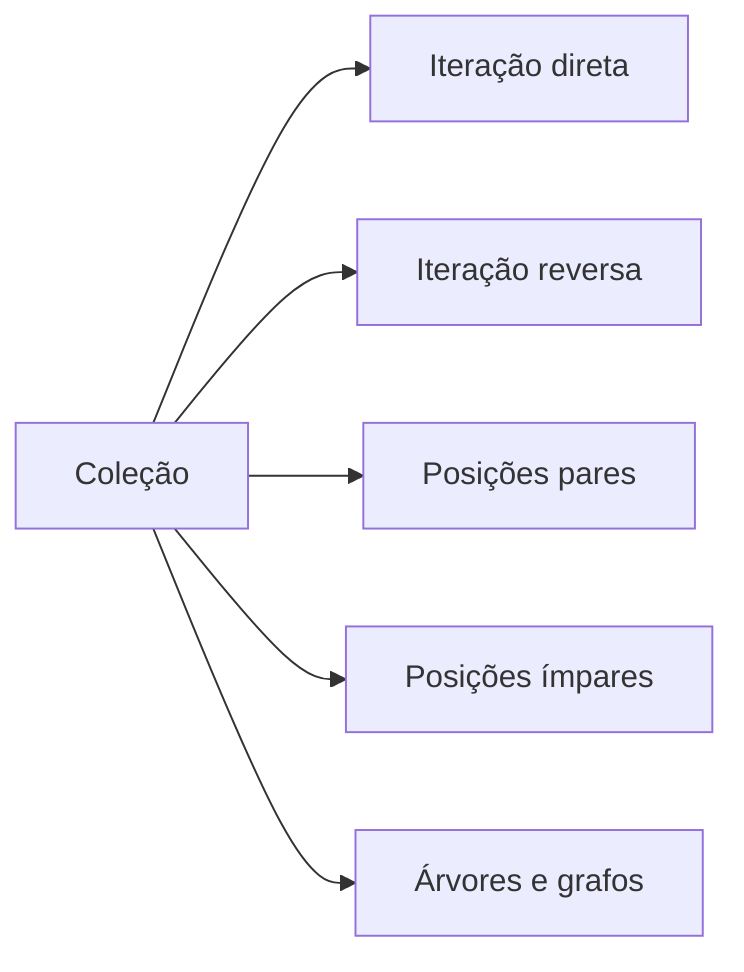
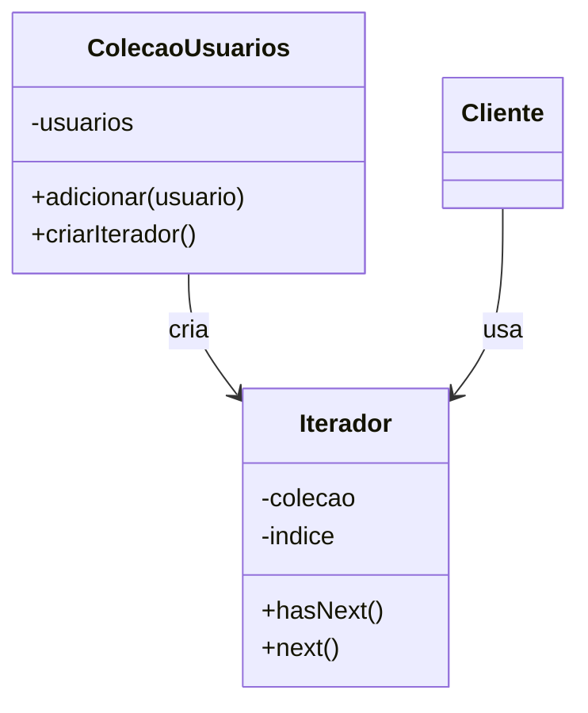

# O Padrão Iterator

## Introdução e contexto

O **Iterator** é um padrão **comportamental** com escopo de **objetos**. Ele
permite **percorrer elementos de uma coleção** sem expor sua **estrutura
interna** e sem acoplar o cliente à forma como os dados são armazenados.

A ideia central é separar **a coleção** de **a lógica de navegação**. A coleção
cuida dos dados; o iterador cuida de como percorrê-los.

## Analogias do mundo real

A aula usa três formas de visitar uma cidade:

| Recurso | Como percorre |
| --- | --- |
| **guia turístico** | roteiro organizado, com explicações |
| **mapa** | navegação manual, ponto a ponto |
| **Google Maps** | rota dinâmica, com diferentes critérios |

Os três permitem conhecer os mesmos pontos turísticos, mas por **caminhos
diferentes**. Cada um funciona como um **iterador**: a cidade é a coleção; a
forma de explorá-la varia.

## Formas de percorrer uma coleção

Uma mesma coleção pode ser lida de várias maneiras:

- da esquerda para a direita, elemento por elemento;
- de trás para frente;
- apenas posições pares;
- apenas posições ímpares;
- em profundidade ou em largura, no caso de árvores e grafos.



Em estruturas complexas, a escolha da travessia tem **impacto de desempenho**.
Uma busca em uma árvore pode ser logarítmica ou linear, dependendo da estratégia.
Por isso, separar a navegação da estrutura é útil: é possível trocar o algoritmo
sem reescrever a coleção.

## O problema sem o padrão

A implementação base tem uma classe `ColecaoUsuarios`:

```js
class ColecaoUsuarios {
  #usuarios = [];

  adicionar(usuario) {
    this.#usuarios.push(usuario);
  }

  obterTodos() {
    return this.#usuarios;
  }
}
```

O cliente adiciona usuários, obtém a lista e percorre com um `for`:

```js
const usuarios = colecao.obterTodos();

for (let i = 0; i < usuarios.length; i++) {
  console.log(usuarios[i]);
}
```

Funciona, mas joga no cliente a responsabilidade de **saber percorrer** a
estrutura. Se a coleção mudar — de array para árvore, por exemplo —, todo cliente
quebra.

Uma melhoria possível é mover o laço para dentro de `obterTodos()`. Isso
esconde a travessia, mas cria outro problema: o método passa a fazer **duas
coisas** (retornar e imprimir) e continua sem flexibilidade.

Se o cliente quiser percorrer **ao contrário**, precisará:

- reimplementar o método na coleção;
- criar uma subclasse e sobrescrever `obterTodos()`;
- ou conhecer tão bem a estrutura a ponto de escrever um novo método.

Nenhuma dessas opções é boa. A lógica de navegação fica presa à coleção ou
espalhada pelo cliente.

## A proposta do padrão

O Iterator introduz uma classe dedicada à navegação. Ela conhece a coleção e
mantém um **cursor** (índice) para saber onde está.

| Participante | Papel |
| --- | --- |
| **Iterator** | interface de navegação (`hasNext`, `next`) |
| **ConcreteIterator** | implementação sobre uma coleção específica |
| **Aggregate** | coleção que cria o iterador |
| **Client** | usa o iterador sem conhecer a estrutura |



O cliente não vê o array interno. Ele só vê o contrato do iterador.

## Benefícios

- **Encapsulamento** da estrutura interna da coleção.
- **Desacoplamento** entre cliente e forma de armazenamento.
- **Múltiplas formas de travessia** com o mesmo contrato.
- **Reutilização**: o mesmo iterador serve a coleções diferentes.
- **Código cliente mais simples** e previsível.

## Limitações e cuidados

- **Mais classes** para coleções simples.
- **Indireção**: para um array pequeno, um `for` pode ser suficiente.
- **Estado do iterador**: ele guarda a posição; reutilizá-lo exige atenção.
- **Nem toda coleção precisa de iterador próprio.** Em JavaScript, arrays já são
  iteráveis nativamente.
- **A complexidade compensa** em estruturas não triviais, múltiplas travessias e
  coleções heterogêneas.

## Conclusão

O Iterator separa **dados** de **navegação**. A coleção guarda os elementos; o
iterador define como percorrê-los e mantém o cursor. O cliente só conhece o
contrato — normalmente `hasNext()` e `next()`.

A implementação da próxima aula mostra a estrutura na prática, começando por uma
travessia direta e evoluindo para uma travessia reversa.
