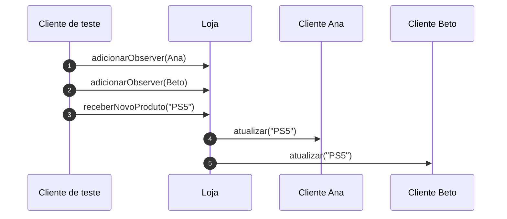
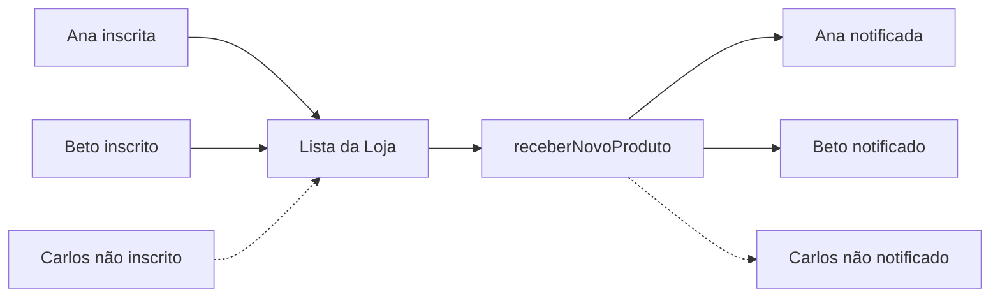

# Implementando o Padrão Observer - Parte 3

## Introdução e contexto

Esta aula fecha o Observer com o **cliente de teste**: cria a loja, cria os
clientes, inscreve alguns, dispara a chegada de um produto e demonstra o
cancelamento da assinatura.

## Montando o cenário

O cliente importa `Loja` e `Cliente`, instancia a loja e cria três clientes:

```js
const loja = new Loja();

const clienteA = new Cliente("Carlos");
const clienteB = new Cliente("Ana");
const clienteC = new Cliente("Beto");
```

Neste momento, os clientes existem, mas **não estão inscritos**. Se a loja
receber um produto, ninguém é notificado.

## Inscrevendo observadores

```js
loja.adicionarObserver(clienteB);
loja.adicionarObserver(clienteC);
```

Agora a loja tem dois assinantes. Ao receber um produto:

```js
loja.receberNovoProduto("PlayStation 5");
```

A saída mostra a notificação para **Ana** e **Beto**, não para Carlos. A loja não
faz *broadcast*: ela avisa apenas quem está na lista.



## Cancelando a assinatura

Um dos clientes muda de ideia — já comprou o produto ou perdeu o interesse. A
loja remove o observer:

```js
loja.removerObserver(clienteB);
```

A próxima notificação chega apenas a quem permaneceu na lista. O cliente
removido **não recebe mais nada**, e nenhum código da loja precisou ser alterado
para isso.



## O que o teste comprova

| Comportamento | Resultado |
| --- | --- |
| cliente não inscrito | não recebe notificação |
| cliente inscrito | recebe notificação personalizada |
| remoção da inscrição | para de receber |
| chegada de novo produto | notifica apenas a lista atual |

O subject não conhece os nomes, os e-mails nem os canais dos clientes. Ele
conhece apenas o contrato `atualizar()`.

## Vantagens

| Vantagem | Explicação |
| --- | --- |
| **Desacoplamento** | a loja não conhece os clientes concretos |
| **Subscrição dinâmica** | adicionar e remover em runtime |
| **Notificação seletiva** | só quem se interessou recebe |
| **Aberto/fechado** | novos observers sem alterar a loja |
| **Reaproveitamento** | subject e observer servem a outros domínios |
| **Base orientada a eventos** | mesmo modelo usado pelo Node.js |

## Desvantagens e cuidados

- **Desempenho**: a lista guarda objetos reais na memória; com muitos observers,
  a notificação pode pesar.
- **Depuração**: o fluxo indireto dificulta rastrear quem foi notificado.
- **Vazamento de memória**: observers não removidos continuam vivos.
- **Ordem e duplicidade**: a lista pode notificar na ordem de inscrição e permitir
  duplicatas.
- **Efeitos em cascata**: um observer pode disparar novos eventos e criar ciclos.
- **Nem todo acoplamento é ruim**: para dois objetos fixos, uma chamada direta
  pode ser mais simples.

## O Observer no Node.js

A aula destaca que o Node.js é construído sobre um modelo **orientado a
eventos**. O `EventEmitter` é um subject: quem chama `on(evento, callback)` se
inscreve; quem chama `emit(evento)` notifica todos os inscritos.

```js
import { EventEmitter } from "node:events";

const loja = new EventEmitter();

loja.on("produto", (produto) => {
  console.log(`Cliente A avisado sobre ${produto}`);
});

loja.emit("produto", "PlayStation 5");
```

É o mesmo princípio: **publicar sem conhecer os assinantes**.

## Quando aplicar

O Observer é indicado quando:

- uma mudança em um objeto precisa notificar **vários outros**;
- os interessados podem **entrar e sair** dinamicamente;
- o publicador **não deve conhecer** os detalhes dos assinantes;
- o sistema é **orientado a eventos**;
- há necessidade de **notificações personalizadas por interesse**.

Exemplos: feeds, e-commerce, sistemas de assinatura, painéis em tempo real,
webhooks e eventos de domínio.

## Conclusão

O teste final mostra o ciclo completo do Observer: inscrever, notificar e
cancelar. A loja mantém uma lista de interessados e avisa apenas quem está nela;
o cliente recebe uma mensagem personalizada e pode sair quando quiser.

O padrão entrega **desacoplamento**, **extensibilidade** e **subscrição
dinâmica**. O custo é mais indireção, atenção à memória e maior cuidado na
depuração. Para sistemas baseados em eventos, é difícil imaginar uma base melhor.

Com isso, encerram-se os padrões **comportamentais** e o conteúdo de Design
Patterns do módulo: **Singleton, Builder, Factory Method, Adapter, Decorator,
Facade, Iterator, Strategy e Observer**.
