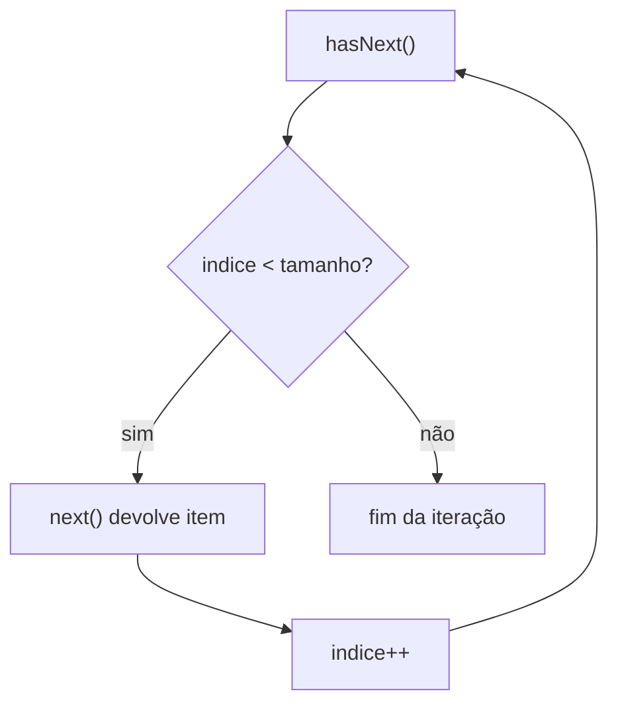
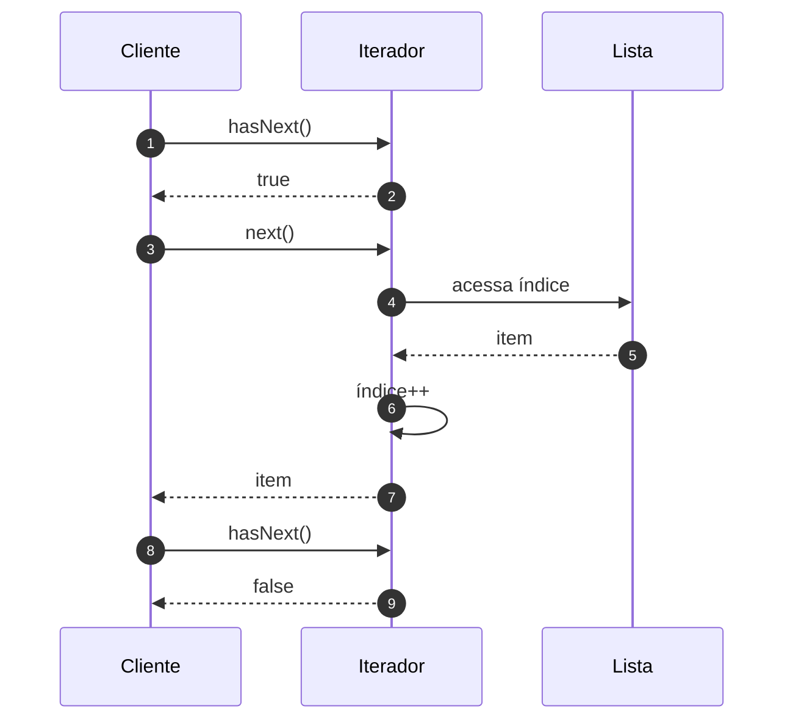

# Implementando o Padrão Iterator - Parte 1

## Introdução e contexto

Esta aula reestrutura o exemplo de usuários em três arquivos:

```
src/
├── Iterador.js
├── ColecaoUsuarios.js
└── cliente.js
```

A coleção deixa de expor a lista e passa a **criar um iterador**. O cliente deixa
de usar `for` sobre o array e passa a usar `hasNext()` e `next()`.

## A coleção

A `ColecaoUsuarios` mantém a lista privada e oferece:

- `adicionar(usuario)`;
- `criarIterador()`, que devolve um novo iterador apontando para a coleção.

```js
class ColecaoUsuarios {
  #usuarios = [];

  adicionar(usuario) {
    this.#usuarios.push(usuario);
  }

  criarIterador() {
    return new Iterador(this.#usuarios);
  }
}
```

O método `obterTodos()` deixa de existir. A lista **não é exposta**; quem precisa
percorrê-la recebe um iterador.

## O iterador

O `Iterador` recebe a coleção e mantém um **índice**:

```js
class Iterador {
  #colecao;
  #indice = 0;

  constructor(colecao) {
    this.#colecao = colecao;
  }

  hasNext() {
    return this.#indice < this.#colecao.length;
  }

  next() {
    const item = this.#colecao[this.#indice];
    this.#indice++;
    return item;
  }
}
```

Os dois métodos têm papéis bem definidos:

| Método | Responsabilidade |
| --- | --- |
| `hasNext()` | verificar se ainda existe um próximo elemento |
| `next()` | devolver o elemento atual e avançar o cursor |

A verificação é feita comparando o índice com o tamanho da coleção. Se o índice
chegou ao fim, `hasNext()` retorna `false` e o cliente para.



## O cliente

O cliente monta a coleção normalmente:

```js
const usuarios = new ColecaoUsuarios();
usuarios.adicionar({ nome: "Carlos", idade: 21 });
usuarios.adicionar({ nome: "Ana", idade: 23 });
usuarios.adicionar({ nome: "Beto", idade: 25 });
```

Depois, percorre com o iterador:

```js
const iterador = usuarios.criarIterador();

while (iterador.hasNext()) {
  console.log(iterador.next());
}
```

A saída é a mesma de antes. O que muda é **quem controla a travessia**: agora é
o iterador, não o cliente.



## Por que isso melhora o design

| Antes | Depois |
| --- | --- |
| cliente conhece o array | cliente conhece o iterador |
| laço `for` no cliente | `while` com `hasNext`/`next` |
| estrutura exposta por `obterTodos` | estrutura encapsulada |
| nova travessia exige mudar coleção/cliente | nova travessia pode ficar no iterador |

## A dúvida legítima

Neste ponto, o benefício ainda parece pequeno: o iterador faz basicamente o que
um `for` faria. Para uma lista simples, a indireção pode não compensar.

A aula reconhece isso e propõe uma evolução: **iteração reversa**. Se o mesmo
iterador conseguir percorrer a coleção nos dois sentidos, o ganho começa a
aparecer — e o cliente não precisa conhecer a estrutura para isso.

## Benefícios

- **Encapsulamento** da lista.
- **Contrato único** de navegação.
- **Cliente independente** da estrutura.
- **Base reutilizável** para outras coleções.
- **Facilidade para adicionar travessias** sem mexer na coleção.

## Limitações e cuidados

- **Mais uma classe** para um problema simples.
- **Estado interno**: o iterador guarda a posição; criar um novo para cada
  travessia é mais seguro.
- **`next()` sem `hasNext()`** pode acessar índice inválido.
- **Coleções nativas** já têm iteradores; reimplementar pode ser redundante.
- **O ganho cresce** com a complexidade da estrutura e a variedade de travessias.

## Conclusão

A primeira parte implementa o Iterator básico: a coleção cria o iterador, o
iterador mantém o índice e o cliente percorre com `hasNext()` e `next()`. A
estrutura interna deixa de ser exposta.

A próxima aula adiciona a navegação reversa (`hasPrevious` e `previous`) e mostra
o mesmo iterador funcionando em outra coleção — o que evidencia o
desacoplamento.
