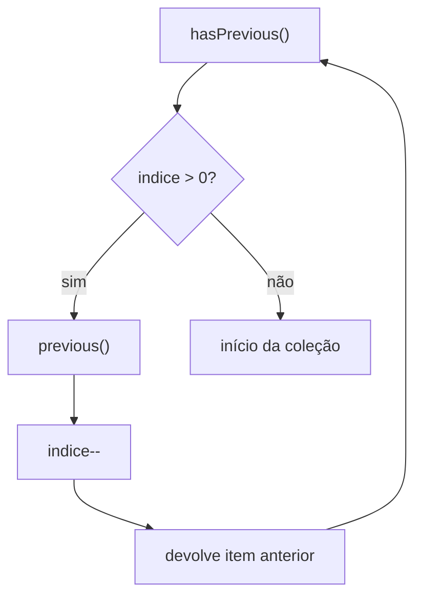
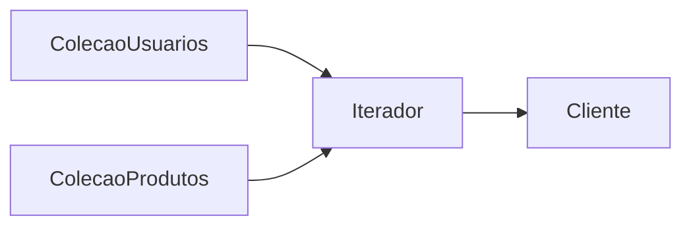

# Implementando o Padrão Iterator - Parte 2

## Introdução e contexto

Esta aula completa o Iterator com **navegação reversa** e prova o
desacoplamento usando o **mesmo iterador** em uma coleção de **produtos**.

O contrato cresce:

| Método | Função |
| --- | --- |
| `hasNext()` | existe próximo? |
| `next()` | devolve o próximo e avança |
| `hasPrevious()` | existe anterior? |
| `previous()` | devolve o anterior e retrocede |

## Navegação reversa

O `hasPrevious()` verifica se o índice atual é maior que zero:

```js
hasPrevious() {
  return this.#indice > 0;
}
```

Se o índice está em 1, 2 ou 3, existem posições atrás para percorrer. Se está em
0, não há anterior.

O `previous()` apenas decrementa o índice e devolve o elemento:

```js
previous() {
  this.#indice--;
  return this.#colecao[this.#indice];
}
```

A implementação é menor que a de `next()`, mas exige atenção à ordem: primeiro
decrementa, depois acessa.



## Usando no cliente

Depois de percorrer a coleção para frente, o mesmo iterador pode voltar:

```js
while (iterador.hasPrevious()) {
  console.log(iterador.previous());
}
```

O cursor está no fim (índice 3, para três elementos). Por isso, o primeiro
`previous()` devolve o último item e retrocede. A saída é a coleção **de trás
para frente**.

Se a tentativa de percorrer ao contrário for feita **antes** de avançar, o
`hasPrevious()` retorna `false` e o laço simplesmente não executa. Não há erro —
apenas nenhuma iteração. Esse comportamento é intencional: o iterador respeita o
estado atual do cursor.

## Reutilizando o iterador em outra coleção

A prova final é criar uma `ColecaoProdutos` com a mesma estrutura:

```js
class ColecaoProdutos {
  #produtos = [];

  adicionar(produto) {
    this.#produtos.push(produto);
  }

  criarIterador() {
    return new Iterador(this.#produtos);
  }
}
```

O `Iterador` **não muda**. Ele continua funcionando porque só depende de uma
coleção indexável com `length` e acesso por índice.

```js
const produtos = new ColecaoProdutos();
produtos.adicionar({ nome: "Geladeira", valor: 3500 });
produtos.adicionar({ nome: "Lava-louças", valor: 2000 });

const iteradorProdutos = produtos.criarIterador();

while (iteradorProdutos.hasNext()) {
  console.log(iteradorProdutos.next());
}
```

O mesmo código de navegação serve a usuários e produtos. O cliente não sabe — e
não precisa saber — como cada coleção armazena seus dados.



## Personalizando a travessia

A lógica de avanço pode variar sem tocar no cliente. Em vez de incrementar de
um em um:

```js
next() {
  const item = this.#colecao[this.#indice];
  this.#indice += 2; // apenas posições pares
  return item;
}
```

Também é possível criar iteradores especializados para árvores e grafos, com
percursos em profundidade ou em largura. O contrato permanece o mesmo; a
estratégia de navegação muda.

## Vantagens

| Vantagem | Explicação |
| --- | --- |
| **Desacoplamento** | cliente não conhece a estrutura |
| **Reutilização** | um iterador serve a várias coleções |
| **Múltiplas travessias** | direta, reversa, pares, ímpares |
| **Encapsulamento** | a lista interna não é exposta |
| **Extensibilidade** | novos percursos sem alterar o cliente |

## Desvantagens

- **Mais complexidade** para coleções simples.
- **Mais classes**: coleção e iterador separados.
- **Estado do cursor**: é preciso entender onde ele está.
- **Indireção** para operações triviais.
- **Risco de uso incorreto**: `next()` sem `hasNext()` pode sair dos limites.

## Quando aplicar

O Iterator é ideal quando:

- a coleção tem **estrutura interna complexa**;
- é preciso percorrer de **formas diferentes**;
- vários clientes precisam de **iterações independentes**;
- a estrutura de dados pode **mudar** sem afetar o cliente.

Para um array simples percorrido uma vez, o `for` nativo continua sendo a opção
mais direta.

## Conclusão

A navegação reversa mostra o verdadeiro valor do Iterator: o cliente ganha um
**contrato estável** (`hasNext`, `next`, `hasPrevious`, `previous`) enquanto a
coleção permanece encapsulada. O mesmo iterador percorre usuários, produtos e,
com ajustes na lógica de avanço, estruturas mais complexas.

O custo é mais uma classe e o cuidado com o estado do cursor. O benefício é
**reaproveitamento** e **flexibilidade** — exatamente o que se espera de um
padrão comportamental.

O próximo padrão é o *Strategy*, que também trabalha com algoritmos
intercambiáveis, mas no nível do comportamento de um objeto.
