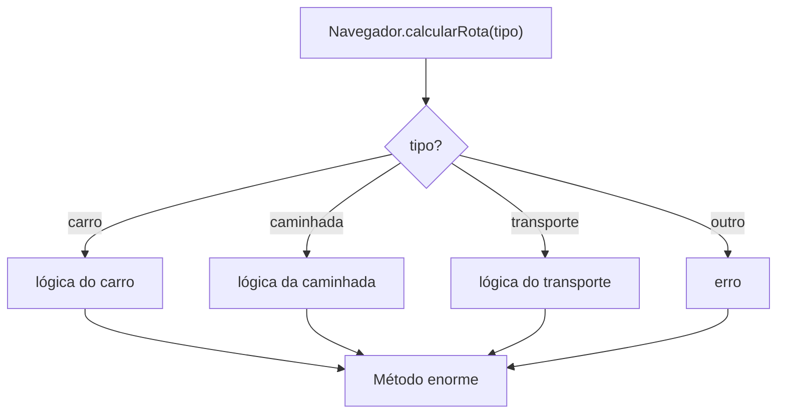
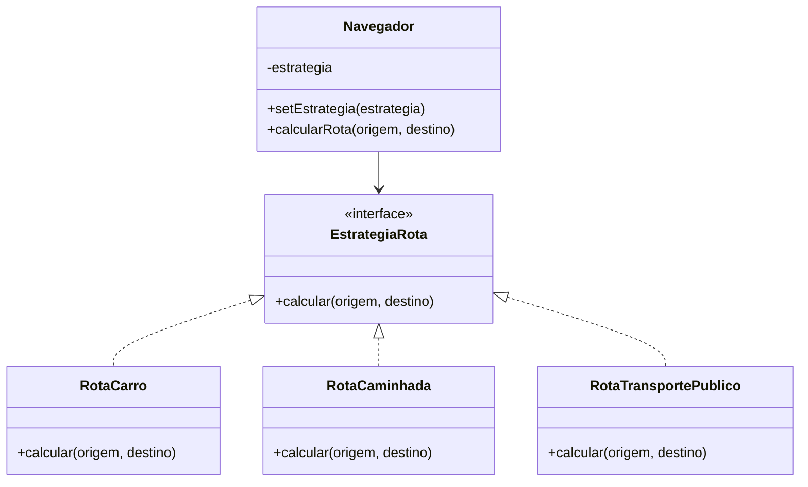

# O Padrão Strategy

## Introdução e contexto

O **Strategy** é um padrão **comportamental** que permite criar uma **família de
algoritmos intercambiáveis**. Cada algoritmo fica em sua própria classe, e o
cliente escolhe qual usar — inclusive **em tempo de execução**.

O padrão é indicado quando existem várias classes **muito similares**, que
diferem apenas em um comportamento específico. Em vez de encher a classe
principal de condicionais, cada variação vira uma estratégia independente.

## A analogia do mapa

A aula usa um aplicativo de navegação. Para ir da universidade ao aeroporto, o
app oferece:

- rota de **carro**;
- rota de **moto**;
- **transporte público**;
- **caminhada**;
- **bicicleta**;
- e assim por diante.

O destino é o mesmo; o **algoritmo de navegação** muda. O usuário escolhe a
estratégia conforme a situação — e pode trocar no meio do caminho.

## O problema sem o padrão

A implementação inicial concentra tudo em um único método:

```js
class Navegador {
  calcularRota(tipo, origem, destino) {
    if (tipo === "carro") {
      console.log(`Rota de carro de ${origem} até ${destino}`);
    } else if (tipo === "caminhada") {
      console.log(`Rota de caminhada de ${origem} até ${destino}`);
    } else if (tipo === "transporte") {
      console.log(`Rota de transporte público de ${origem} até ${destino}`);
    } else {
      console.log("Tipo de rota desconhecido");
    }
  }
}
```

Funciona para três tipos, mas o método está **saturado**:

| Problema | Consequência |
| --- | --- |
| `if/else` cresce sem limite | código longo e difícil de ler |
| novo transporte exige editar o método | viola o princípio **aberto/fechado** |
| toda a lógica fica em uma classe | acoplamento alto |
| testes precisam cobrir todos os ramos | manutenção trabalhosa |
| combinações e regras se misturam | risco de regressão |



Adicionar uma rota de **navio** exigiria alterar `calcularRota` e revisar os
testes existentes. A classe principal vira um ponto único de falha.

## A proposta do padrão

O Strategy separa cada algoritmo em uma classe e cria um **contexto** que
conhece uma estratégia:

| Participante | Papel |
| --- | --- |
| **Strategy** | interface comum dos algoritmos |
| **ConcreteStrategy** | implementações: carro, caminhada, transporte público |
| **Context** | mantém uma estratégia e delega a ela |
| **Client** | escolhe e troca a estratégia |



O `Navegador` deixa de conhecer os tipos de rota. Ele apenas delega à estratégia
recebida.

## Benefícios

- **Algoritmos intercambiáveis** em tempo de execução.
- **Princípio aberto/fechado**: novas estratégias sem alterar o contexto.
- **Menos `if/else`** na classe principal.
- **Classes coesas**, cada uma com um algoritmo.
- **Testes isolados** por estratégia.
- **Manutenção localizada**.

## Limitações e cuidados

- **Mais classes.** A estrutura cresce, embora de forma organizada.
- **O cliente precisa conhecer as estratégias** para escolher.
- **Pode ser exagero** quando existe apenas uma variação fixa.
- **A escolha ainda precisa acontecer** em algum lugar — o padrão não elimina
  toda decisão.
- **Comunicação entre contexto e estratégia** precisa ser bem definida: quais
  dados a estratégia recebe?

## Conclusão

O Strategy transforma um método cheio de condicionais em uma **família de
algoritmos**. O contexto (`Navegador`) mantém uma estratégia e delega o cálculo;
as estratégias concretas sabem **como** calcular cada rota.

O ganho é extensibilidade e clareza. O custo é mais estrutura. Para sistemas em
que o comportamento varia em tempo de execução — navegação, pagamento,
compressão, cálculo de impostos —, o padrão é uma escolha natural.

A implementação prática começa pela interface `EstrategiaRota` e pelas rotas
concretas.
