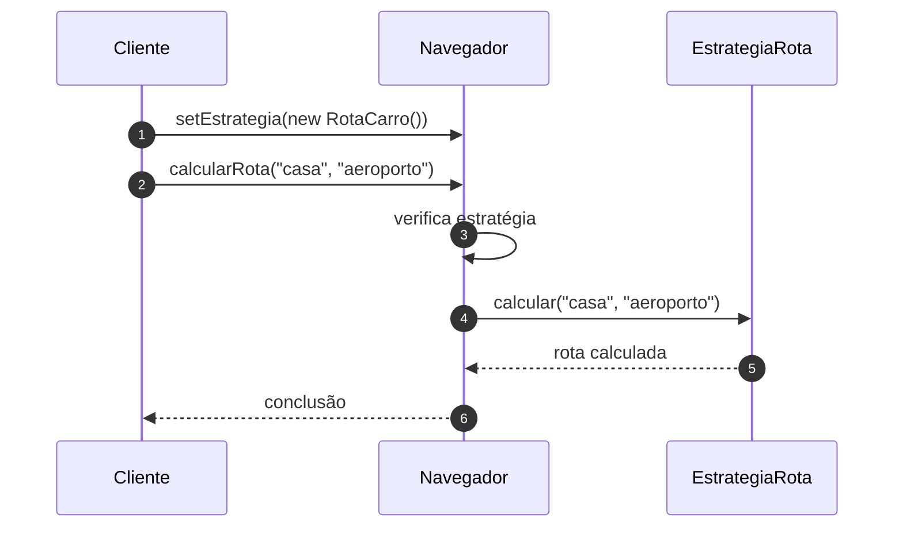

# Implementando o Padrão Strategy - Parte 1

## Introdução e contexto

Esta aula reestrutura o projeto de navegação em:

```
projeto-navegacao/
├── models/
│   ├── EstrategiaRota.js
│   ├── RotaCarro.js
│   ├── RotaCaminhada.js
│   ├── RotaTransportePublico.js
│   └── Navegador.js
└── teste-navegador.js
```

Cada estratégia concreta implementa o cálculo da rota. O `Navegador` passa a ser
o **contexto**, que recebe uma estratégia e delega a ela.

## A interface da estratégia

`EstrategiaRota` define o contrato:

```js
class EstrategiaRota {
  calcular(origem, destino) {
    throw new Error("O método calcular deve ser implementado");
  }
}
```

O método recebe **origem** e **destino**. O que acontece entre eles é
responsabilidade de cada estratégia.

## As estratégias concretas

Cada rota herda de `EstrategiaRota` e implementa `calcular`:

```js
class RotaCarro extends EstrategiaRota {
  calcular(origem, destino) {
    console.log(`Calculando rota de carro de ${origem} até ${destino}`);
  }
}

class RotaCaminhada extends EstrategiaRota {
  calcular(origem, destino) {
    console.log(`Calculando rota de caminhada de ${origem} até ${destino}`);
  }
}

class RotaTransportePublico extends EstrategiaRota {
  calcular(origem, destino) {
    console.log(`Calculando rota de transporte público de ${origem} até ${destino}`);
  }
}
```

A repetição é proposital e pequena: cada classe isola **um algoritmo**. Se a
lógica de uma rota mudar, só ela é alterada.

## O contexto

O `Navegador` mantém uma estratégia e oferece duas operações:

```js
class Navegador {
  #estrategia;

  setEstrategia(estrategia) {
    this.#estrategia = estrategia;
  }

  calcularRota(origem, destino) {
    if (!this.#estrategia) {
      throw new Error("Nenhuma estratégia de rota foi definida");
    }

    this.#estrategia.calcular(origem, destino);
  }
}
```

O método `calcularRota` não sabe se a rota é de carro, caminhada ou transporte
público. Ele apenas verifica se existe uma estratégia e **delega**.



## Por que separar

| Antes | Depois |
| --- | --- |
| um método com todos os `if/else` | um contexto que delega |
| adicionar rota exige editar o contexto | adicionar rota é criar uma classe |
| testes cobrem todos os ramos | testes isolados por estratégia |
| lógica de rota misturada ao navegador | responsabilidades separadas |

O `Navegador` fica estável. As variações ficam nas estratégias.

## Tratamento de erro

O contexto lança uma exceção quando nenhuma estratégia foi definida. Isso evita
um `undefined.calcular()` e deixa explícito que o navegador precisa de uma
estratégia para funcionar.

Em uma API, esse erro poderia virar uma resposta `400`; em uma aplicação de
linha de comando, uma mensagem clara. O importante é não falhar de forma
silenciosa.

## Benefícios

- **Contexto enxuto** e sem condicionais.
- **Estratégias independentes** e testáveis.
- **Extensão sem modificação** do contexto.
- **Troca de comportamento** em tempo de execução.
- **Contrato único**: toda estratégia calcula uma rota.

## Limitações e cuidados

- **Mais classes** e mais arquivos.
- **O cliente precisa instanciar** a estratégia correta.
- **Erro se esquecer de definir** uma estratégia — mitigado pela exceção.
- **Interface precisa ser estável**: mudanças em `calcular` afetam todas as
  estratégias.
- **Nem toda variação merece o padrão**: para uma única rota fixa, uma função
  resolve.

## Conclusão

A estrutura do Strategy está montada: `EstrategiaRota` define o contrato,
`RotaCarro`, `RotaCaminhada` e `RotaTransportePublico` implementam os algoritmos,
e `Navegador` é o contexto que delega.

O próximo passo é usar o cliente para **trocar estratégias em tempo de
execução** e comprovar o ganho ao adicionar uma nova rota sem tocar no
`Navegador`.
