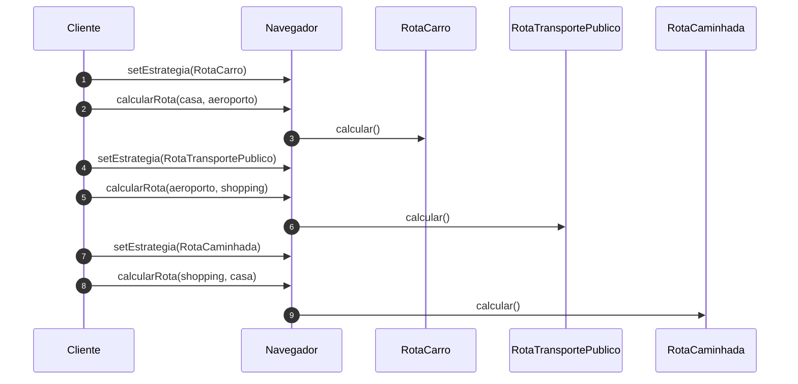

# Implementando o Padrão Strategy - Parte 2

## Introdução e contexto

Esta aula usa o `Navegador` no cliente, troca estratégias em tempo de execução e
adiciona uma nova rota sem alterar o contexto.

## O cliente

O cliente instancia o navegador e define a estratégia:

```js
const navegador = new Navegador();

navegador.calcularRota("casa", "aeroporto");
// Erro: nenhuma estratégia definida

navegador.setEstrategia(new RotaCarro());
navegador.calcularRota("casa", "aeroporto");
// Calculando rota de carro de casa até aeroporto
```

O erro inicial é esperado: o contexto exige uma estratégia antes de calcular.

## Trocando de estratégia

A qualquer momento, o cliente pode substituir a estratégia:

```js
navegador.setEstrategia(new RotaCarro());
navegador.calcularRota("casa", "aeroporto");

navegador.setEstrategia(new RotaTransportePublico());
navegador.calcularRota("aeroporto", "shopping");

navegador.setEstrategia(new RotaCaminhada());
navegador.calcularRota("shopping", "casa");
```

Cada chamada a `setEstrategia` muda o **algoritmo** usado pelo mesmo navegador.
O contexto não é recriado; apenas a estratégia é substituída.



## Adicionando uma nova estratégia

Para criar uma rota de **navio**, basta uma nova classe:

```js
class RotaNavio extends EstrategiaRota {
  calcular(origem, destino) {
    console.log(`Calculando rota de navio de ${origem} até ${destino}`);
  }
}
```

Nenhuma linha do `Navegador` é alterada. O cliente apenas usa a nova estratégia:

```js
navegador.setEstrategia(new RotaNavio());
navegador.calcularRota("Rio de Janeiro", "Santos");
```

É aqui que o **princípio aberto/fechado** aparece na prática: o sistema está
**aberto para extensão** e **fechado para modificação**.

## O antes e o depois

| Aspecto | Antes (`if/else`) | Depois (Strategy) |
| --- | --- | --- |
| adicionar rota | editar `calcularRota` | criar nova classe |
| testar uma rota | testar o método gigante | testar a estratégia isolada |
| trocar comportamento | nova chamada com outro `tipo` | `setEstrategia` |
| contexto | concentra todas as regras | delega à estratégia |
| abertura/fechamento | violado | respeitado |

## Vantagens

| Vantagem | Explicação |
| --- | --- |
| **Aberto/fechado** | novas estratégias sem alterar o contexto |
| **Classes coesas** | cada rota tem seu algoritmo |
| **Testes isolados** | um teste por estratégia |
| **Troca em runtime** | o cliente muda o comportamento quando quiser |
| **Baixo acoplamento** | o contexto depende da interface |
| **Manutenção localizada** | mudanças ficam na estratégia afetada |

## Desvantagens

- **Aumento no número de classes.** O projeto fica estruturalmente maior.
- **Curva de entendimento.** Quem não conhece o padrão pode se perder com
  `setEstrategia` e as classes concretas.
- **O cliente precisa escolher.** A decisão de qual estratégia usar não
  desaparece.
- **Pode ser exagero** para um comportamento único e estável.
- **Interface comum precisa ser bem pensada.** Se as estratégias recebem dados
  muito diferentes, o contrato fica forçado.

## Quando aplicar

O Strategy é indicado quando:

- o comportamento varia **em tempo de execução**;
- existem **vários algoritmos** para o mesmo problema;
- a classe principal está cheia de **condicionais**;
- novas variações precisam entrar sem alterar o código existente.

Exemplos:

- **sistemas de pagamento**: Pix, cartão, boleto;
- cálculo de frete por transportadora;
- compressão de arquivos;
- cálculo de impostos por regime;
- navegação por diferentes meios de transporte.

## Limitações e cuidados

- **Não esconda a escolha.** Em algum lugar o sistema precisa decidir a
  estratégia; deixe isso explícito.
- **Evite estratégias gigantes.** Se uma estratégia tem muitas regras, talvez
  ela própria precise ser decomposta.
- **Cuidado com estado compartilhado.** Estratégias devem ser, de preferência,
  sem estado ou com estado bem controlado.
- **Padronize o contrato.** Todos os métodos `calcular` devem ter a mesma
  assinatura e semântica.
- **Documente.** Um time que não conhece o padrão pode achar a estrutura
  desnecessariamente complexa.

## Conclusão

O Strategy implementado mostra o ciclo completo: o cliente define uma
estratégia, o contexto delega, e a troca acontece em tempo de execução. Adicionar
uma rota de navio não exige tocar no `Navegador` — apenas criar mais uma classe.

O padrão entrega flexibilidade e respeito ao aberto/fechado ao custo de mais
classes e de uma decisão explícita no cliente. Para comportamentos
intercambiáveis, é uma das soluções mais limpas.

O próximo padrão é o *Observer*, que muda o foco: em vez de escolher um
algoritmo, trata da **notificação de múltiplos interessados** quando algo
acontece.
