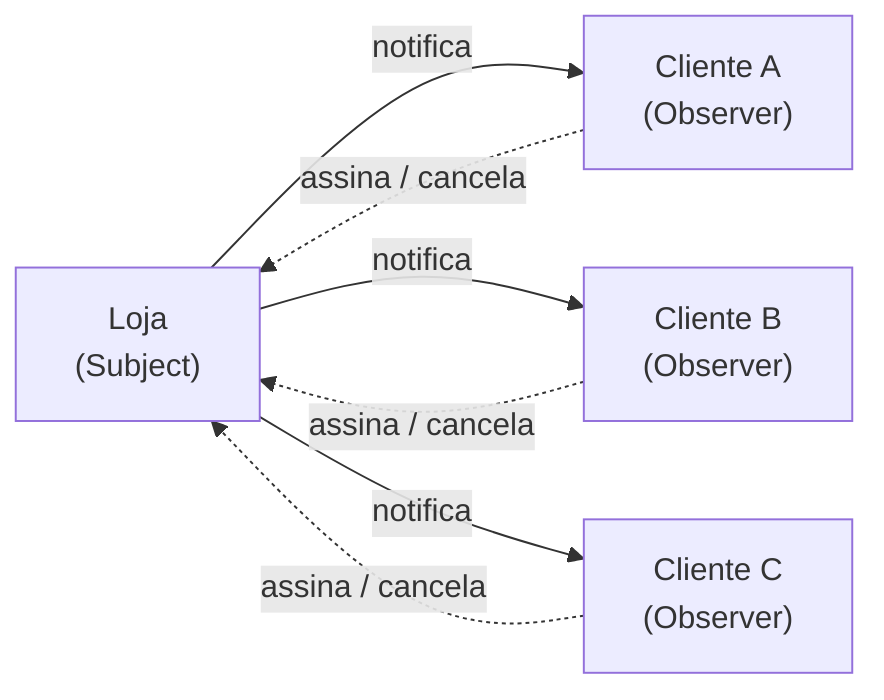
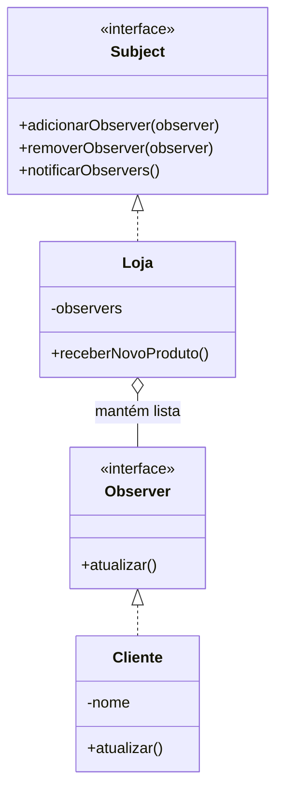

# O Padrão Observer

## Introdução e contexto

O **Observer** é um padrão **comportamental** de escopo de **objetos**. Ele
permite que **múltiplos objetos sejam notificados** quando algo acontece em
outro objeto.

Os participantes têm nomes próprios:

| Participante | Papel |
| --- | --- |
| **Subject** (assunto) | objeto observado; é quem dispara as notificações |
| **Observer** (observador) | objeto interessado; recebe as atualizações |

O padrão estabelece uma relação de **publicador/assinante**: o subject publica;
os observers assinam.

## A analogia da loja

A aula usa uma **loja** com **clientes**:

1. o cliente chega e diz que quer ser avisado quando um produto chegar;
2. a loja anota esse cliente na lista de interessados;
3. quando o produto chega, a loja notifica **somente quem se inscreveu**;
4. se o cliente perder o interesse, ele pode sair da lista.

O ponto central é a **subscrição**: a loja não faz *broadcast* para todo mundo.
Ela notifica apenas os clientes que demonstraram interesse naquele produto.

## Outros exemplos

- **feed de notícias**: o usuário assina temas de tecnologia, esportes ou
  romance e recebe apenas o que escolheu;
- **redes sociais**: notificações de curtidas, comentários e mensagens;
- **e-commerce**: aviso de reposição de estoque;
- **sistemas baseados em eventos**: o Node.js é construído sobre esse modelo.

## O problema sem o padrão

A implementação inicial tem uma `Loja` com:

- um atributo `produtoDisponivel` (uma flag);
- um método `notificarClientes()` que imprime mensagens fixas para clientes
  A, B e C;
- um método `receberNovoProduto()` que marca o produto como disponível e chama a
  notificação.

Funciona para o exemplo, mas concentra tudo na loja:

| Problema | Consequência |
| --- | --- |
| lista de clientes **hardcoded** | adicionar/remover exige editar a loja |
| notificação para todos | clientes recebem o que não querem |
| lógica de aviso dentro da loja | acoplamento alto |
| novo canal/cliente exige mudança | viola o **aberto/fechado** |
| testes difíceis | comportamento fixo e entrelaçado |

A loja precisa **conhecer** cada cliente e **saber** como notificá-lo. Isso é
exatamente o que o Observer elimina.

## A proposta do padrão

O Observer separa **quem publica** de **quem observa**:

O subject mantém uma **lista de observers**. Quando o evento acontece, ele
percorre a lista e chama `atualizar()` em cada um. O subject não precisa saber
quem são os observers concretos.

## Benefícios

- **Baixo acoplamento** entre publicador e assinantes.
- **Extensibilidade**: novos observers entram sem alterar o subject.
- **Subscrição dinâmica**: adicionar e remover interessados em tempo de execução.
- **Notificação seletiva**: cada observer recebe o que faz sentido para ele.
- **Aberto/fechado**: novos tipos de observer não exigem mudanças no subject.
- **Base para sistemas orientados a eventos**.

## Limitações e cuidados

- **Ordem de notificação** nem sempre é garantida.
- **Muitos observers** podem impactar desempenho.
- **Vazamento de memória**: observers precisam ser removidos quando não são mais
  necessários.
- **Depuração mais difícil**: o fluxo é indireto e distribuído.
- **Atualizações podem gerar efeitos em cascata**.
- **O subject não deve assumir responsabilidades dos observers**.

## Conclusão

O Observer transforma uma notificação fixa e acoplada em uma relação de
**assinatura**. A loja mantém uma lista de interessados e avisa todos quando o
produto chega; o cliente decide se quer continuar recebendo.

O padrão é a base de feeds, sistemas de notificação e arquiteturas orientadas a
eventos. A implementação prática começa pelas interfaces **Subject** e
**Observer**, seguidas das versões concretas `Loja` e `Cliente`.
