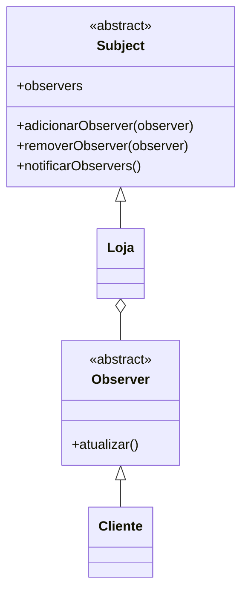

# Implementando o Padrão Observer - Parte 1

## Introdução e contexto

Esta aula estrutura o Observer em quatro peças:

```
modules/
├── Subject.js
├── ConcreteSubject.js
├── Observer.js
└── ConcreteObserver.js
```

As duas primeiras formam o lado do **publicador**; as duas últimas, o lado do
**assinante**.

## A interface Subject

O `Subject` define o contrato de gerenciamento dos observers:

```js
class Subject {
  constructor() {
    this.observers = [];
  }

  adicionarObserver(observer) {
    throw new Error("O método adicionarObserver precisa ser implementado");
  }

  removerObserver(observer) {
    throw new Error("O método removerObserver precisa ser implementado");
  }

  notificarObservers(produto) {
    throw new Error("O método notificarObservers precisa ser implementado");
  }
}
```

Os três métodos são a base do padrão:

| Método | Responsabilidade |
| --- | --- |
| `adicionarObserver` | inscrever um interessado |
| `removerObserver` | cancelar a inscrição |
| `notificarObservers` | avisar todos os inscritos |

A lista `observers` fica no subject. As subclasses concretas decidem como
inscrever, remover e notificar.

## A interface Observer

O `Observer` tem um único método:

```js
class Observer {
  atualizar(produto) {
    throw new Error("O método atualizar precisa ser implementado");
  }
}
```

É o contrato que todo observador precisa cumprir. O subject chama `atualizar()`
sem saber o que o observer fará com a notificação.



## Por que duas interfaces

A separação permite que o subject e o observer evoluam de forma independente:

- o subject não conhece as classes concretas dos observers;
- o observer não conhece a implementação interna do subject;
- novos observers entram sem alterar o subject;
- novos subjects podem reutilizar os mesmos observers.

É o **princípio da inversão de dependência** na prática: ambos dependem de
abstrações, não de implementações concretas.

## O que cada interface garante

| Interface | Garante que... |
| --- | --- |
| `Subject` | existe uma lista de observers e uma forma de notificá-los |
| `Observer` | existe um método `atualizar(produto)` padronizado |

O subject pode notificar qualquer objeto que implemente `atualizar()`. Não
importa se é cliente, serviço de e-mail, logger ou painel.

## Benefícios

- **Contrato claro** entre publicador e assinante.
- **Desacoplamento** entre as partes.
- **Extensibilidade** dos dois lados.
- **Substituição de observers** sem impacto no subject.
- **Base reutilizável** para diferentes domínios.

## Limitações e cuidados

- **Interfaces abstratas em JavaScript** são convenções, não imposições da
  linguagem. Lançar exceção ajuda a documentar, mas não impede instanciação.
- **A lista de observers precisa ser gerenciada** com cuidado para evitar
  duplicatas e vazamentos.
- **Defina o que a notificação carrega.** Nesta modelagem, `atualizar(produto)`
  recebe o produto; se o evento tiver mais contexto, a assinatura deve ser
  planejada.
- **Nem todo subject precisa ser abstrato.** Para um caso único, a interface pode
  ser incorporada diretamente na classe concreta.
- **Cuidado com notificações em cascata**: um observer que dispara outro evento
  pode criar ciclos.

## Conclusão

As interfaces `Subject` e `Observer` definem o **contrato do padrão**: o subject
mantém uma lista e notifica; o observer implementa `atualizar()`.

Com a base pronta, a próxima aula implementa as classes concretas: a `Loja`
(subject) e o `Cliente` (observer).
