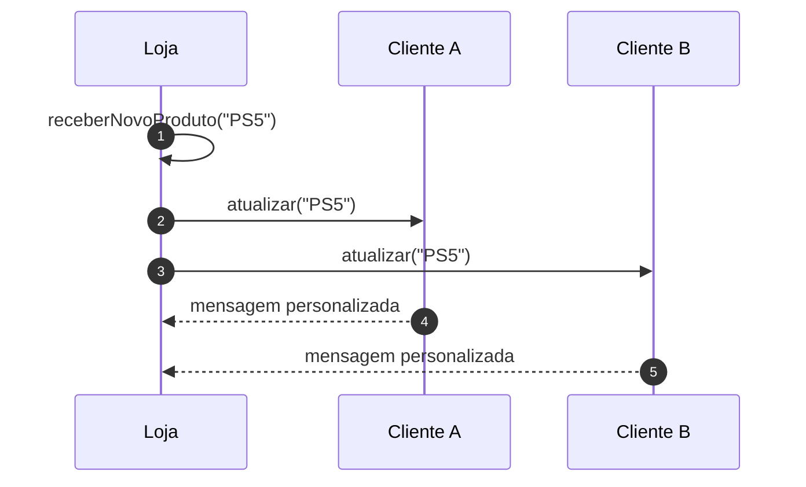
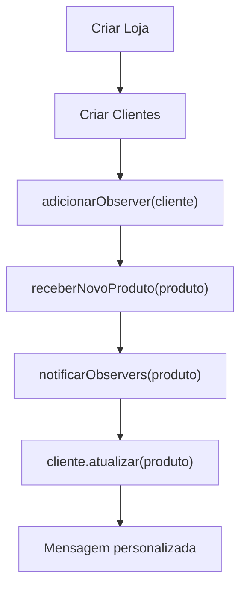

# Implementando o Padrão Observer - Parte 2

## Introdução e contexto

Esta aula implementa as classes concretas do Observer:

| Interface | Classe concreta |
| --- | --- |
| `Subject` | `Loja` |
| `Observer` | `Cliente` |

A `Loja` gerencia a lista de assinantes e dispara as notificações. O `Cliente`
recebe a atualização e personaliza a mensagem com seu nome.

## A Loja (ConcreteSubject)

A `Loja` herda de `Subject` e implementa os três métodos:

```js
class Loja extends Subject {
  adicionarObserver(observer) {
    this.observers.push(observer);
  }

  removerObserver(observer) {
    this.observers = this.observers.filter((o) => o !== observer);
  }

  notificarObservers(produto) {
    for (const observer of this.observers) {
      observer.atualizar(produto);
    }
  }

  receberNovoProduto(produto) {
    console.log(`Novo produto chegou à loja: ${produto}`);
    this.notificarObservers(produto);
  }
}
```

Cada método tem um papel bem definido:

| Método | O que faz |
| --- | --- |
| `adicionarObserver` | insere o cliente na lista |
| `removerObserver` | remove o cliente da lista |
| `notificarObservers` | percorre a lista e chama `atualizar` |
| `receberNovoProduto` | dispara o evento de chegada |

A notificação percorre **apenas os observers inscritos**. Não há mais lista fixa
de clientes A, B e C.



## O Cliente (ConcreteObserver)

O `Cliente` herda de `Observer`, guarda o nome e implementa `atualizar`:

```js
class Cliente extends Observer {
  #nome;

  constructor(nome) {
    super();
    this.#nome = nome;
  }

  atualizar(produto) {
    console.log(`${this.#nome}, o produto ${produto} está disponível!`);
  }
}
```

A mensagem é **personalizada** com o nome do cliente. O subject não precisa saber
disso: ele apenas chama `atualizar(produto)`.

## O fluxo completo

1. a loja é criada;
2. os clientes são criados;
3. os clientes interessados são adicionados à loja;
4. a loja recebe um novo produto;
5. a loja notifica todos os observers da lista;
6. cada cliente reage com sua própria mensagem.



## Por que isso é melhor que a versão inicial

| Versão inicial | Versão com Observer |
| --- | --- |
| lista de clientes fixa no código | lista dinâmica de observers |
| notificação para todos | notificação só para inscritos |
| loja conhece cada cliente | loja conhece a interface `Observer` |
| adicionar cliente exige editar a loja | basta chamar `adicionarObserver` |
| remover cliente não era possível | `removerObserver` disponível |
| acoplamento alto | baixo acoplamento |

## Benefícios

- **Inscrição e cancelamento** em tempo de execução.
- **Notificação seletiva**.
- **Subject independente** dos observers concretos.
- **Mensagens personalizadas** sem alterar a loja.
- **Base reutilizável** para outros subjects e observers.

## Limitações e cuidados

- **Remoção por identidade**: `filter((o) => o !== observer)` exige a mesma
  referência do objeto inscrito.
- **Duplicatas**: adicionar o mesmo observer duas vezes faz ele receber duas
  notificações.
- **Ordem**: a notificação segue a ordem da lista, que pode mudar.
- **Dados da notificação**: a assinatura de `atualizar` precisa ser consistente
  entre os observers.
- **Vazamento de memória**: observers não removidos continuam na lista.

## Conclusão

A `Loja` implementa o lado do publicador: mantém a lista, inscreve, remove e
notifica. O `Cliente` implementa o lado do assinante: recebe o produto e gera uma
mensagem personalizada.

A loja deixa de conhecer clientes específicos e passa a trabalhar com a
**interface** `Observer`. É isso que permite adicionar e remover interessados
sem alterar o código do subject.

A próxima aula monta o cliente de teste e demonstra a subscrição e o
cancelamento na prática.
