# Padrões Comportamentais

## Índice

| # | Aula | Duração |
| --- | --- | --- |
| 1 | [O Padrão Iterator](./1%20-%20O%20Padr%C3%A3o%20Iterator.md) | 09:54 |
| 2 | [Implementando o Padrão Iterator - Parte 1](./2%20-%20Implementando%20o%20Padr%C3%A3o%20Iterator%20-%20Parte%201.md) | 09:37 |
| 3 | [Implementando o Padrão Iterator - Parte 2](./3%20-%20Implementando%20o%20Padr%C3%A3o%20Iterator%20-%20Parte%202.md) | 11:05 |
| 4 | [O Padrão Strategy](./4%20-%20O%20Padr%C3%A3o%20Strategy.md) | 10:20 |
| 5 | [Implementando o Padrão Strategy - Parte 1](./5%20-%20Implementando%20o%20Padr%C3%A3o%20Strategy%20-%20Parte%201.md) | 12:00 |
| 6 | [Implementando o Padrão Strategy - Parte 2](./6%20-%20Implementando%20o%20Padr%C3%A3o%20Strategy%20-%20Parte%202.md) | 11:20 |
| 7 | [O Padrão Observer](./7%20-%20O%20Padr%C3%A3o%20Observer.md) | 11:33 |
| 8 | [Implementando o Padrão Observer - Parte 1](./8%20-%20Implementando%20o%20Padr%C3%A3o%20Observer%20-%20Parte%201.md) | 07:39 |
| 9 | [Implementando o Padrão Observer - Parte 2](./9%20-%20Implementando%20o%20Padr%C3%A3o%20Observer%20-%20Parte%202.md) | 05:25 |
| 10 | [Implementando o Padrão Observer - Parte 3](./10%20-%20Implementando%20o%20Padr%C3%A3o%20Observer%20-%20Parte%203.md) | 07:09 |

## Sequência das aulas

```mermaid
flowchart LR
    A1["1 · O Padrão Iterator"] --> A2["2 · Implementando o Iterator - Parte 1"]
    A2 --> A3["3 · Implementando o Iterator - Parte 2"]
    A3 --> A4["4 · O Padrão Strategy"]
    A4 --> A5["5 · Implementando o Strategy - Parte 1"]
    A5 --> A6["6 · Implementando o Strategy - Parte 2"]
    A6 --> A7["7 · O Padrão Observer"]
    A7 --> A8["8 · Implementando o Observer - Parte 1"]
    A8 --> A9["9 · Implementando o Observer - Parte 2"]
    A9 --> A10["10 · Implementando o Observer - Parte 3"]
```

