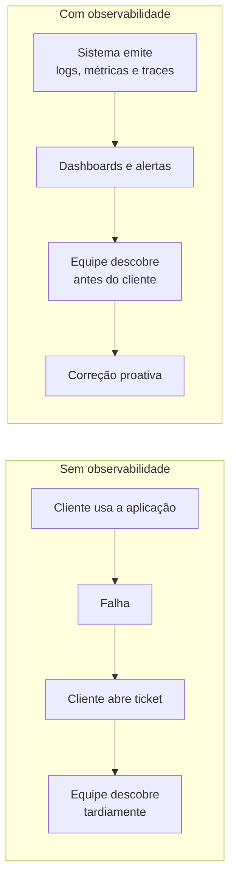
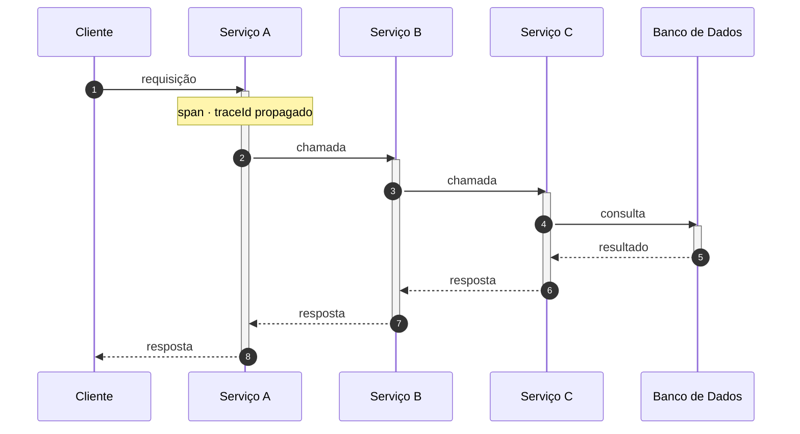

# Explorando o Conceito de Observabilidade

## Introdução e contexto

Esta aula abre o módulo de **observabilidade** com foco no back-end, ou seja, na
aplicação **Node** construída ao longo do curso. Antes de instalar qualquer
ferramenta, o objetivo é firmar o conceito: o que significa observar um sistema
e o que, afinal, queremos enxergar nele.

A etimologia ajuda. Observabilidade vem de **observar** — e é exatamente isso que
precisamos fazer com a aplicação que está rodando em algum lugar. Esse lugar, via
de regra, é o ambiente **produtivo**, mas o mesmo raciocínio vale para
**staging** ou para um ambiente interno de testes.

Observar o sistema significa responder com segurança a perguntas como:

- ele está **saudável** neste momento?
- os **logs** que ele emite fazem sentido?
- ele está **rápido** ou **lento**?
- se algo quebrou, **onde** e **por quê** quebrou?

## Por que observar

Problemas vão acontecer — isso é fato. A questão é **quem descobre o problema
primeiro**. Sem observabilidade, o cenário típico é o cliente tentar usar a
plataforma, não conseguir e abrir um ticket. Você descobre a falha de forma
tardia, dependente de feedback externo, e o custo é alto: estresse, reclamação e
tempo de indisponibilidade que poderia ter sido evitado.

A observabilidade existe para inverter essa ordem: **você** percebe o problema
antes do usuário. E vai além da visualização passiva — permite criar
**mecanismos de alerta**. Por exemplo, se um erro ocorrer *x* vezes dentro de um
intervalo de tempo, você recebe uma notificação por telefone, SMS ou no Slack
corporativo.

## Os pilares da observabilidade

O conceito de "observar" é amplo demais para virar prática sem um recorte. Esse
recorte são os **pilares da observabilidade** — também técnicas para descobrir a
origem de um problema:

| Pilar | Termo em inglês | O que é | Responde |
| --- | --- | --- | --- |
| **Logs** | *logs* | registros imutáveis de eventos | **por que** aconteceu? |
| **Métricas** | *metrics* | medidas quantitativas de desempenho | **quanto / com que frequência**? |
| **Rastreamento** | *traces* | registro detalhado de chamadas entre componentes | **onde** e **em que etapa**? |

Um exemplo guia a diferença entre eles. Se a aplicação está lenta, o log pode
indicar a causa. Mas se o serviço **A** chama **B**, que chama **C**, e a
lentidão está no meio do caminho, o rastreamento mostra o percurso completo com o
tempo gasto em cada etapa. As métricas, por sua vez, podem apontar *que* algo
piorou, mas não explicam *por quê*.

### Logs

**Logs** são **registros imutáveis**. Uma vez emitido, o registro não pode ser
editado nem atualizado: não existe operação de *update* sobre um log. Ele
normalmente carrega **data e hora**, a mensagem escrita e, opcionalmente, objetos
com informações adicionais.

Formatos possíveis:

- **textual** — o mais comum no dia a dia;
- **estruturado** — por exemplo, um objeto (útil para logar erros);
- **binário** — menos frequente.

O log é sempre atribuído a uma **aplicação**. Em um cenário de vários
microsserviços, cada um emite seus próprios registros, vinculados a quem de fato
disparou o evento.

A qualidade do log importa mais do que a quantidade. Um bom log **direciona o
troubleshooting**: informa se foi erro ou sucesso e em que contexto. Logar
qualquer coisa indiscriminadamente não só não ajuda como **atrapalha** a leitura.
O log é, portanto, o pilar que melhor explica a **causa** quando está bem
estruturado — é ele que mostra como a aplicação está se saindo na execução do
processo.

### Métricas

**Métricas** são **medidas quantitativas de desempenho** do sistema. Na prática,
é um **valor inteiro** — 1, 2, 3, 4 — acompanhado ao longo do tempo. Exemplos
clássicos:

- quantidade de **CPU** utilizada;
- quantidade de **memória**;
- **RPS** (requisições por segundo) e **RPM** (requisições por minuto).

Há dois caminhos para obtê-las:

- **auto-instrumentadas** — já vêm prontas da plataforma ou biblioteca;
- **inferidas** — criadas por você a partir da regra de negócio.

O exemplo de inferência é um caso de uso com sucesso e erro. Se der certo,
**incremente** a métrica de sucesso daquele contexto em 1; se der errado,
incremente a de erro em 1. É recomendável manter as duas métricas separadas,
pois **não existe decrementar métrica** — métricas são sempre **incrementais**.
(Na medição de CPU o valor pode aparecer quebrado, mas, ao instrumentar a
aplicação, você trabalha com inteiros.)

A métrica serve para **acompanhar tendências**. Se a aplicação operava com 100
RPS e passou a 500 ou 600 RPS, isso pode indicar que ela não aguentará o tráfego.
É um **norteador**, não um diagnóstico: a métrica aponta o problema, mas **não
diz a causa**. Por isso, ao emitir métricas de sucesso e erro, mantenha **logs
associados** a esses eventos.

Há ainda um ganho prático: métricas são **muito mais performáticas** de
consultar. Como são apenas valores incrementais, agregar um intervalo de tempo é
barato.

### Rastreamento (*traces*)

O **rastreamento** — *trace*, ou *traces* no plural — é um **registro detalhado
de chamadas entre diferentes componentes**. Ele mostra o **caminho** que uma
requisição percorreu dentro do sistema.

Voltando ao exemplo do serviço **A** que chama **B**, que chama **C**: a métrica
pode dizer qual serviço está mais lento, mas não explica bem o que está
acontecendo; os logs, sozinhos, também tornam a análise difícil. O trace resolve
isso ao exibir a **linha do tempo de execução** de cada trecho da chamada.

Isso é o conceito de **trace distribuído**: o trace que começou no serviço A é
propagado até o serviço D, e você enxerga o tempo gasto em cada salto. O
resultado é uma visão clara da **cadeia de eventos** que levou à lentidão ou ao
erro.

O rastreamento não se limita a chamadas entre serviços. Se a aplicação não chama
vários serviços, provavelmente ela acessa um **banco de dados** — e isso também
gera um trace, mostrando que a requisição chegou ao banco e quanto tempo levou.
Para obter esse nível de detalhe é preciso **instrumentar o banco**; sem essa
instrumentação, ainda é possível **inferir métricas** na aplicação para medir o
tempo de forma aproximada.

Cada trecho destacado é um **span**: ele registra início, fim e duração daquela
etapa. O conjunto de spans, unidos pelo mesmo identificador de trace, forma a
linha do tempo completa. É assim que o trace aponta **onde** o tempo foi
consumido — algo que nem a métrica nem o log entregam com a mesma clareza.

## Como os pilares se complementam

Os três pilares não competem entre si; eles respondem a perguntas diferentes e se
reforçam:

| Situação | Métrica | Log | Trace |
| --- | --- | --- | --- |
| "a aplicação está lenta" | mostra **quando** piorou | pode indicar **por que** | mostra **em qual serviço/etapa** |
| "houve muitos erros" | mostra **volume** e tendência | mostra **a causa** do erro | mostra **onde** o erro nasceu na cadeia |
| "o tráfego cresceu" | mostra RPS/RPM | contextualiza eventos | mostra o comportamento por requisição |

Uma leitura útil é: **métricas dizem que algo está errado; logs dizem por quê;
traces dizem onde**. Combinados, encurtam o *troubleshooting* e tornam os alertas
mais confiáveis.

## Limitações e cuidados

- **Logar tudo atrapalha.** O log precisa nortear; ruído dificulta a análise.
- **Métrica não é diagnóstico.** Ela indica tendência, não causa.
- **Métrica não decrementa.** Modele sucesso e erro como contadores separados.
- **Trace exige instrumentação.** Sem ela, o tempo do banco só pode ser estimado
  por métricas inferidas.
- **Observar não é adivinhar.** Sem os três pilares, a equipe volta a depender do
  ticket do cliente para descobrir problemas.

## Conclusão

Observabilidade é a capacidade de **entender a saúde do sistema em execução** —
saber se ele está saudável, rápido e coerente, e descobrir problemas **antes** que
o usuário os perceba. Os **pilares** fornecem as lentes para isso: **logs**
imutáveis e bem direcionados, **métricas** quantitativas e incrementais, e
**traces** que revelam o caminho e o tempo de cada chamada.

Com o conceito firmado, o próximo passo é a prática. Na próxima aula conheceremos
as **ferramentas** com as quais trabalharemos ao longo do módulo — a começar pela
*Grafana Stack*.
