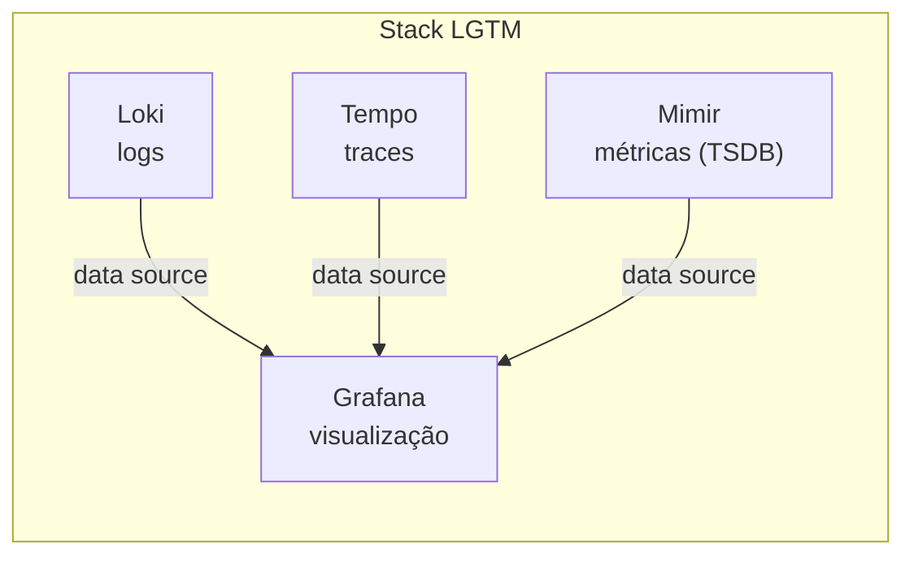
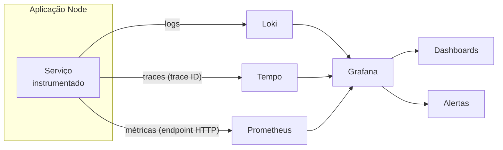

# Conhecendo os Pilares da Observabilidade

## Introdução e contexto

Com o conceito de observabilidade já firmado, esta aula apresenta as
**ferramentas** com as quais vamos trabalhar. O recorte é o contexto de
**DevOps**, e o caminho é feito em duas etapas: primeiro conhecer o **Grafana** e
sua stack; depois comparar com outras ferramentas de mercado.

A proposta não é decorar nomes, mas entender **qual ferramenta resolve qual
pilar**. Ao final, deve ficar claro como as peças se encaixam — e por que a
aplicação não deveria depender de uma ferramenta específica.

## A stack LGTM

O conjunto de ferramentas open source em torno do Grafana é conhecido pela sigla
**LGTM**:

| Letra | Ferramenta | Pilar | Papel |
| --- | --- | --- | --- |
| **L** | **Loki** | logs | agregação e armazenamento de logs |
| **G** | **Grafana** | visualização | dashboards e consulta a múltiplas fontes |
| **T** | **Tempo** | traces | rastreamento distribuído |
| **M** | **Mimir** | métricas | *Time Series Database* (TSDB) |

Todas são **open source**: você pode rodá-las gratuitamente, inclusive em
**Docker**, ou hospedá-las no seu próprio servidor e cuidar do ecossistema. Essa
é uma opção legítima — porém **não trivial**. Subir e operar a stack completa
exige conhecimento de infraestrutura que foge do foco de um curso full stack.

## Grafana Cloud: abstraindo a infraestrutura

Para manter o foco na aplicação, o curso usa o **Grafana Cloud**, a versão
**gerenciada** da stack. Em vez de subir containers de Loki, Grafana ou Tempo, a
gente consome o serviço pronto. A vantagem é didática: **menos complexidade de
infraestrutura, mesmo resultado observável**.

O trade-off é o custo. O Grafana Cloud oferece um **free trial** para estudos,
mas o serviço é pago justamente pelo **gerenciamento** — a parte trabalhosa que
alguém está operando por você.

Um detalhe importante: no Grafana Cloud o pilar de métricas é atendido pelo
**Prometheus**, e não pelo Mimir. Os dois têm papéis parecidos — ambos são
**TSDB** (*Time Series Database*) —, mas o Prometheus é o que será usado na
prática. O Mimir continua valendo a pena conhecer: é um TSDB open source, pensado
para escala, e poderia ocupar esse lugar.

## Conhecendo cada ferramenta

### Loki — logs

O **Loki** é um **agregador de logs** open source. É a ferramenta para quando
queremos **debugar** ou entender melhor o que a aplicação registrou.

Seus pontos fortes:

- armazenamento de logs de forma **relativamente econômica**;
- **indexação inteligente** — indexa metadados em vez do conteúdo inteiro;
- boa **performance** nas consultas;
- integração com o **Prometheus**, o que permite correlacionar logs e métricas
  em um monitoramento mais abrangente.

Em resumo: o Loki resolve o **pilar de logs**.

### Grafana — visualização

O **Grafana** é uma **plataforma de visualização** open source. É a ferramenta
que "não se encaixa em nenhum pilar e ao mesmo tempo se encaixa em todos", porque
**não produz nem armazena dados**: ela os **mostra**.

É no Grafana que construímos **dashboards** e **gráficos interativos**, e é por
ele que consultamos logs no Loki, traces no Tempo e métricas no Prometheus. O
Grafana se conecta a **múltiplos data sources** — inclusive *exporters* — e
**unifica** a visualização em um só lugar, bastando segmentar a fonte de dados.

### Tempo — rastreamento

O **Tempo** é o serviço de **rastreamento distribuído** open source, responsável
pelo pilar de **traces**.

Ele atende a chamadas que começam em um serviço e terminam em outro: o Tempo
gera o **trace ID** (o identificador do rastreamento), e esse ID é propagado por
todo o tempo de execução daquela chamada. É o que permite reconstruir a **linha
do tempo** da requisição entre os serviços.

### Prometheus — métricas

O **Prometheus** é o sistema projetado para **coletar métricas** de sistemas e
serviços.

Seu modelo de coleta é baseado em **endpoints HTTP**: ele busca periodicamente as
métricas dos serviços configurados — aplicações, servidores e outros alvos. Além
disso, a **auto-instrumentação** no código emite métricas prontas, sem trabalho
manual, como **tempo de requisição**, entre outras que veremos na prática.

## Como as peças se integram

O fluxo é sempre o mesmo: a aplicação **emite** dados, cada backend **armazena**
o seu tipo, e o Grafana **consulta** essas fontes para montar dashboards e
disparar alertas. O Loki e o Prometheus conversam especialmente bem, o que
facilita correlacionar um pico de erros (métrica) com as linhas de log
correspondentes.

## O ponto de atenção: acoplamento ao vendor

Aqui surge a pergunta que prepara a próxima aula: **como a aplicação se conecta a
esse ecossistema?** Será que precisamos de uma biblioteca para o Loki, outra para
o Tempo e outra para o Prometheus?

O mercado tem vários *vendors*: Grafana, ferramentas da **Elastic**, **Datadog**,
**New Relic** e outros. Se a aplicação conhece o fornecedor, trocar de ferramenta
vira um problema de escala: com **100 microsserviços** usando Grafana, mudar para
o New Relic por questão de estratégia significaria **alterar os 100 serviços**.

Esse é o **acoplamento ao vendor** que queremos evitar. A aplicação deve emitir
dados de observabilidade de forma **padronizada**, e não amarrada a quem vai
consumi-los. Na próxima aula veremos a base teórica que resolve isso —
o **OpenTelemetry**.

## Limitações e cuidados

- **Open source não significa operação simples.** Rodar a stack completa exige
  infraestrutura e manutenção.
- **Grafana Cloud é gerenciado, não gratuito para sempre.** Há *free trial*, mas
  o gerenciamento é cobrado.
- **Grafana não é um pilar.** Ele visualiza; quem armazena são Loki, Tempo e
  Prometheus.
- **Prometheus não é Mimir.** Têm papéis equivalentes como TSDB, mas são
  ferramentas distintas.
- **Evite integrar a aplicação diretamente ao fornecedor.** O custo aparece na
  hora da migração.

## Conclusão

Esta aula traduziu os pilares em ferramentas concretas:

- **Loki** para logs;
- **Tempo** para traces;
- **Prometheus** para métricas;
- **Grafana** como camada de visualização e alerta.

O **Grafana Cloud** entra para reduzir a complexidade operacional e deixar o foco
na aplicação. Mas a pergunta sobre **como a aplicação se conecta** a tudo isso
permanece — e é justamente o gancho para a próxima aula, em que conheceremos o
**OpenTelemetry** e o papel dos padrões abertos nessa integração.
