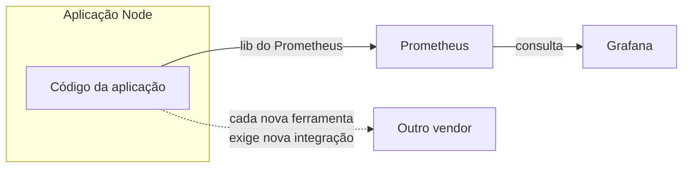
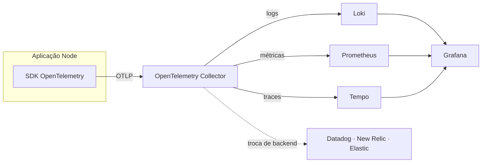

# O que é o OpenTelemetry

## Introdução e contexto

Na aula anterior, traduzimos os pilares da observabilidade em ferramentas
concretas: **Loki** para logs, **Prometheus** para métricas, **Tempo** para
traces e **Grafana** para visualização. Também vimos que o **Grafana Cloud**
reduz a complexidade operacional ao entregar essa stack de forma gerenciada.

Ficou, porém, uma pergunta central: **como a aplicação se conecta a esse
ecossistema?** Precisamos instalar uma biblioteca para o Loki, outra para o
Prometheus e mais outra para o Tempo? E o que acontece se, no futuro, a empresa
decidir trocar de fornecedor?

Esta aula compara dois caminhos — a instrumentação **acoplada ao vendor** e a
instrumentação **padronizada com OpenTelemetry** — e mostra por que o segundo
escala melhor.

## O caminho mais óbvio: acoplar a aplicação ao vendor

A primeira resposta que vem à cabeça é instalar, no código, a biblioteca do
fornecedor que vamos usar. No caso de métricas, seria a **lib do Prometheus**
para Node.js — que também existe para .NET, Java, Python e outras linguagens.

Com essa abordagem, a aplicação passa a **conhecer o Prometheus**:

1. a biblioteca instrumenta o código e expõe as métricas em um endpoint HTTP;
2. o Prometheus coleta e armazena essas métricas;
3. o Grafana se conecta ao Prometheus para consultar e visualizar os dados.

Funciona para um único fornecedor e é fácil de entender. O problema aparece
quando o sistema cresce ou quando a empresa decide mudar de ferramenta.

### Por que isso não escala

Se a aplicação conhece o fornecedor, ela carrega uma dependência que não tem
relação com a regra de negócio. Em um cenário com **100 microsserviços** usando
Grafana, migrar para o New Relic por uma decisão estratégica significaria
**alterar os 100 serviços** — trocar bibliotecas, configurações e talvez a forma
de emitir cada sinal.

O acoplamento também se multiplica por sinal: logs, métricas e traces costumam
ter integrações diferentes. Quanto mais ferramentas e mais serviços, maior o
custo de manutenção e maior o risco de a instrumentação virar um problema em si.

Esse é o **vendor lock-in**: a aplicação fica presa ao fornecedor não por uma
escolha de arquitetura, mas porque o código foi escrito para conhecê-lo.

## OpenTelemetry: telemetria aberta e padronizada

O **OpenTelemetry** — abreviado como **OTel** e apelidado de *hotel* pela
comunidade — é um **framework open source** mantido pela **CNCF** (*Cloud Native
Computing Foundation*). Sua proposta é ser um **padronizador** de telemetria:
gerar, processar e transmitir dados em um **formato unificado**.

Na prática, isso significa que a aplicação passa a conhecer apenas o
OpenTelemetry. Ele conversa com a stack da Grafana — Prometheus, Loki, Tempo — e
também com outros fornecedores, como Datadog, New Relic e ferramentas da
Elastic. A aplicação não precisa saber quem vai consumir os dados.

> **A inversão de dependência da observabilidade:** antes, o código conhecia o
> fornecedor; agora, o código conhece o padrão e o padrão conhece o fornecedor.

## As peças do OpenTelemetry

| Peça | Papel |
| --- | --- |
| **API** | Contrato usado pelo código para criar spans, métricas e logs. |
| **SDK** | Implementação que coleta, processa e exporta os dados. |
| **Collector** | Componente que recebe, processa e encaminha a telemetria para um ou mais backends. |
| **OTLP** | Protocolo padronizado de transporte da telemetria. |

O **Collector** é a peça que concentra a configuração do destino. Ele recebe os
dados da aplicação, aplica processamentos — como filtros, enriquecimento e
amostragem — e os exporta para o backend escolhido. É por isso que trocar de
fornecedor normalmente significa **reconfigurar o Collector**, não reescrever a
aplicação.

O **OTLP** (*OpenTelemetry Protocol*) é o que torna o formato realmente
unificado: a aplicação exporta em OTLP e o Collector traduz para o que cada
backend entende.

## O que muda na prática

| Aspecto | Sem OpenTelemetry | Com OpenTelemetry |
| --- | --- | --- |
| O que a aplicação conhece | O fornecedor (ex.: Prometheus) | O padrão (OTel) |
| Troca de fornecedor | Altera todos os serviços | Reconfigura o Collector |
| Instrumentação | Uma biblioteca por ferramenta | API/SDK padronizada |
| Formato dos dados | Proprietário | OTLP |
| Escopo | Cada sinal com integração própria | Logs, métricas e traces no mesmo padrão |

O ganho não é apenas trocar de fornecedor com menos esforço. É também **emitir
uma vez** e decidir depois para onde mandar, além de evitar que a aplicação
carregue detalhes de infraestrutura que não pertencem ao domínio.

## OpenTelemetry e a Grafana Stack

No nosso curso, a aplicação Node será instrumentada com o **SDK do
OpenTelemetry** e enviará os dados ao **Collector**. A partir dele, cada sinal
segue para o backend correspondente:

- **logs** para o **Loki**;
- **métricas** para o **Prometheus**;
- **traces** para o **Tempo**.

O **Grafana** continua sendo a camada de visualização: ele consulta essas fontes
e monta dashboards e alertas. O OpenTelemetry não substitui nenhuma dessas
ferramentas — ele organiza a forma como a aplicação conversa com elas.

Vale conferir a documentação oficial em
[opentelemetry.io](https://opentelemetry.io/) para saber quais linguagens,
bibliotecas e backends são suportados. A maioria das ferramentas conhecidas já
tem integração, mas o ecossistema evolui rápido e a documentação é a fonte mais
confiável.

## Benefícios

- **Desacoplamento do fornecedor:** a aplicação depende de um padrão aberto, não
  de uma empresa.
- **Portabilidade:** trocar o backend vira uma decisão de configuração do
  Collector.
- **Instrumentação única:** logs, métricas e traces compartilham a mesma base.
- **Padrão de mercado:** projeto mantido pela CNCF, com suporte das principais
  ferramentas de observabilidade.
- **Escala:** em ambientes com muitos serviços, a mudança de destino não precisa
  ser replicada em cada aplicação.

## Limitações e cuidados

- **OpenTelemetry não é um backend.** Ele coleta e transmite; armazenar,
  consultar e visualizar continuam sendo responsabilidade de ferramentas como
  Grafana, Loki, Prometheus e Tempo.
- **O Collector é mais uma peça para operar.** Em troca do desacoplamento,
  ganhamos um componente que precisa ser configurado, monitorado e, dependendo
  do cenário, escalado.
- **Nem todo recurso é 100% padronizado.** Integrações específicas de cada
  fornecedor podem exigir configuração adicional; confira a documentação.
- **Configuração tem custo de aprendizado.** Receivers, processors, exporters e
  pipelines do Collector exigem entendimento para não virarem caixa-preta.
- **Instrumentar bem continua importante.** Cardinalidade excessiva, dados
  sensíveis e amostragem inadequada são problemas que o padrão não resolve
  sozinho.

## Conclusão

O OpenTelemetry resolve a pergunta que ficou da aula anterior: a aplicação não
precisa conhecer Loki, Prometheus, Tempo ou qualquer outro fornecedor. Ela
conhece o **OpenTelemetry**, e o **Collector** decide para onde encaminhar cada
sinal usando o **OTLP** como formato comum.

Com o conceito firmado, o próximo passo é a prática: criar o nosso serviço na
**Grafana Cloud** e preparar a configuração que permitirá enviar os dados da
aplicação para a stack. É o que veremos em
[Criando a Nossa Conta na Grafana Cloud](./4%20-%20Criando%20a%20Nossa%20Conta%20na%20Grafana%20Cloud.md).
