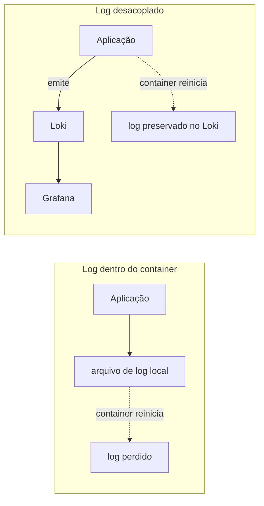
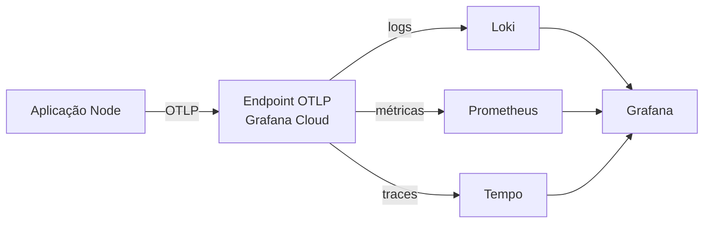

# Criando a Nossa Conta na Grafana Cloud

## Introdução e contexto

Na aula anterior, entendemos por que a aplicação deve conhecer o
**OpenTelemetry** em vez de conhecer diretamente cada fornecedor. Chegou a hora
de sair do conceito e preparar o ambiente: criar a conta no **Grafana Cloud**,
subir a nossa **stack** e localizar a configuração **OTLP** que usaremos para
enviar a telemetria.

O objetivo desta aula não é instrumentar o código ainda. É conhecer o portal,
entender o que cada ferramenta da stack faz e preparar o terreno para a próxima
etapa — enviar traces, métricas e logs da aplicação.

## Criando a conta

O ponto de partida é o site [grafana.com](https://grafana.com). No canto da
página, clique em **Sign in**. Se ainda não tiver conta, o próprio fluxo permite
fazer o cadastro; se já tiver, basta entrar. O login pode ser feito com
**GitHub**, o que agiliza o processo.

Ao criar a conta, o Grafana Cloud oferece um período de **14 dias de uso
ilimitado** para experimentar a plataforma. Depois dele, é possível continuar no
**Cloud Free**, uma camada gratuita com limites — mais do que suficiente para
estudar e acompanhar o curso.

| Plano | Característica | Indicado para |
| --- | --- | --- |
| **Trial** | 14 dias de uso ilimitado | explorar a plataforma sem restrições |
| **Cloud Free** | camada gratuita com limites | estudos e projetos pequenos |

> **Atenção:** o trial é temporário. Para não ser surpreendido, acompanhe o
> consumo e conheça os limites do Cloud Free antes de o período terminar.

## Criando a stack

Depois do login, você cai no **Grafana Cloud Portal**. É nele que ficam as
stacks e as ferramentas disponíveis. Para criar a nossa:

1. clique em **Adicionar stack**;
2. informe um **nome** — no curso, o exemplo é algo como `rocket-city`;
3. adicione uma **descrição** opcional, por exemplo, “stack da pós-graduação”;
4. confirme e aguarde alguns minutos enquanto o provisionamento termina.

A criação não é instantânea: o Grafana precisa preparar os serviços por trás da
stack. Quando o processo terminar, a página de gerenciamento mostrará todas as
ferramentas disponíveis.

### O que vem na stack

| Ferramenta | Papel |
| --- | --- |
| **Grafana** | visualização, dashboards e exploração dos dados |
| **Prometheus** | coleta e armazenamento de métricas |
| **Loki** | agregação e armazenamento de logs |
| **Tempo** | rastreamento distribuído (*traces*) |
| **Pyroscope** | *profiling* contínuo da aplicação |
| **k6** | testes de carga e estresse |
| **Alerting** | mecanismo de alertas do Grafana |
| **OpenTelemetry** | configuração do endpoint OTLP |

Vale conhecer também o **k6**: é uma ferramenta de **teste de carga** mantida
pela Grafana Labs, útil para simular tráfego e descobrir como a aplicação se
comporta sob pressão. Ela não faz parte dos três pilares clássicos, mas
complementa a observabilidade.

## Abrindo o Grafana

Na página da stack, localize o card do **Grafana** e clique em **Launch**. O
Grafana Cloud cria um endereço no formato:

```text
https://<nome-da-sua-stack>.grafana.net
```

O login pode ser feito com a própria conta Grafana ou com **SSO**, como uma
conta Google configurada para a organização.

Ao abrir, você encontra a interface que já conhecemos conceitualmente:

- **Connections / Data sources:** onde o Grafana se conecta ao Prometheus, Loki,
  Tempo e outros backends;
- **Dashboards:** visualizações prontas ou criadas por você;
- **Explore:** consulta direta às fontes de dados;
- **Grafana Cloud:** visão geral dos serviços e do consumo da stack.

Como ainda não configuramos nenhuma aplicação, não há dados para mostrar. Os
dashboards podem até exibir algum conteúdo de exemplo, mas a aplicação ainda não
está enviando telemetria.

### As linguagens de consulta

Cada backend tem a sua linguagem de consulta, e o Grafana serve como camada
única de acesso:

| Ferramenta | Linguagem | Uso |
| --- | --- | --- |
| **Loki** | **LogQL** | filtrar e analisar logs |
| **Prometheus** | **PromQL** | consultar métricas |
| **Tempo** | **TraceQL** | investigar traces |

Essas linguagens aparecem quando você for explorar os dados. O ponto importante
é que o Grafana **não armazena** a telemetria: ele consulta cada backend e
unifica a visualização.

## Por que não salvar logs dentro da aplicação?

Uma pergunta natural é: por que não escrever os logs em um arquivo dentro da
própria aplicação? A resposta está no modelo de execução em containers.

Aplicações em container são, por padrão, **stateless**: não mantêm estado local.
Quando o container é reiniciado, recriado ou removido, o sistema de arquivos
dele também vai embora. Se os logs estiverem apenas em um arquivo dentro do
container, eles são **perdidos** junto com ele.



É possível associar um **volume** ao container, mas isso deve ser reservado para
casos muito específicos — não para armazenar logs. A ideia é **desacoplar
responsabilidades**: a aplicação **emite** o log; um serviço dedicado
**armazena, indexa e consulta** esse log.

O paralelo com imagens ajuda: você não salva os uploads na pasta `assets` da
aplicação, e sim em um serviço de armazenamento de objetos. Se o container cair,
as imagens continuam disponíveis. Com logs, o raciocínio é o mesmo.

## O caminho manual e suas limitações

Na página da stack, o Grafana oferece atalhos como **Send Logs** (para o Loki) e
**Send Metrics** (para o Prometheus). Esses atalhos mostram o endpoint, o token e
as configurações necessárias para integrar a aplicação.

Funciona, mas traz de volta o problema que queremos evitar: a aplicação passa a
**conhecer o fornecedor**. Para enviar logs, você configura o Loki; para enviar
métricas, configura o Prometheus; e assim por diante. Se a empresa trocar de
ferramenta, a aplicação precisa ser alterada.

O portal também sugere o **Grafana Alloy** como agente de coleta. Ele é útil em
muitos cenários, mas a nossa meta nesta trilha é outra: manter a aplicação
**agnóstica ao vendor** e deixar a configuração de destino fora do código.

## O caminho com OpenTelemetry

Na mesma página da stack, localize a opção **OpenTelemetry** e clique em
**Configure**. O Grafana Cloud abre a configuração do protocolo **OTLP** com
três informações essenciais:

1. o **endpoint** para onde a aplicação enviará a telemetria;
2. o **token** de autenticação, que você gera no próprio portal;
3. um **exemplo de configuração** para a sua linguagem — no nosso caso,
   **TypeScript/Node**.



A aplicação envia tudo pelo mesmo protocolo; o destino de cada sinal é resolvido
na configuração do OpenTelemetry/Collector. É essa separação que permite trocar
de backend sem reescrever os serviços.

> **Segurança:** o token dá acesso à sua stack. Trate-o como credencial e nunca
> o commite no repositório.

## Benefícios dessa abordagem

- **Começo rápido:** a stack gerenciada evita subir e operar Loki, Prometheus e
  Tempo manualmente.
- **Ambiente integrado:** logs, métricas, traces e profiling convivem no mesmo
  portal.
- **Padrão aberto:** a configuração via OTLP mantém a aplicação independente do
  fornecedor.
- **Custo controlado para estudo:** o trial e o Cloud Free permitem aprender sem
  investir em infraestrutura.
- **Escalabilidade da configuração:** o destino da telemetria fica centralizado,
  não espalhado pelo código.

## Limitações e cuidados

- **O trial expira.** Planeje o uso e conheça os limites do plano gratuito.
- **Nem tudo é ilimitado.** Métricas, logs e traces consomem recursos; acompanhe
  o consumo da stack.
- **O token é sensível.** Use variáveis de ambiente ou um gerenciador de
  segredos.
- **Cloud é gerenciado.** Você ganha conveniência, mas perde parte do controle
  sobre a infraestrutura em comparação com uma stack self-managed.
- **Configurar não é instrumentar.** Criar a stack e gerar o token é só o
  começo; a aplicação ainda precisa emitir a telemetria corretamente.

## Conclusão

Nesta aula preparamos o ambiente:

- criamos a conta e conhecemos os planos do Grafana Cloud;
- subimos uma stack e exploramos as ferramentas do portal;
- abrimos o Grafana e entendemos o papel dos data sources e das linguagens de
  consulta;
- vimos por que logs não devem viver dentro do container;
- localizamos a configuração **OTLP** do OpenTelemetry, com endpoint e token.

Na próxima aula, vamos colocar essa configuração em prática e começar a enviar
telemetria da aplicação — a começar pelos traces. O conceito de agnosticismo ao
vendor, visto em [O que é o OpenTelemetry](./3%20-%20O%20que%20%C3%A9%20o%20OpenTelemetry.md),
vai deixar de ser teoria e virar código em
[Enviando Traces para Grafana](./5%20-%20Enviando%20Traces%20para%20Grafana.md).
