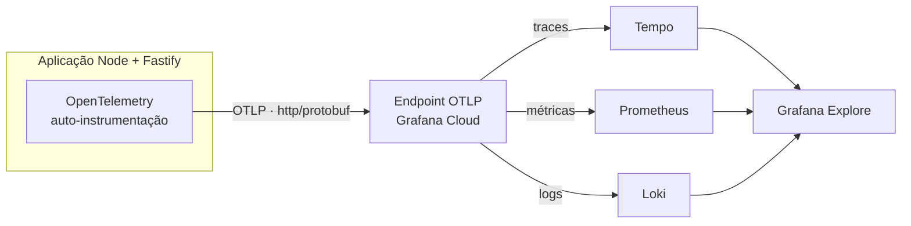
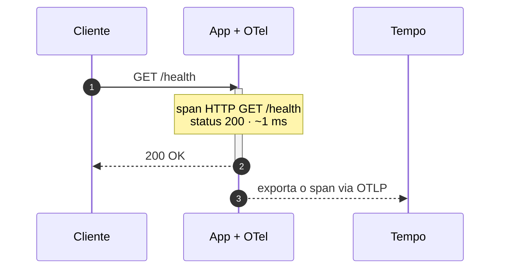

# Enviando Traces para Grafana

## Introdução e contexto

Na aula anterior, criamos a conta, subimos a stack no **Grafana Cloud** e
localizamos a configuração **OTLP** do OpenTelemetry. Agora vamos finalmente
conectar a aplicação: gerar o token, configurar as variáveis de ambiente,
instalar a auto-instrumentação do Node e ver os primeiros **traces** e
**métricas** chegando no Grafana.

A proposta é fazer isso com o **mínimo de código possível**. Em vez de criar
manualmente um `tracer.ts` e instrumentar cada biblioteca, usaremos a
**auto-instrumentação** do OpenTelemetry, que sobe junto com a aplicação e
captura automaticamente as chamadas HTTP, o framework e as bibliotecas comuns.

## Criando o token de acesso

Na página da stack, abra a configuração do **OpenTelemetry**. O portal já mostra
o **endpoint** OTLP e o **instance ID**, mas ainda falta o **token** — e é ele
que autentica o envio.

O endpoint é relativamente genérico: é o **token** que determina para qual conta
e para qual stack a telemetria será encaminhada. Por isso, endpoint e token
precisam estar sempre juntos e corretos.

Ao criar o token, o Grafana permite escolher os escopos. Para o nosso caso,
precisamos de permissão de escrita para os sinais que vamos enviar:

| Escopo | Para que serve |
| --- | --- |
| **Métricas** | enviar e importar métricas |
| **Logs** | enviar logs ao Loki |
| **Traces** | enviar traces ao Tempo |
| **Profiles** | enviar dados de profiling ao Pyroscope |
| **Rules / Alerting** | configurar regras e alertas |

Depois de criar, o portal disponibiliza um trecho com as **variáveis de
ambiente** já preenchidas. O token aparece nesse trecho e não precisa ser
copiado manualmente para outro lugar.

> **Segurança:** o token é uma credencial sensível. Em produção, ele deve ficar
> em um gerenciador de segredos — como AWS Secrets Manager, SSM ou KMS — e
> nunca no código ou em um `.env` commitado.

## Configurando as variáveis de ambiente

O OpenTelemetry para Node é configurado quase inteiramente por variáveis de
ambiente. O trecho gerado pelo Grafana serve como base:

```dotenv
OTEL_EXPORTER_OTLP_ENDPOINT=https://otlp-gateway-<zona>.grafana.net/otlp
OTEL_EXPORTER_OTLP_HEADERS=Authorization=Basic <token-base64>
OTEL_EXPORTER_OTLP_PROTOCOL=http/protobuf

OTEL_TRACES_EXPORTER=otlp
OTEL_METRICS_EXPORTER=otlp
OTEL_LOGS_EXPORTER=otlp

OTEL_SERVICE_NAME=FTR Upload
OTEL_RESOURCE_ATTRIBUTES=deployment.environment=local
OTEL_NODE_RESOURCE_DETECTORS=env,host,os

NODE_OPTIONS=--require @opentelemetry/auto-instrumentations-node/register
```

Os nomes e valores exatos vêm do snippet do Grafana Cloud; o bloco acima é a
estrutura conceitual. Entendendo cada grupo:

| Variável | Papel |
| --- | --- |
| `OTEL_EXPORTER_OTLP_ENDPOINT` | endereço que recebe a telemetria (`/otlp`) |
| `OTEL_EXPORTER_OTLP_HEADERS` | autenticação no formato `Authorization=Basic ...` |
| `OTEL_EXPORTER_OTLP_PROTOCOL` | transporte: `http/protobuf` ou gRPC |
| `OTEL_TRACES_EXPORTER` | exportador de traces (`otlp`) |
| `OTEL_METRICS_EXPORTER` | exportador de métricas (`otlp`) |
| `OTEL_LOGS_EXPORTER` | exportador de logs (`otlp`) |
| `OTEL_SERVICE_NAME` | nome da aplicação, usado como label no Grafana |
| `OTEL_RESOURCE_ATTRIBUTES` | atributos extras, como ambiente e versão |
| `OTEL_NODE_RESOURCE_DETECTORS` | detectores automáticos de host e sistema |
| `NODE_OPTIONS` | carrega a auto-instrumentação antes do bootstrap |

### HTTP/protobuf ou gRPC?

O protocolo OTLP pode trafegar por **HTTP com Protobuf** ou por **gRPC**. Nos
dois casos os dados são binários, o que é mais performático do que trafegar JSON.
O snippet do Grafana já escolhe uma opção válida; o importante é que a aplicação
e o endpoint falem o mesmo protocolo.

### Atributos de recurso

O `service.name` é o atributo mais importante para a organização no Grafana: ele
vira uma **label** e permite filtrar todos os traces daquela aplicação. No curso,
o nome usado é algo como `FTR Upload`.

Além dele, os **resource detectors** adicionam informações como:

- `deployment.environment` — `local`, `staging` ou `production`;
- `host.name` — nome do host;
- `os.type` — sistema operacional;
- `service.instance.id` — identificador da instância, quando disponível.

Quanto mais labels úteis, melhor a filtragem — mas é preciso cuidado com
**cardinalidade**: valores únicos por requisição, como um ID de usuário, podem
explodir o volume de séries temporais. IDs de requisição e detalhes específicos
combinam mais com **traces** e **logs** do que com métricas.

### O que é da aplicação e o que é do cluster

Nem toda configuração pertence à aplicação. `service.name` e
`deployment.environment` são claramente da aplicação. Já `host.name` e `os.type`
são informações de infraestrutura: se você tiver dez aplicações no mesmo cluster,
todas compartilhariam a mesma configuração de host.

Em Kubernetes, essa parte costuma ser resolvida por um agente/collector no nível
do cluster, muitas vezes via **DaemonSet**. Assim, cada aplicação envia apenas os
atributos que realmente lhe pertencem. Neste momento temos uma aplicação só, mas
esse recorte será importante mais adiante.

## Instalando a auto-instrumentação

No projeto Node, instale os dois pacotes usados na aula:

```bash
pnpm add @opentelemetry/api @opentelemetry/auto-instrumentations-node
```

- **`@opentelemetry/api`** — contrato usado pelo código para criar spans,
  métricas e logs;
- **`@opentelemetry/auto-instrumentations-node`** — conjunto de
  instrumentações prontas para Node, HTTP, Fastify e diversas bibliotecas.

O `NODE_OPTIONS` com `--require` faz a instrumentação subir **antes** do
bootstrap da aplicação. É isso que permite interceptar o framework e as
bibliotecas antes que elas sejam carregadas.



Nesta aula não precisamos criar um arquivo de tracer nem alterar o código da
aplicação. As variáveis de ambiente e a auto-instrumentação já entregam o
resultado para o escopo do curso. Em um ecossistema maior, vale refinar a
configuração e adicionar instrumentação manual para regras de negócio.

## Subindo a aplicação

Com as variáveis carregadas, suba o projeto normalmente:

```bash
pnpm dev
```

Se a configuração estiver correta, o terminal deve exibir uma mensagem
semelhante a:

```text
OpenTelemetry automatic instrumentation started successfully
```

Essa mensagem confirma que a instrumentação foi carregada antes da aplicação.
Se ela não aparecer, revise o `NODE_OPTIONS`, as variáveis de ambiente e se as
dependências foram instaladas.

## Testando o envio

Faça algumas requisições ao endpoint de **health check** da aplicação para gerar
tráfego. Em seguida, abra o **Explore** no Grafana Cloud.

### Logs

Ainda não há logs. Configurar `OTEL_LOGS_EXPORTER=otlp` não faz o `console.log`
virar log automaticamente: é preciso instrumentar a aplicação para emitir logs no
formato esperado. Esse é justamente o tema da próxima aula.

### Métricas

No **Prometheus**, começa a aparecer uma série de métricas geradas pela
auto-instrumentação — por exemplo, duração e quantidade de requisições HTTP.
Elas vêm “de fábrica” com a instrumentação e já permitem acompanhar o
comportamento da aplicação. Métricas específicas de negócio exigiriam
instrumentação manual.

### Traces

No **Tempo**, abra o **Search** e filtre por **Service Name**. O serviço
`FTR Upload` deve aparecer na lista. Ao rodar a busca, o Grafana mostra os traces
recebidos, cada um com seu **trace ID**.

Ao abrir um trace:

- a rota `/health` aparece como `GET`, com status **200** e duração de poucos
  milissegundos;
- como a rota só devolve um “OK”, o trace tem **um único span**;
- se a aplicação consultasse o banco ou chamasse outro serviço, cada etapa
  apareceria como um novo span;
- o **TraceQL** permite consultar por trace ID ou por atributos como o nome do
  serviço.



O trace é a **linha do tempo** da requisição; o span é cada trecho dessa linha do
tempo. Quanto mais camadas a requisição percorrer, mais rico fica o trace — e
mais fácil fica descobrir onde o tempo foi consumido.

## O que já funciona e o que falta

| Sinal | Status nesta aula | Onde observar |
| --- | --- | --- |
| **Traces** | funcionando | Tempo / Explore |
| **Métricas** | funcionando (auto-instrumentadas) | Prometheus |
| **Logs** | ainda não enviados | Loki (próxima aula) |

## Segurança e boas práticas

- **Nunca commite o token.** Use `.env` local, variáveis do ambiente ou um
  gerenciador de segredos.
- **Garanta que o `.env` esteja no `.gitignore`.** Se o arquivo não estiver
  ignorado, adicione antes de criar o token.
- **Use o menor escopo possível.** O token da aula tem escopos de escrita para
  vários sinais; em produção, limite ao necessário.
- **Rotacione o token** se ele vazar ou se uma pessoa deixar o time.
- **Cuidado com dados sensíveis** em atributos, logs e spans: nomes, e-mails,
  documentos e credenciais não devem ser exportados sem tratamento.
- **Evite alta cardinalidade** em labels de métricas; prefira traces e logs para
  informações únicas por requisição.
- **Em produção, avalie amostragem** para controlar custo e volume sem perder
  visibilidade dos erros.

## Limitações e cuidados

- **Auto-instrumentação não cobre regra de negócio.** Ela enxerga bibliotecas e
  chamadas comuns; spans de domínio exigem instrumentação manual.
- **Logs não são automáticos.** O exportador OTLP precisa que a aplicação
  produza logs de forma compatível.
- **Configuração errada pode falhar em silêncio.** Confira a mensagem de
  inicialização e o Explore se os dados não aparecerem.
- **O Grafana Cloud esconde parte da infraestrutura.** Isso simplifica o uso,
  mas limita o controle em relação a uma stack self-managed.
- **Atributos de host e cluster** não devem ser duplicados em cada aplicação
  quando existe um collector central.

## Conclusão

Nesta aula, a aplicação passou a enviar **traces** e **métricas** para o Grafana
sem conhecer Loki, Tempo ou Prometheus: ela conhece apenas o **OTLP**. O token
autenticou o envio, as variáveis de ambiente definiram o destino e a
auto-instrumentação capturou as chamadas HTTP e o framework.

Os traces já mostram o caminho da requisição e os spans; as métricas já trazem
indicadores básicos de HTTP. Falta o terceiro pilar: os **logs**. Na próxima
aula, vamos instrumentar a aplicação para enviá-los ao Loki e ver a correlação
com os traces em
[Formatando os Nossos Logs](./6%20-%20Formatando%20os%20Nossos%20Logs.md).
