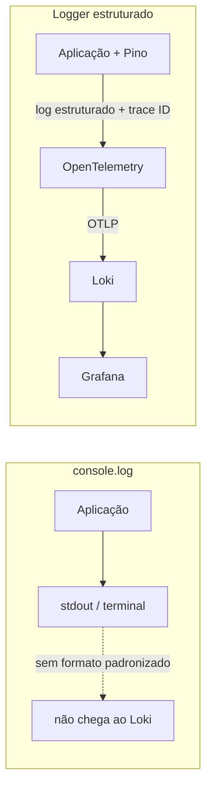
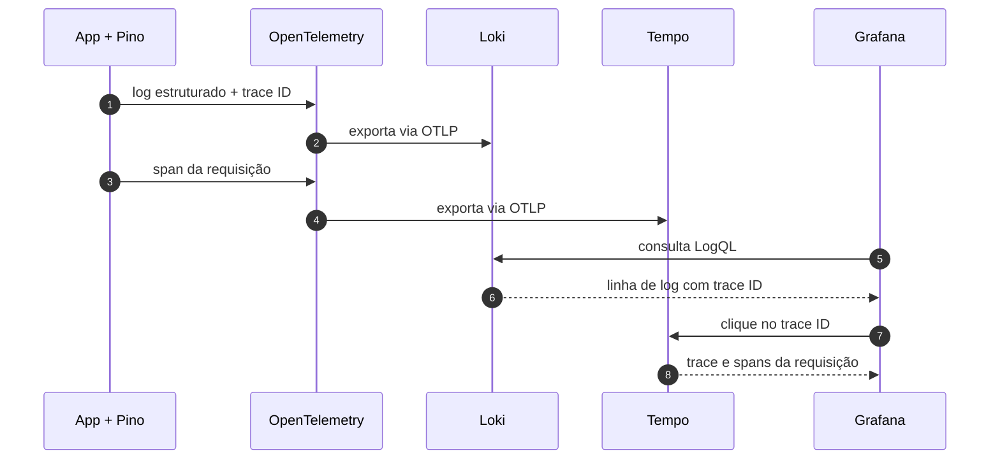

# Formatando os Nossos Logs

## Introdução e contexto

Na aula anterior, colocamos a aplicação para enviar **traces** e **métricas**
para o Grafana usando o **OTLP** — veja
[Enviando Traces para Grafana](./5%20-%20Enviando%20Traces%20para%20Grafana.md).
Faltava o terceiro pilar: os **logs**.

A aplicação já tinha um `console.log("http server running")`, e ele aparecia
normalmente no terminal. No entanto, ao abrir o **Loki** no Grafana, não havia
nada. O mesmo acontecia ao tentar ver logs associados a um trace no **Tempo**.

Esta aula explica por que isso acontece e mostra como trocar o `console.log` por
um **logger estruturado** — o **Pino** — para que os logs sejam formatados,
enviados pelo OpenTelemetry e fiquem disponíveis no Grafana, correlacionados com
os traces.

## Por que o console.log não aparece no Loki

O `console.log` é uma ferramenta de **debug local**. Ele escreve uma linha no
`stdout`, mas não carrega uma estrutura padronizada: não tem nível de severidade,
não separa campos e não inclui automaticamente o **trace ID** da requisição.

O OpenTelemetry não transforma qualquer `console.log` em log de observabilidade.
É preciso usar uma biblioteca que produza logs em um formato que a instrumentação
consiga reconhecer e encaminhar. É por isso que o log aparecia no terminal, mas
não no agregador.



O mesmo raciocínio vale para outras linguagens: `console.log`, `print` ou
equivalents são úteis para desenvolver, mas não substituem um logger de
produção. Logar é diferente de imprimir uma mensagem qualquer.

| `console.log` | Logger estruturado |
| --- | --- |
| texto livre | campos e metadados |
| sem nível de severidade | `debug`, `info`, `warn`, `error`, `fatal` |
| sem contexto de trace | pode incluir `traceId` e `spanId` |
| difícil de filtrar | fácil de consultar por labels |
| pensado para debug local | pensado para observabilidade |

## Pino: um logger para Node e TypeScript

No ecossistema Node/TypeScript, uma das opções mais usadas é o **Pino**. Ele é
rápido, produz logs em **JSON** e permite definir níveis, contexto e
transportes.

Para o nosso caso, usamos dois pacotes:

```bash
pnpm add pino pino-pretty
```

- **`pino`** — o logger em si, que produz os registros estruturados;
- **`pino-pretty`** — um transporte que formata a saída para leitura humana no
  terminal, com cores e data legível.

> **Importante:** o `pino-pretty` é útil no desenvolvimento. Em produção, o
> ideal é manter a saída em **JSON**, que é mais fácil de parsear e indexar por
> ferramentas de observabilidade.

## Criando a abstração de logger

Em vez de espalhar `console.log` pelo projeto, criamos uma abstração central.
No projeto do curso, isso fica em `src/infra/logger.ts`:

```ts
import pino from "pino";

export const log = pino({
  name: "dev",
  level: "debug",
  transport: {
    target: "pino-pretty",
    options: {
      colorize: true,
      levelFirst: true,
      translateTime: "SYS:standard",
    },
  },
});
```

Entendendo a configuração:

| Opção | Efeito |
| --- | --- |
| `name` | nome lógico do logger |
| `level: "debug"` | emite `debug` e todos os níveis acima |
| `transport.target` | usa o `pino-pretty` para formatar a saída |
| `colorize` | adiciona cores por nível |
| `levelFirst` | coloca o nível antes da mensagem |
| `translateTime` | formata o timestamp para leitura humana |

O nível funciona como um **limiar**: com `debug`, aparecem `debug`, `info`,
`warn`, `error` e `fatal`; com `info`, os `debug` são descartados. Isso permite
aumentar o detalhe durante a investigação e reduzir o volume em produção.

## Usando o logger na aplicação

Com a abstração criada, basta importar o `log` e trocar as chamadas:

```ts
import { log } from "./infra/logger.ts";

log.info("http server running");
```

No **health check**, podemos registrar que a rota foi acessada:

```ts
log.info("acessei a rota e deu certo");
```

E, em um bloco `try/catch`, o logger ajuda a registrar o erro com contexto:

```ts
try {
  // operação
} catch (error) {
  log.error({ err: error }, "falha ao processar a requisição");
}
```

As chamadas disponíveis incluem `log.debug`, `log.info`, `log.warn`,
`log.error` e `log.fatal`. Use cada nível com intenção:

- **debug** — detalhes para investigação local;
- **info** — eventos normais e marcos da aplicação;
- **warn** — situação inesperada que não interrompe o fluxo;
- **error** — falha que precisa de atenção;
- **fatal** — erro que impede a aplicação de continuar.

Evite mensagens genéricas como “erro”. Prefira algo que responda **o que**
aconteceu e **em qual contexto**: rota, operação, identificador da entidade e,
quando fizer sentido, o erro serializado.

## O que muda no Grafana

Depois de reiniciar a aplicação com o Pino, os logs passam a aparecer no
**Loki**. No **Explore**, é possível:

- filtrar pelo **service name** `FTR Upload`;
- filtrar por nível, como `info` ou `error`;
- usar o **Builder** para montar a consulta visualmente;
- usar o modo **Code** para escrever **LogQL**;
- abrir uma linha e inspecionar os campos disponíveis.

Uma consulta inicial no modo Code pode ser parecida com:

```logql
{service_name="FTR Upload"} |= "error"
```

Os nomes das labels podem variar conforme a configuração da stack; o Builder
ajuda a descobrir os campos reais. Quando o log é JSON, também é possível
parsear os campos com `| json` para filtrar por atributos específicos.

### Campos que aparecem no log

Além da mensagem e do horário, o log estruturado traz metadados úteis:

- `service.name` — nome da aplicação;
- `service.instance.id` — identificação da instância;
- `os.type` — sistema operacional, como `Darwin` no macOS;
- nível do log;
- **trace ID**, quando há um trace associado.

O `trace ID` é o elo entre os pilares. A partir dele, o Grafana consegue levar
você do log até o trace correspondente — e o trace pode mostrar os logs
relacionados àquela requisição.



No Grafana Cloud, a seção de **Logs** também permite filtrar por nível e
mostra que a origem é o **OpenTelemetry**. Isso reforça a abstração: a aplicação
não conhece o Loki; ela conhece o logger e o OTLP.

## Ajustando labels e ruído

O log pode carregar muitos campos, e alguns viram **labels** no Loki. Labels
ajudam a filtrar, mas também aumentam o custo e a complexidade. Vale manter o
que é útil para a operação — serviço, ambiente, nível, instância — e evitar
transformar em label valores únicos por requisição, como IDs de usuário.

Campos de alta cardinalidade combinam mais com o **corpo do log** ou com
**traces**. Se um campo só serve para uma investigação pontual, ele não precisa
ser uma label.

## Boas práticas de logging

- **Logue eventos, não ruído.** Cada mensagem deve ter propósito.
- **Use níveis corretamente.** `debug` para investigação, `info` para o fluxo
  normal, `error` para falhas.
- **Inclua contexto.** Rota, operação, identificadores e erro.
- **Nunca logue segredos.** Tokens, senhas, documentos e dados pessoais exigem
  cuidado e, muitas vezes, redaction.
- **Mantenha o formato estruturado.** JSON em produção; `pino-pretty` apenas no
  desenvolvimento.
- **Aproveite o trace ID.** É o que conecta log, trace e métrica na investigação.
- **Cuidado com volume e custo.** Logs em excesso encarecem o armazenamento e
  dificultam a análise.
- **Centralize o logger.** Uma abstração única evita configurações divergentes
  pelo projeto.

## Limitações e cuidados

- **`pino-pretty` não é para produção.** A saída colorida e multilinha é ótima
  para o terminal, mas atrapalha parsers e agregadores.
- **Nem todo log é capturado automaticamente.** A instrumentação precisa
  reconhecer a biblioteca; `console.log` continua sendo apenas `stdout`.
- **Alta cardinalidade em labels custa caro.** Prefira manter detalhes no corpo
  do log.
- **`debug` em produção pode gerar volume excessivo.** Ajuste o nível por
  ambiente.
- **Erros precisam ser serializados corretamente.** Objetos circulares e erros
  mal formatados podem se perder ou virar `[object Object]`.
- **Correlação depende de propagação.** O trace ID só aparece no log se o
  contexto estiver disponível no momento da emissão.
- **Log não substitui trace nem métrica.** Cada pilar responde a uma pergunta
  diferente; o valor está na combinação.

## Conclusão

Nesta aula, o terceiro pilar entrou no fluxo:

- o `console.log` foi substituído por um **logger estruturado** com **Pino**;
- criamos uma abstração central em `src/infra/logger.ts`;
- os logs passaram a ser enviados pelo **OpenTelemetry** e ficaram visíveis no
  **Loki**;
- o **trace ID** permite correlacionar logs e traces no Grafana;
- ajustamos níveis e labels para manter o sinal útil e o ruído sob controle.

Com logs, métricas e traces funcionando, o próximo passo é transformar esses
dados em ação: vamos conhecer o mecanismo de **alertas** do Grafana e as
políticas de escalação em
[Conhecendo o Mecanismo de Alerta do Grafana](./7%20-%20Conhecendo%20o%20Mecanismo%20de%20Alerta%20do%20Grafana.md).

Mais adiante no módulo, veremos também a mesma aplicação rodando na AWS — em
**ECS** ou **App Runner** — apenas com as variáveis de ambiente ajustadas, e a
integração direta com o **New Relic**, para comparar com o caminho padronizado
pelo OpenTelemetry.
