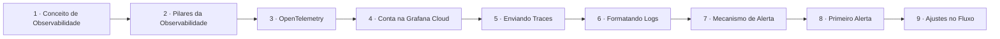

# Grafana Stack

## Índice

| # | Aula | Duração |
| --- | --- | --- |
| 1 | [Explorando o Conceito de Observabilidade](./1%20-%20Explorando%20o%20Conceito%20de%20Observabilidade.md) | 10:59 |
| 2 | [Conhecendo os Pilares da Observabilidade](./2%20-%20Conhecendo%20os%20Pilares%20da%20Observabilidade.md) | 08:31 |
| 3 | [O que é o OpenTelemetry](./3%20-%20O%20que%20%C3%A9%20o%20OpenTelemetry.md) | 05:07 |
| 4 | [Criando a Nossa Conta na Grafana Cloud](./4%20-%20Criando%20a%20Nossa%20Conta%20na%20Grafana%20Cloud.md) | 10:30 |
| 5 | [Enviando Traces para Grafana](./5%20-%20Enviando%20Traces%20para%20Grafana.md) | 15:24 |
| 6 | [Formatando os Nossos Logs](./6%20-%20Formatando%20os%20Nossos%20Logs.md) | 14:04 |
| 7 | [Conhecendo o Mecanismo de Alerta do Grafana](./7%20-%20Conhecendo%20o%20Mecanismo%20de%20Alerta%20do%20Grafana.md) | 11:12 |
| 8 | [Configurando O Nosso Primeiro Alerta](./8%20-%20Configurando%20O%20Nosso%20Primeiro%20Alerta.md) | 08:37 |
| 9 | [Alteração de Algumas Configurações no Fluxo](./9%20-%20Altera%C3%A7%C3%A3o%20de%20Algumas%20Configura%C3%A7%C3%B5es%20no%20Fluxo.md) | 11:31 |

## Sequência das aulas

