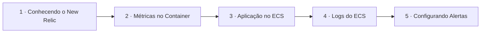

# NewRelic

## Índice

| # | Aula | Duração |
| --- | --- | --- |
| 1 | [Conhecendo o New Relic](./1%20-%20Conhecendo%20o%20New%20Relic.md) | 15:33 |
| 2 | [Testando o Envio de Métricas Dentro do Container](./2%20-%20Testando%20o%20Envio%20de%20M%C3%A9tricas%20Dentro%20do%20Container.md) | 10:30 |
| 3 | [Enviando Aplicação para ECS](./3%20-%20Enviando%20Aplica%C3%A7%C3%A3o%20para%20ECS.md) | 15:07 |
| 4 | [Analisando Logs do ECS](./4%20-%20Analisando%20Logs%20do%20ECS.md) | 04:02 |
| 5 | [Configurando Alertas](./5%20-%20Configurando%20Alertas.md) | 14:36 |

## Sequência das aulas

