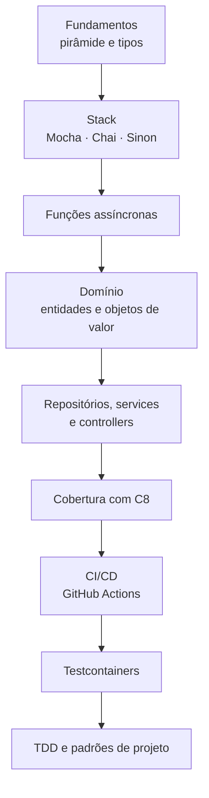
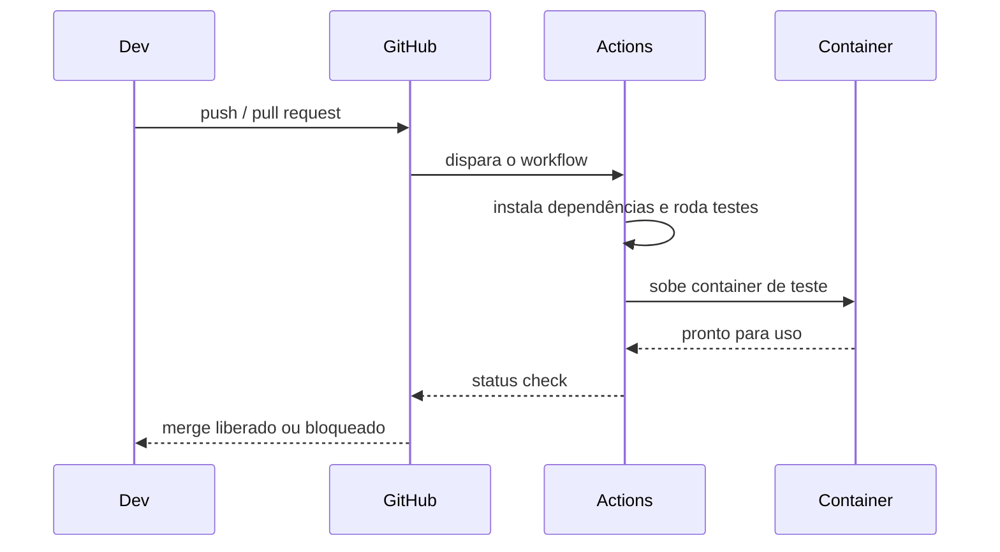

# Boas-vindas

## Introdução e contexto

Abertura do módulo de **Testes Avançados** em Node.js. A aula apresenta o
roteiro completo: da base conceitual até automação em containers e integração
contínua.

Um aviso importante aparece logo no começo: teste **não é bala de prata**. Ele
reduz a probabilidade de bugs e funciona como selo de qualidade — mas não
elimina 100% dos erros de uma aplicação.

## O que o módulo cobre

| Bloco | Conteúdo |
| --- | --- |
| **Fundamentos** | por que testar, pirâmide de testes, tipos de teste |
| **Stack** | Mocha (runner), Chai (asserções), Sinon (spies, stubs, mocks) |
| **Assincronismo** | callbacks, promises e `async/await` nos testes |
| **Camadas** | entidades, objetos de valor, repositórios, services e controllers |
| **Qualidade** | cobertura com C8 |
| **Infraestrutura** | Testcontainers com Docker |
| **Automação** | CI/CD com GitHub Actions |
| **Prática guiada** | TDD e testes dos padrões de projeto |

## A pirâmide como fio condutor

O curso parte da **pirâmide de testes**, estrutura clássica que organiza os
tipos de teste por quantidade e custo:

- **unitários** na base, muitos e rápidos;
- **integração** no meio, verificando a colaboração entre partes;
- **fim a fim** no topo, poucos e caros, simulando o usuário.

A base sustenta o resto: sem unidades confiáveis, testar a integração vira
tentativa e erro.

## A stack

| Ferramenta | Responsabilidade |
| --- | --- |
| **Mocha** | framework/runner que organiza e executa os testes |
| **Chai** | asserções (`expect`, `assert`, `should`) |
| **Sinon** | mocks, spies e stubs para simular dependências |

A combinação é usada em projetos reais no mundo inteiro: o Mocha executa, o
Chai verifica e o Sinon substitui o que não deveria estar no teste.

## Do domínio à infraestrutura

O módulo percorre as camadas de uma aplicação de agendamento de consultas:

1. **entidades** e **objetos de valor** (domínio rico, com DDD);
2. **repositórios** (persistência isolada);
3. **services** (regras de orquestração);
4. **controllers** (entrada da API).

Arquitetura em camadas e hexagonal aparecem juntas porque são próximas — e
porque a testabilidade muda conforme a fronteira entre as camadas.

## Automação e produção

Dois temas fecham o ciclo:

- **CI/CD com GitHub Actions**: os testes rodam a cada push e o merge só é
  liberado quando a suíte passa. Aulas mostram a criação do workflow em YAML e
  as regras de proteção de branch.
- **Testcontainers**: containers Docker sobem dependências reais (como um banco
  de dados) durante o teste, aproximando o cenário do mundo real e reduzindo a
  dependência de mocks.

## TDD e padrões de projeto

O encerramento conecta testes com **Test Driven Development** (vermelho →
verde → refatorar) e com padrões já conhecidos: **Factory Method**, **Builder**,
**Singleton** e **Strategy**. Cada padrão é testado com as ferramentas do
módulo, mostrando como a estrutura de classes influencia o teste.

## Benefícios

- **Base conceitual sólida** antes das ferramentas.
- **Stack única** para todo o módulo.
- **Progressão realista**: função pura → domínio → API → containers → CI.
- **Qualidade mensurável** com cobertura de código.
- **Automação** como parte do fluxo de trabalho, não como etapa opcional.

## Limitações e cuidados

- **Teste não garante ausência de bugs**: reduz a probabilidade.
- **Cobertura alta não é qualidade**: 100% de linhas não prova correção.
- **Mock em excesso** esconde problemas de integração — daí o Testcontainers.
- **Suíte lenta** desestimula execução local; mantenha o feedback curto.
- **Muita ferramenta nova ao mesmo tempo**: o módulo distribui a complexidade ao
  longo das aulas, mas prática é indispensável.

## Conclusão

O módulo entrega um percurso completo de testes em Node: fundamentos, stack,
assincronismo, camadas, cobertura, containers, CI/CD e TDD aplicado a padrões.

A próxima aula começa pela pergunta básica: afinal, o que são testes de software
e qual o papel de cada tipo na pirâmide?

<!-- commit de referência: módulo inicial -->
