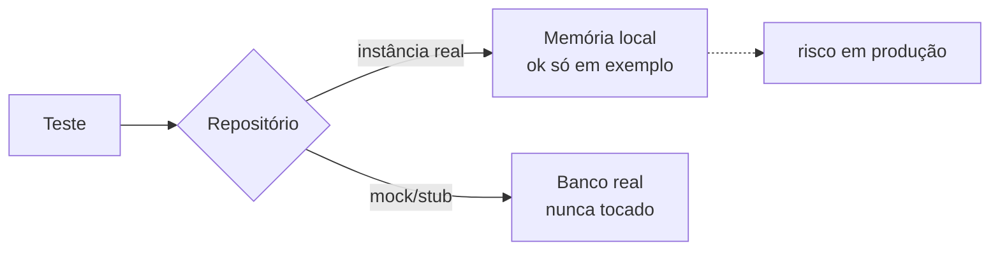
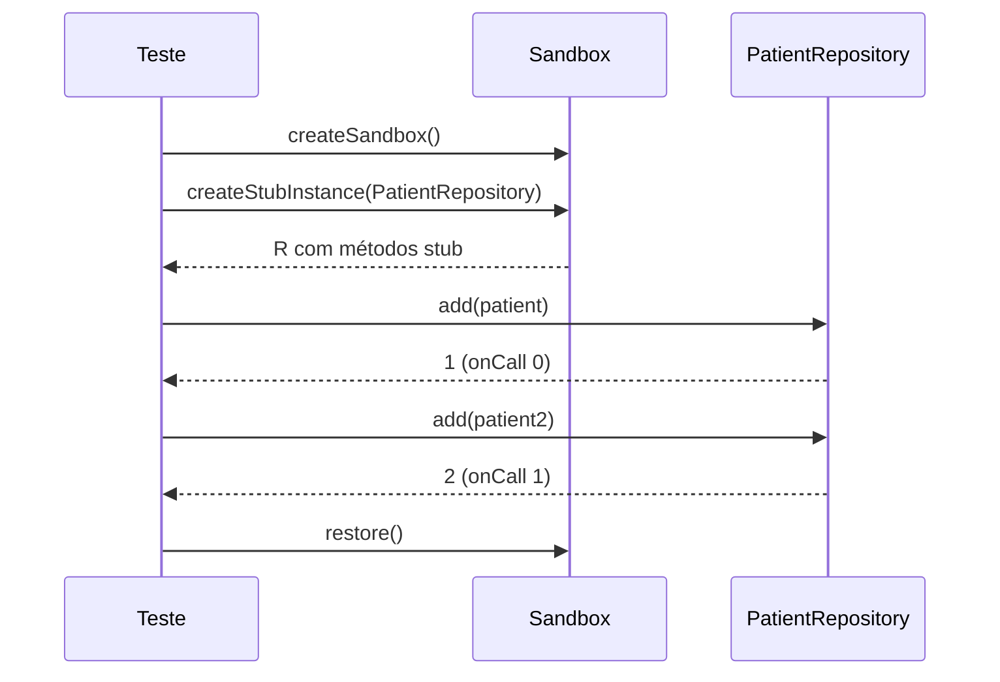

# Testando Repositórios

## Introdução e contexto

Repositórios concentram o acesso às entidades — adicionar, buscar, atualizar e
remover. Nesta etapa ainda não existe banco de dados: a persistência é simulada
com **`Map`** em memória, o que permite focar no comportamento.

A aula mostra dois níveis: o repositório genérico e o `PatientRepository`, onde
o **Sinon** passa a ser usado de forma sistemática.

## O repositório genérico

```js
class Repository {
  constructor() {
    this.items = new Map()
  }

  add(entity) {
    if (this.items.has(entity.id)) {
      throw new Error('Entity already exists')
    }
    this.items.set(entity.id, entity)
    return entity
  }
  // findById, findAll, update, delete
}
```

| Método | Regra |
| --- | --- |
| `add` | lança exceção se o `id` já existe |
| `findById` | retorna a entidade ou `undefined` |
| `findAll` | devolve um array com todos os itens |
| `update` | lança exceção se a entidade não existe |
| `delete` | remove e retorna a entidade; lança se não existe |

Como é uma base para todos os repositórios, testá-la diretamente faz sentido:
qualquer subclasse herda esse contrato.

## O risco de testar contra o "banco"

Testar o repositório genérico usando a instância real é aceitável porque não há
banco de verdade. Em um sistema conectado, isso seria um problema: cada teste
poderia **alterar dados reais**.

A regra aparece na aula:

> Se isso fosse o banco de dados de verdade, tudo o que fizéssemos aqui poderia
> alterar o banco real — por isso devemos mocar.



## O PatientRepository

Fica em `src/infrastructure/persistence/PatientRepository.js` e herda de
`Repository`:

```js
class PatientRepository extends Repository {
  #currentId = 0

  add(patient) {
    this.#currentId += 1
    return super.add({ ...patient, id: this.#currentId })
  }

  findByName(name) { /* filtra por nome */ }
  findByBloodType(type) { /* filtra por tipo sanguíneo */ }
}
```

- o **id é gerado automaticamente** (emulado com contador);
- `findByName` e `findByBloodType` são consultas específicas do domínio;
- os demais métodos vêm da superclasse.

## Isolamento com sandbox

Cada teste cria um **sandbox** do Sinon — um contêiner que agrupa stubs e mocks:

```js
let sandbox

beforeEach(() => {
  sandbox = sinon.createSandbox()
  patientRepository = sandbox.createStubInstance(PatientRepository)
  // ...
})

afterEach(() => {
  sandbox.restore()
})
```

`createStubInstance` substitui **todos** os métodos da classe por stubs, que
retornam `undefined` por padrão. Por isso o teste precisa definir os retornos:

```js
sandbox.stub(PatientRepository.prototype, 'add')
  .onCall(0).returns(1)
  .onCall(1).returns(2)
```

| Recurso | Efeito |
| --- | --- |
| `createSandbox` | agrupa as simulações de um teste |
| `restore` | desfaz tudo ao final |
| `onCall(0/1)` | define retornos diferentes por chamada |
| `sinon.assert` | asserções próprias do Sinon |



## O que os testes cobrem

| Cenário | Verificação |
| --- | --- |
| id automático | primeiro paciente recebe `1`, segundo recebe `2` |
| `findByName` | retorna os dois pacientes "Alice", na ordem esperada |
| `findByBloodType` | retorna a lista do tipo sanguíneo solicitado |
| `add` | `sinon.assert` confirma a chamada com o paciente esperado |

O total da suíte chega a **45 testes**, todos rápidos.

## Benefícios

- **Contrato do repositório protegido**: duplicidade e ausência são testadas.
- **Dados fora do banco real**: sandbox isola qualquer efeito.
- **Testes determinísticos**: ids e retornos controlados por stub.
- **Cobertura de métodos específicos** (`findByName`, `findByBloodType`).
- **Base pronta** para services, que dependem de repositórios.

## Limitações e cuidados

- **Stub em excesso** testa o mock, não o repositório: quando possível, prefira
  um banco em memória ou Testcontainers.
- **`createStubInstance` retorna `undefined`** em tudo; sem configurar retornos,
  o teste falha de forma confusa.
- **Contador de id manual** é uma emulação frágil; em produção quem gera é o
  banco.
- **Sandbox sem `restore`** vaza stubs para os próximos testes.
- **Ordem de listas** pode variar; compare com cuidado.

## Conclusão

Testar repositórios exige duas decisões: o que é contrato genérico e o que é
específico do domínio, e como isolar a persistência. Sandbox + stubs resolvem a
segunda.

A próxima aula sobe para a camada de **serviços**, onde o repositório entra por
injeção de dependência.

<!-- commit de referência: e5af2aa2 -->
