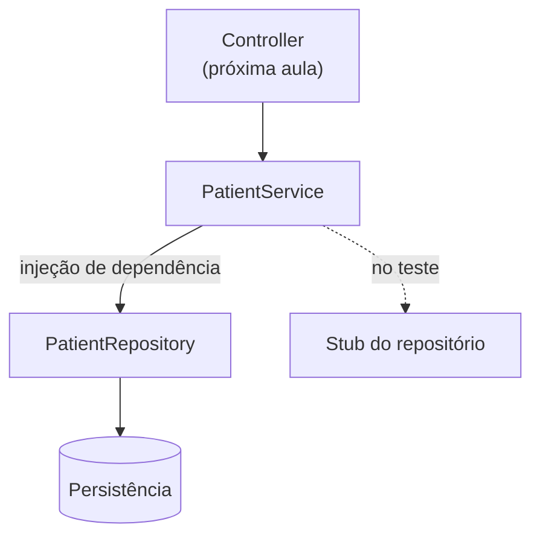
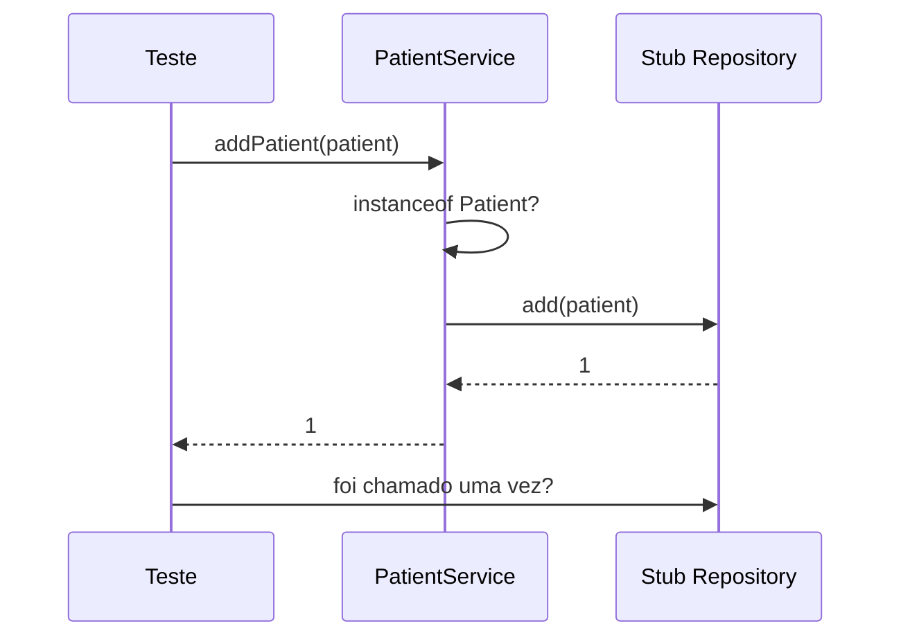

# Testando Services - Parte 1

## Introdução e contexto

O **service** é a camada que orquestra as regras de negócio e conversa com o
repositório. Ele existe em qualquer arquitetura — em camadas ou hexagonal —
porque o cliente não deve acessar o repositório diretamente.

Esta aula apresenta o `PatientService` e monta toda a infraestrutura de teste:
sandbox, stub do repositório e dados de exemplo.

## O serviço

```js
class PatientService {
  #repository

  constructor(repository) {
    this.#repository = repository
  }

  addPatient(patient) {
    if (!(patient instanceof Patient)) {
      throw new Error('Invalid patient')
    }
    return this.#repository.add(patient)
  }
}
```

O repositório chega por **injeção de dependência**: o serviço não sabe (nem
deveria saber) como instanciá-lo. Em produção entra o `PatientRepository`; no
teste entra um stub.

## Os métodos

| Método | Comportamento |
| --- | --- |
| `addPatient` | valida a instância e delega ao repositório |
| `findAllPatients` | lista todos os pacientes |
| `findPatientById` | retorna o paciente ou `null` |
| `updatePatient` | atualiza apenas os campos enviados |
| `deletePatient` | remove e devolve o paciente |
| `findPatientByName` | busca por nome |
| `findPatientsByBloodType` | busca por tipo sanguíneo |

Detalhes importantes:

- **`updatePatient` é parcial**: nome, telefone, e-mail, contato de emergência e
  endereço são atualizados só se vierem na chamada.
- **`findPatientById` devolve `null`** em vez de lançar exceção — a decisão de
  como tratar ausência fica para a camada superior.
- **`deletePatient`** reaproveita a busca e lança erro se o paciente não existe.



## Montando o cenário de teste

```js
let patientService
let patientRepository
let sandbox

beforeEach(() => {
  sandbox = sinon.createSandbox()
  patientRepository = sandbox.createStubInstance(PatientRepository)
  patientService = new PatientService(patientRepository)
})
```

| Variável | Papel |
| --- | --- |
| `patientService` | objeto sob teste |
| `patientRepository` | stub — nenhum banco é tocado |
| `sandbox` | agrupa e restaura as simulações |

Repare que o serviço é instanciado com o **stub**, não com o repositório real.
O teste não depende de `Map`, arquivo ou banco.

## Dados de apoio

```js
const mockPatientData = {
  identificationNumber: '123',
  name: 'John Doe',
  birthDate: '1990-01-01',
  // ...
}
```

Os campos menos relevantes ficam vazios de propósito: endereço, contato de
emergência e a própria entidade já foram testados nas aulas anteriores.
Repetir essas validações aqui só aumentaria o ruído.

## Configurando retornos

Um `createStubInstance` retorna `undefined` em todos os métodos. Para o cenário
funcionar, cada retorno precisa ser definido:

```js
patientRepository.add.returns(1)
patientRepository.findById.withArgs(1).returns(patient)
```

| Configuração | Efeito |
| --- | --- |
| `.returns(1)` | sempre retorna o id 1 |
| `.withArgs(1)` | só responde ao argumento 1 |
| `.onCall(0/1)` | retorno diferente por chamada |

Um detalhe específico: como o `id` normalmente é gerado pelo repositório, no
teste ele viria `undefined`. Para permitir a comparação, o paciente ganha um
método auxiliar `_setId(1)` usado **apenas** no ambiente de teste.



## Cuidados com estado

`beforeEach` recria sandbox, repositório e serviço. `afterEach` restaura:

```js
afterEach(() => {
  sandbox.restore()
})
```

Sem isso, um teste que altera o paciente ou configura um stub afeta o seguinte —
o clássico efeito dominó em suítes grandes.

## Benefícios

- **Isolamento total**: nenhuma dependência de persistência.
- **Serviço testado no contrato real** (mesma assinatura de produção).
- **Retornos controlados** para cada cenário.
- **Base pronta** para testar erros na próxima aula.
- **Dados reaproveitados** entre testes com `beforeEach`.

## Limitações e cuidados

- **Stub configurado demais** acaba testando o próprio stub.
- **`undefined` inesperado**: esquecer um `.returns()` gera falha confusa.
- **`_setId` só existe no teste**: não confunda com API pública.
- **Testar campos já cobertos** em entidades e objetos de valor é redundante.
- **Sandbox não restaurado** contamina a suíte inteira.

## Conclusão

O serviço é testado com o repositório substituído por um stub dentro de um
sandbox. A estrutura `beforeEach` + `afterEach` garante isolamento e os dados de
apoio evitam repetição.

A próxima aula escreve os testes em si: cenários positivos e negativos de cada
método.

<!-- commit de referência: 963e7e3f -->
