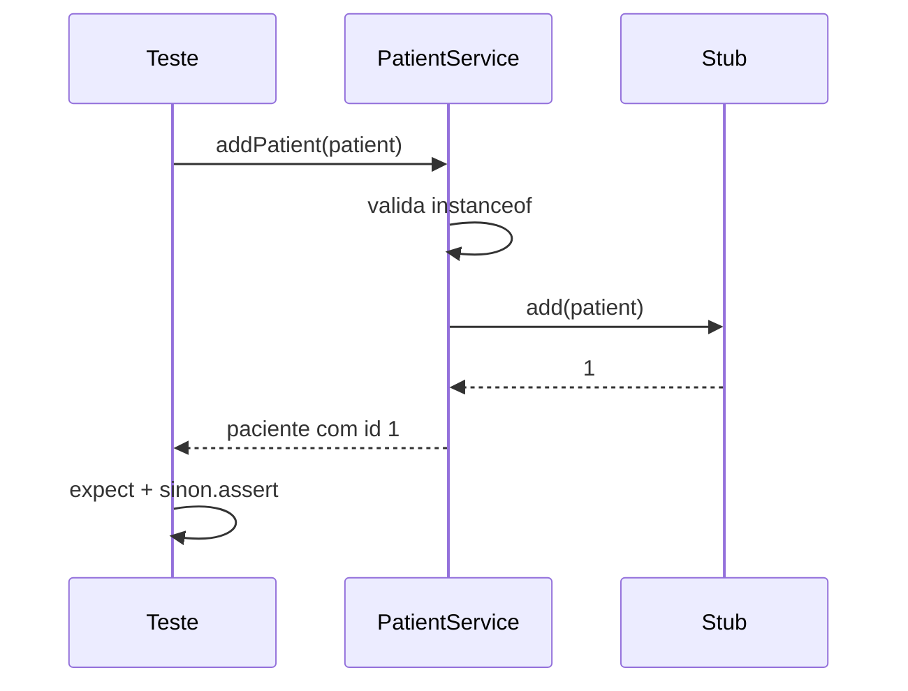
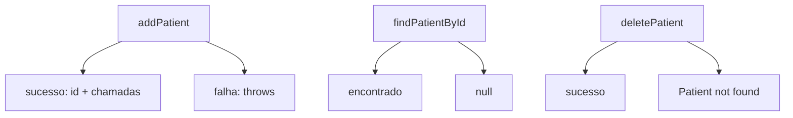

# Testando Services - Parte 2

## Introdução e contexto

Com o cenário montado, a aula escreve os testes do `PatientService`: o caminho
feliz do cadastro, o caminho de falha, a busca por id, a remoção e as exceções
de paciente inexistente.

É o primeiro contato com **asserções de exceção** e com a verificação de que o
repositório foi chamado corretamente.

## Estrutura dos testes

```js
describe('PatientService', () => {
  describe('addPatient', () => {
    it('deve adicionar um paciente e retornar o id', () => {
      /* ... */
    })

    it('deve lançar erro quando a persistência falha', () => {
      /* ... */
    })
  })
})
```

`describe` aninhado separa por método; cada `it` representa um cenário. O
relatório do Mocha passa a ler como uma especificação.

## Cenário positivo: adicionar paciente

```js
const patient = new Patient(mockPatientData)

const result = patientService.addPatient(patient)

expect(result).to.be.instanceOf(Patient)
expect(result.id).to.equal(1)
expect(result.name).to.equal('John Doe')
sinon.assert.calledOnce(patientRepository.add)
sinon.assert.calledWith(patientRepository.add, patient)
```

| Verificação | O que garante |
| --- | --- |
| `instanceOf(Patient)` | o serviço devolveu a entidade correta |
| `id === 1` | o id do stub foi propagado |
| `name` | os dados não foram perdidos no caminho |
| `calledOnce` | o repositório foi acionado uma única vez |
| `calledWith` | o argumento é o próprio paciente |

Não é necessário testar todos os campos: a entidade `Patient` já tem testes
próprios. Aqui interessa o **fluxo** — receber, validar, delegar, devolver.



## Cenário negativo: falha ao salvar

```js
patientRepository.add.throws(new Error('Fail to save patient'))

expect(() => patientService.addPatient(patient))
  .to.throw('Fail to save patient')
```

O padrão é sempre o mesmo: configura o stub para falhar, envolve a chamada em
uma função (`() => ...`) e verifica a exceção com `expect(...).to.throw(...)`.

O detalhe didático da aula: trocar a mensagem esperada (`patient` por
`paciente`) faz o teste falhar — a asserção compara o **texto** do erro.

## Busca por id

```js
it('deve retornar o paciente quando encontrado', () => {
  const result = patientService.findPatientById(1)
  expect(result).to.be.instanceOf(Patient)
  sinon.assert.calledOnce(patientRepository.findById)
})

it('deve retornar null quando não encontrado', () => {
  patientRepository.findById.withArgs(99).returns(null)
  expect(patientService.findPatientById(99)).to.be.null
})
```

Dois cenários, um contrato: encontrado devolve a entidade, não encontrado devolve
`null`. O serviço não decide o que fazer com a ausência — isso fica para o
controller (próxima aula, com status 404).

## Remoção

```js
it('deve deletar um paciente existente', () => {
  const result = patientService.deletePatient(1)
  expect(result.id).to.equal(1)
})

it('deve lançar erro quando o paciente não existe', () => {
  patientRepository.findById.withArgs(99).returns(null)
  expect(() => patientService.deletePatient(99))
    .to.throw('Patient not found')
})
```

Aqui o serviço assume a responsabilidade de verificar existência antes de
remover — por isso a exceção.

## Cobertura de comportamento

| Método | Casos testados |
| --- | --- |
| `addPatient` | sucesso e falha na persistência |
| `findPatientById` | encontrado e não encontrado |
| `deletePatient` | sucesso e paciente inexistente |
| `findAllPatients` | lista (inclusive vazia) |
| `findPatientByName` | nome existente e inexistente |
| `findPatientsByBloodType` | tipo com e sem resultados |

Para listas, vale a pena garantir o retorno de **array vazio** quando não há
registros — é o caso que costuma quebrar o front-end.

## Rodando apenas o serviço

```sh
npx mocha test/domain/services/PatientService.test.js
```

O relatório mostra os cenários individuais. Rodar a suíte inteira continua sendo
o passo antes de integrar.



## Benefícios

- **Fluxo verificado**, não apenas o retorno.
- **Interação com o repositório assegurada** (`calledOnce`, `calledWith`).
- **Erros previstos** viram testes, não surpresas em produção.
- **Relatório legível** como especificação do serviço.
- **Base para TDD**: os cenários podem ser escritos antes da implementação.

## Limitações e cuidados

- **Testar demais os campos** repete o que entidades e value objects já cobrem.
- **Asserção de mensagem exata** é frágil: qualquer ajuste no texto quebra o
  teste.
- **`throws` sem função** (`expect(fn()).to.throw`) executa antes da verificação
  e falha de forma obscura.
- **Verificar chamadas internas demais** engessa a refatoração.
- **Falta de teste de lista vazia** deixa o caso de borda descoberto.

## Conclusão

O service é testado pelo comportamento: o que retorna, o que lança e como se
comunica com o repositório. Stubs e sandbox mantêm o teste isolado e rápido.

A próxima camada é a que o cliente enxerga: **controllers**, com status HTTP e
requisição/resposta.

<!-- commit de referência: b83273de -->
