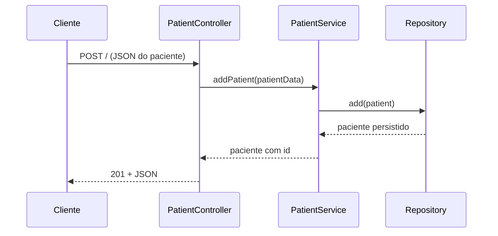
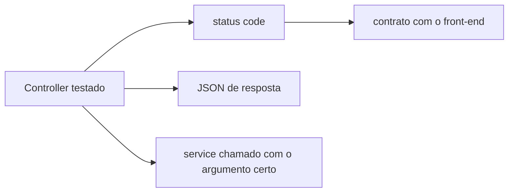

# Testando Controllers - Parte 1

## Introdução e contexto

O **controller** é a porta de entrada da API: recebe a requisição HTTP, chama o
service e devolve a resposta com o status correto. Depois de testar entidades,
objetos de valor, repositórios e services, chega a camada que o cliente enxerga.

A aula apresenta o `PatientController`, suas rotas e o esqueleto do teste.

## O controller

```js
import express from 'express'

export class PatientController {
  constructor(patientService) {
    this.router = express.Router()
    this.patientService = patientService
    this.initializeRoutes()
  }

  initializeRoutes() {
    this.router.post('/', this.createPatient.bind(this))
    this.router.get('/', this.getAllPatients.bind(this))
    this.router.get('/:id', this.getPatientById.bind(this))
    this.router.put('/:id', this.updatePatient.bind(this))
    this.router.delete('/:id', this.deletePatient.bind(this))
    this.router.get('/search/name/:name', this.getPatientByName.bind(this))
    this.router.get('/search/bloodType/:bloodType', this.getPatientByBloodType.bind(this))
  }
}
```

| Rota | Ação |
| --- | --- |
| `POST /` | cria paciente |
| `GET /` | lista todos |
| `GET /:id` | busca por id |
| `PUT /:id` | atualiza |
| `DELETE /:id` | remove |
| `GET /search/name/:name` | busca por nome |
| `GET /search/bloodType/:bloodType` | busca por tipo sanguíneo |

O service entra por **injeção de dependência** — o controller não instancia nada
além do próprio router.

## Mudança importante: DTO em vez de entidade

O controller passa a receber `patientData` (o corpo da requisição) e não mais
uma instância de `Patient`:

```js
async createPatient(req, res) {
  try {
    const createdPatient = await this.patientService.addPatient(req.body)
    res.status(201).json(createdPatient)
  } catch (error) {
    res.status(400).json({ error: error.message })
  }
}
```

O motivo é evitar **redundância cíclica**: se o controller montasse a entidade,
ele repetiria a responsabilidade do service. O controller apenas transporta
dados.

## Status codes

| Situação | Status |
| --- | --- |
| criação bem-sucedida | `201` |
| requisição inválida / erro do service | `400` |
| listagem ou busca com sucesso | `200` |
| paciente não encontrado | `404` |
| erro interno | `500` |

Cada método usa `try/catch` e devolve `{ error: error.message }` em caso de falha.
A aula sugere tratar erros individualmente em vez de generalizar tudo em `400`.



## O esqueleto do teste

```js
let patientController
let patientService
let sandbox

beforeEach(() => {
  sandbox = sinon.createSandbox()
  patientService = sandbox.createStubInstance(PatientService)
  patientController = new PatientController(patientService)
})

afterEach(() => {
  sandbox.restore()
})
```

| Variável | Papel |
| --- | --- |
| `patientController` | objeto sob teste |
| `patientService` | stub — nenhuma regra real é executada |
| `sandbox` | isolamento e restauração |

O mesmo `mockPatientData` usado nos testes de service é reaproveitado: endereço e
contato de emergência ficam genéricos porque já foram validados antes.

## Por que testar controller

| Motivo | Consequência |
| --- | --- |
| contrato HTTP | status code e corpo corretos |
| integração controller ↔ service | chamada com o parâmetro certo |
| tratamento de erro | exceções viram respostas adequadas |
| independência do banco | tudo é simulado |



## Benefícios

- **Contrato da API verificável** sem subir servidor.
- **Status codes** garantidos por teste.
- **Isolamento** com service stubado.
- **Reuso** de dados e padrões das aulas anteriores.
- **Base para testes de integração** mais adiante.

## Limitações e cuidados

- **Não é teste de integração**: aqui o service é stub; o caminho HTTP real não é
  exercitado.
- **`try/catch` genérico** esconde erros diferentes no mesmo `400`.
- **`bind(this)`** é obrigatório nas rotas; sem ele, `this.patientService` falha.
- **Status incorreto** quebra o front-end mesmo com lógica certa.
- **Testar controller específico demais** acopla o teste à implementação.

## Conclusão

O controller é a camada que traduz HTTP em chamadas de domínio. O teste verifica
status, corpo e argumentos — com o service substituído por stub.

A próxima aula escreve o teste de criação e busca por id.

<!-- commit de referência: 66e62339 -->
