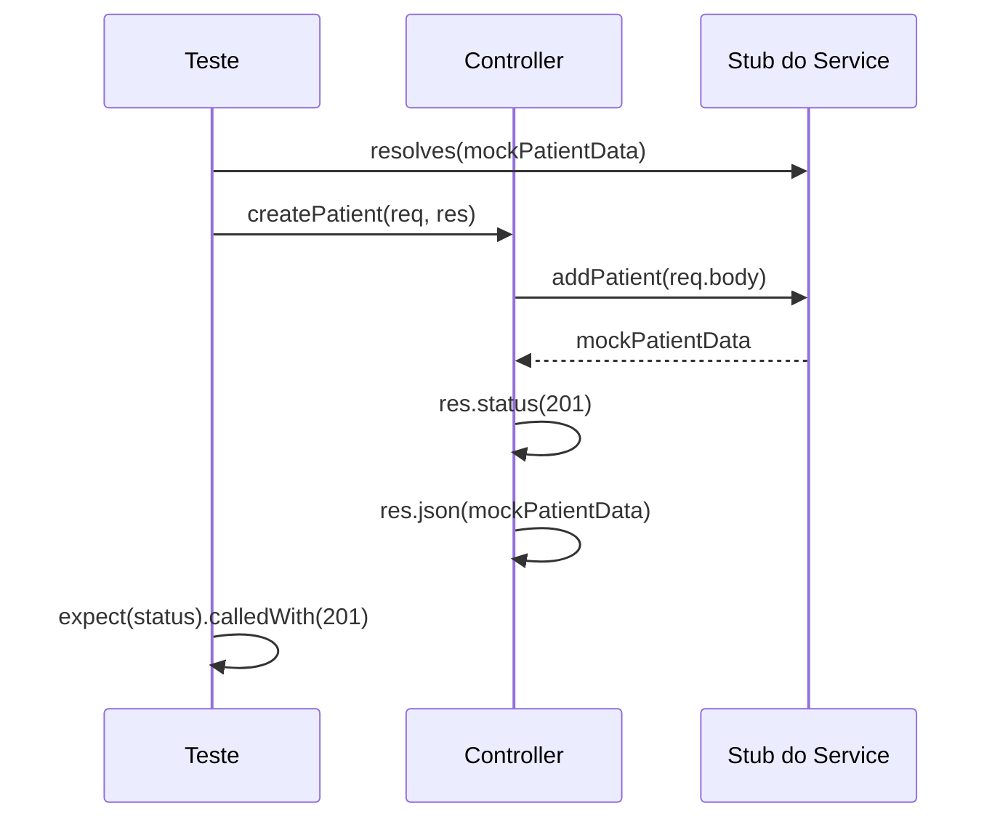

# Testando Controllers - Parte 2

## Introdução e contexto

Esta aula implementa os dois primeiros cenários do CRUD: **criação** e **busca
por id**. O padrão é sempre o mesmo: montar `req`/`res` falsos, forçar o retorno
do service e verificar o status e o corpo da resposta.

## Mocks de requisição e resposta

```js
const req = { body: mockPatientData, params: {} }
const res = {
  status: sinon.stub().returnsThis(),
  json: sinon.stub().returnsThis(),
}
```

| Objeto | Conteúdo |
| --- | --- |
| `req.body` | dados enviados pelo cliente |
| `req.params` | parâmetros da rota (`:id`) |
| `res.status` | stub que devolve `this` para encadear |
| `res.json` | stub que captura o corpo devolvido |

O `returnsThis()` é o detalhe que permite `res.status(201).json(...)`, exatamente
como no Express.

## Cenário: criar paciente

```js
patientService.addPatient.resolves(mockPatientData)

await patientController.createPatient(req, res)

sinon.assert.calledWith(patientService.addPatient, mockPatientData)
expect(res.status.calledWith(201)).to.be.true
expect(res.json.calledWith(mockPatientData)).to.be.true
```

| Verificação | Garante |
| --- | --- |
| `calledWith` no service | o body foi repassado sem alteração |
| `status(201)` | criação reportada corretamente |
| `json(...)` | o paciente persistido voltou para o cliente |

O `resolves` é essencial: `addPatient` é assíncrono, então o stub precisa devolver
uma promise resolvida. Sem isso, o `await` recebe `undefined`.



## Cenário: buscar paciente por id

```js
const req = { params: { id: 1 } }
patientService.findPatientById.resolves(patient)

await patientController.getPatientById(req, res)

expect(res.status.calledWith(200)).to.be.true
```

### Quando não encontra

```js
patientService.findPatientById.resolves(null)

await patientController.getPatientById(req, res)

expect(res.status.calledWith(404)).to.be.true
expect(res.json.calledWith({ error: 'Patient not found' })).to.be.true
```

O controller traduz `null` em **404** — decisão que ficou fora do service de
propósito.

## O fluxo completo


## Por que testar cada status

| Caso | Status esperado | Risco se faltar teste |
| --- | --- | --- |
| criação ok | `201` | front recebe 200 e não sabe que criou |
| não encontrado | `404` | cliente trata como erro genérico |
| erro no service | `400`/`500` | resposta inconsistente |

Status code é contrato. Um teste que só verifica o JSON não pega um `200` no lugar
de `201`.

## Executando

```sh
npx mocha test/interfaces/controllers/PatientController.test.js
```

O relatório mostra cada cenário separadamente — o que ajuda a localizar a falha
quando o contrato muda.

## Benefícios

- **Contrato HTTP protegido** sem subir servidor.
- **Verificação de argumentos** entre camadas.
- **Cenários de erro explícitos** (404).
- **Rápido**: tudo em memória.
- **Padrão reutilizável** para todos os endpoints.

## Limitações e cuidados

- **`returnsThis()` ausente** quebra o encadeamento e o teste falha de forma
  estranha.
- **`resolves` esquecido** faz o controller receber `undefined`.
- **Testar só o caminho feliz** deixa o 404 e o 400 descobertos.
- **Mocks frágeis**: mudar a assinatura do service exige atualizar os testes.
- **Isso não prova o Express**: rota, middleware e parsing só aparecem em teste
  de integração.

## Conclusão

Criação e busca por id mostram o padrão completo: dublê de `req`/`res`, stub do
service, asserções de status e corpo. O 404 fecha o contrato de ausência.

A próxima aula cobre remoção e atualização, incluindo promise rejeitada.

<!-- commit de referência: 5af8f069 -->
