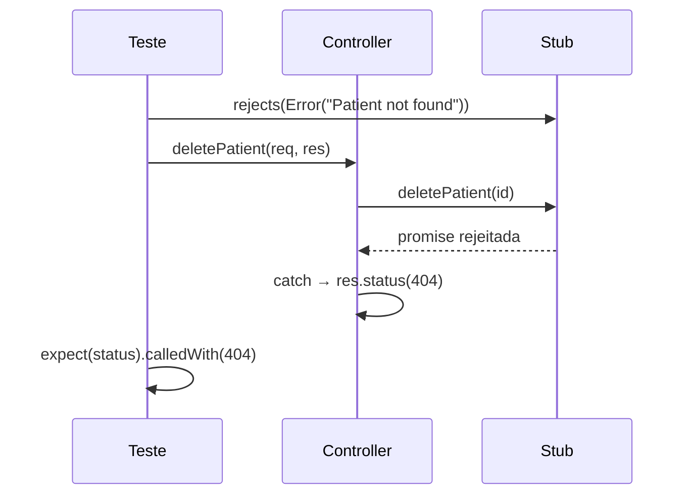
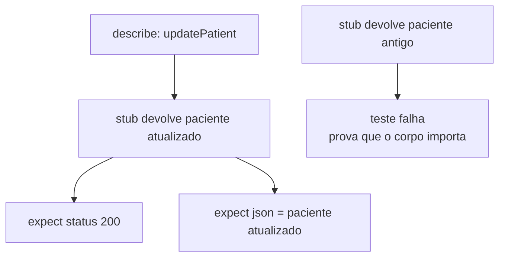
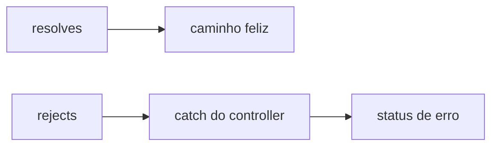

# Testando Controllers - Parte 3

## Introdução e contexto

A aula fecha o CRUD testando **remoção** e **atualização** de pacientes. O
diferencial é o cenário de falha com **promise rejeitada** — a forma de simular
um erro do service sem quebrar o teste.

## Remoção

```js
async deletePatient(req, res) {
  try {
    const { id } = req.params
    const deleted = await this.patientService.deletePatient(id)
    res.status(200).json(deleted)
  } catch (error) {
    res.status(404).json({ error: error.message })
  }
}
```

### Sucesso

```js
const req = { params: { id: 1 } }
patientService.deletePatient.resolves(patient)

await patientController.deletePatient(req, res)

expect(res.status.calledWith(200)).to.be.true
expect(res.json.calledWith(patient)).to.be.true
```

### Falha

```js
patientService.deletePatient.rejects(new Error('Patient not found'))

await patientController.deletePatient(req, res)

expect(res.status.calledWith(404)).to.be.true
```

Aqui entra o **`rejects`**: em vez de resolver a promise, o stub a rejeita,
simulando a exceção lançada pelo service.

| Configuração | Efeito |
| --- | --- |
| `resolves(valor)` | promise cumprida |
| `rejects(erro)` | promise rejeitada (cai no `catch`) |



## Atualização

```js
async updatePatient(req, res) {
  try {
    const { id } = req.params
    const updated = await this.patientService.updatePatient(id, req.body)
    res.status(200).json(updated)
  } catch (error) {
    res.status(400).json({ error: error.message })
  }
}
```

O teste usa um paciente com nome alterado:

```js
const updatedPatient = { ...mockPatientData, id: 1, name: 'Jane Doe' }
const req = { params: { id: 1 }, body: { name: 'Jane Doe' } }

patientService.updatePatient.resolves(updatedPatient)

await patientController.updatePatient(req, res)

sinon.assert.calledWith(patientService.updatePatient, 1, { name: 'Jane Doe' })
expect(res.status.calledWith(200)).to.be.true
expect(res.json.calledWith(updatedPatient)).to.be.true
```

Repare que o `id` vem da **URL** (`params`) e os dados do **corpo** (`body`). O
teste garante que o controller não troca essas origens.

## A pegadinha didática

A aula força o stub a devolver o paciente **antigo** no lugar do atualizado e
mostra o teste falhando. É a demonstração de que a asserção do `json` compara o
objeto inteiro, não apenas o status.

Depois, ao restaurar o retorno correto, o teste volta a passar.



## Cobertura acumulada

| Endpoint | Cenários |
| --- | --- |
| `POST /` | criação com 201 |
| `GET /:id` | encontrado (200) e ausente (404) |
| `DELETE /:id` | sucesso (200) e falha (404) |
| `PUT /:id` | atualização (200) |

Seis testes verdes ao final da aula.

## Por que `rejects` importa

Sem ele, o erro aconteceria fora do `try/catch` — o teste quebraria por exceção
não capturada, não por asserção. Com `rejects`, o fluxo de erro é exercitado como
em produção.



## Benefícios

- **Fluxo de erro testado de verdade**.
- **Contrato de status garantido** em todos os verbos do CRUD.
- **Origem dos dados verificada** (`params` vs `body`).
- **Teste rápido e independente do servidor**.
- **Confiança para refatorar** o controller.

## Limitações e cuidados

- **`rejects` sem `Error`** (string) dificulta a asserção de mensagem.
- **`await` esquecido** faz o teste passar antes da resposta.
- **Verificar só o status** deixa o corpo incorreto passar.
- **Tratar todo erro com o mesmo status** esconde problemas reais.
- **Controller testado isolado** não cobre middlewares nem validação de rota.

## Conclusão

Com `resolves` e `rejects`, o controller é testado nos dois sentidos: sucesso e
falha. O CRUD fica coberto com asserções de status e de corpo.

O próximo tema deixa o comportamento de lado e mede **quanto** do código está
coberto: cobertura de testes com C8.

<!-- commit de referência: f29d9844 -->
