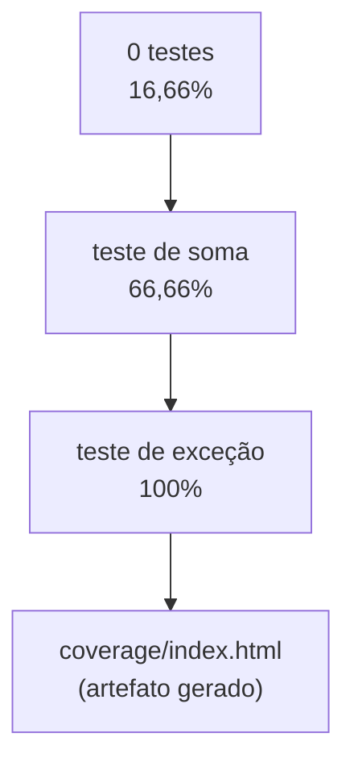
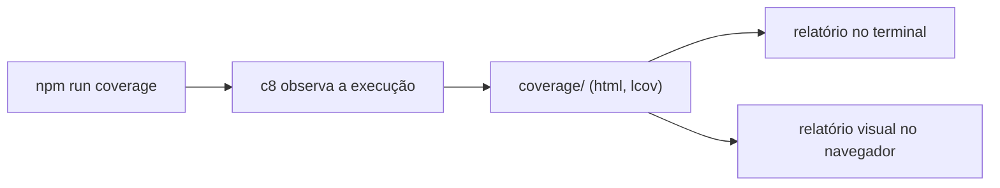

# Cobertura de Testes com C8 - Parte 1

## Introdução e contexto

Cobertura mede **quanto do código** é exercitado pelos testes — em linhas,
funções, declarações e caminhos (branches). É um número que dá respaldo para
dizer "o sistema está 90% coberto".

E o alerta de sempre: **100% de cobertura não significa 0% de bugs**. Significa
que o código passou por testes, não que está correto.

## A ferramenta

| Ferramenta | Observação |
| --- | --- |
| **nyc** | popular, baseada no Istanbul |
| **c8** | usa o coverage nativo do Node, sem instrumentação |

O curso usa **C8**. Instalação como dependência de desenvolvimento:

```sh
npm install --save-dev c8
```

E o script:

```json
{
  "scripts": {
    "test": "mocha",
    "coverage": "c8 mocha"
  }
}
```

`c8 mocha` executa o Mocha sob observação e coleta o que foi visitado.

## A função analisada

```js
export function soma(a, b) {
  if (typeof a !== 'number' || typeof b !== 'number') {
    throw new Error('Invalid arguments')
  }
  return a + b
}
```

Dois caminhos: a soma propriamente dita e a exceção.

## Primeira execução

Sem nenhum teste implementado:

```text
File           | % Stmts | % Branch | % Funcs | % Lines
mathUtils.js   |   16.66 |      100 |       0 |   16.66
```

O `16.66` vem apenas do carregamento do módulo — a função existe, mas nada dela
foi executado. As linhas não cobertas aparecem listadas.

## Adicionando o caminho feliz

```js
it('deve somar dois números', () => {
  expect(soma(2, 3)).to.equal(5)
})
```

```text
mathUtils.js   |   66.66 |    66.66 |     100 |   66.66
```

Agora só as linhas do `throw` ficam descobertas: a condição é avaliada, mas o
ramo de erro nunca é executado.



## Completando a cobertura

```js
it('deve lançar exceção para entradas não numéricas', () => {
  expect(() => soma('a', 2)).to.throw('Invalid arguments')
})
```

```text
mathUtils.js   |     100 |      100 |     100 |     100
```

Todas as linhas, funções, declarações e branches cobertas.

## As quatro métricas

| Métrica | O que mede |
| --- | --- |
| **Statements** | declarações executadas |
| **Branches** | caminhos de `if/else`, ternários, `switch` |
| **Functions** | funções chamadas |
| **Lines** | linhas executadas |

Branch costuma ser a mais difícil: uma linha pode rodar sem que todos os desvios
tenham sido testados.

## O diretório `coverage/`

Cada execução gera uma pasta `coverage/` com relatórios — arquivos grandes, que
**não devem ser versionados**:

```gitignore
coverage/
```



## Benefícios

- **Número objetivo** de cobertura.
- **Linhas descobertas visíveis** no terminal.
- **Feedback para priorizar testes**: o que está vermelho aponta o próximo passo.
- **Argumento concreto** em conversa com cliente ou time.
- **Integração simples** com scripts e CI.

## Limitações e cuidados

- **Cobertura ≠ qualidade**: uma linha executada sem asserção conta como coberta.
- **100% é raro** em projetos reais e pode incentivar teste sem valor.
- **Branch ignorada** esconde caminhos de erro.
- **`coverage/` no Git** polui o histórico.
- **Perseguir números** leva a testes frágeis.

## Conclusão

C8 transforma a execução dos testes em um mapa do código: verde é coberto,
vermelho é desconhecido. O ciclo 0% → 66% → 100% mostra como cada teste novo
fecha uma lacuna.

A próxima aula gera o relatório **visual** e adiciona limites mínimos de
cobertura.

<!-- commit de referência: 724f1348 -->
