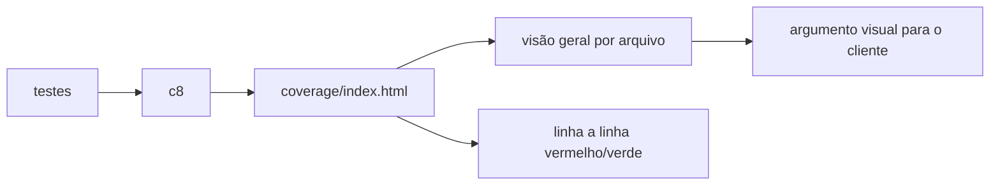
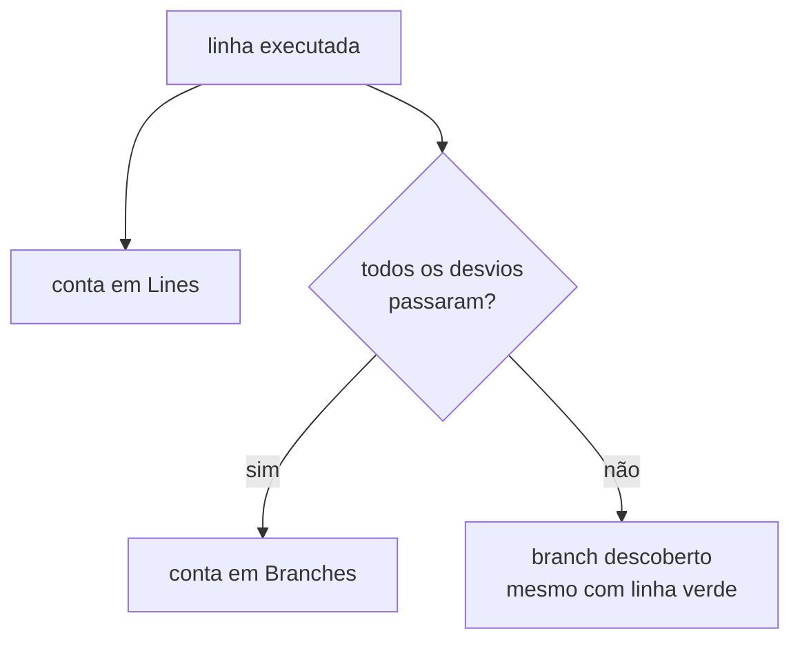

# Cobertura de Testes com C8 - Parte 2

## Introdução e contexto

Relatório no terminal convence quem já entende de teste. Para cliente, **gráfico**
funciona melhor. Esta aula gera o relatório HTML do C8, explora a diferença entre
cobertura de **linhas** e de **branches** e define limites mínimos com
`--check-coverage`.

## Relatório HTML

```sh
npx c8 report --reporter=html
```

O comando escreve em `coverage/` um site estático com:

- `index.html` — visão geral de todos os arquivos;
- uma página por arquivo, com as linhas coloridas.

| Cor | Significado |
| --- | --- |
| verde | linha/branch coberta |
| vermelho | não coberta |
| amarelo | cobertura parcial (geralmente branches) |

A visão geral mostra as quatro métricas por arquivo — statements, branches,
functions e lines — com totais tipo `6/6`.

## Prova visual

Ao comentar um dos testes, o relatório muda na hora: as linhas correspondentes
ficam vermelhas e o percentual cai para `66.66`. É a demonstração de que o
relatório reflete a suíte, não uma estimativa.



## Linhas versus branches

A aula adiciona uma função de divisão:

```js
export function divide(a, b) {
  if (b === 0) {
    throw new Error('Division by zero')
  }
  return a / b
}
```

Sem teste algum, a cobertura cai. Testando apenas o caminho feliz:

```text
% Stmts | % Branch | % Funcs | % Lines
 90.9  |   83.33  |  100   |  90.9
```

O branch de erro continua descoberto. Para fechar:

```js
it('deve lançar exceção ao dividir por zero', () => {
  expect(() => divide(6, 0)).to.throw('Division by zero')
})
```

### O experimento com um `if` extra

Adicionando `if (a > 999) { ... }` sem teste:

| Métrica | Antes | Depois |
| --- | --- | --- |
| Lines | 100% | 100% |
| Branches | 100% | 71,42% |

As linhas continuam cobertas porque a condição é avaliada; o **caminho** do
`if` não é percorrido. É a diferença central entre as duas métricas.



## Definindo limites mínimos

```sh
npx c8 --check-coverage --lines 90 --branches 80 mocha
```

| Flag | Efeito |
| --- | --- |
| `--check-coverage` | falha o comando se o mínimo não for atingido |
| `--lines 90` | exige 90% das linhas |
| `--branches 80` | exige 80% dos caminhos |

Com testes suficientes, o comando termina com sucesso. Com um teste comentado:

```text
ERROR: Coverage for lines (81.81%) does not meet global threshold (90%)
ERROR: Coverage for branches (60%) does not meet global threshold (80%)
```

O código de saída deixa de ser `0` — e é isso que faz o CI bloquear o merge.

## Escolhendo os limites

| Contexto | Sugestão |
| --- | --- |
| projeto novo | 80% linhas / 70% branches, subindo com o tempo |
| código legado | começar pelo patamar atual e nunca diminuir |
| biblioteca crítica | 90%+ linhas e branches altos |

Perseguir 100% costuma gerar testes artificiais. O número deve servir ao time,
não o contrário.

## Benefícios

- **Comunicação visual** com quem não lê terminal.
- **Diagnóstico linha a linha**.
- **Branches explodem a falsa sensação de 100%**.
- **Threshold objetivo** e integrável ao pipeline.
- **Regressão de cobertura** detectada automaticamente.

## Limitações e cuidados

- **Cobertura alta sem asserção** não prova nada.
- **Threshold muito alto** incentiva testes ruins só para bater meta.
- **HTML é artefato**: manter fora do Git.
- **Branch de exceção** é o que mais escapa.
- **Ignorar arquivos** (`--exclude`) pode mascarar código não testado.

## Conclusão

O relatório HTML dá visibilidade e o `--check-coverage` transforma cobertura em
regra. Lines mostram o que rodou; branches mostram o que foi decidido.

A próxima aula leva esses limites para o **GitHub Actions**, bloqueando merges
sem cobertura.

<!-- commit de referência: 1adb7523 -->
