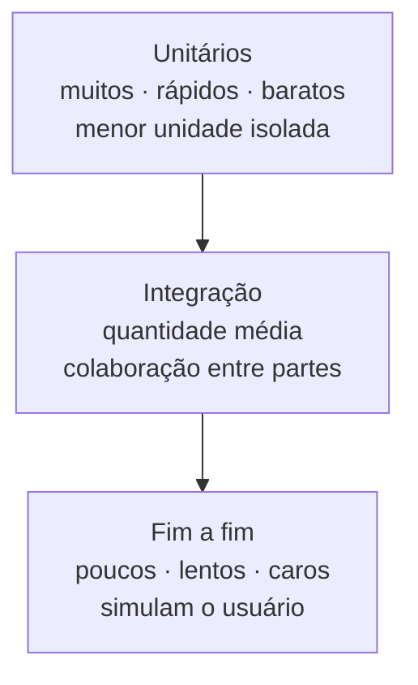

# Testes de Software

## Introdução e contexto

Testes de software são o **selo de qualidade** do produto: verificam se o código
funciona conforme as especificações acordadas. A aula revisita os conceitos
básicos, explica por que testar e apresenta os tipos organizados na **pirâmide
de testes**.

Os conceitos não são exclusivos do Node — valem para Java, C#, Python e
qualquer outra stack.

## O que é testar

Testar é executar o sistema sob condições controladas para responder:

- o código faz o que deveria?
- atende ao conjunto de especificações?
- continua funcionando depois de uma mudança?

O teste não prova que o software está livre de erros. Ele **reduz a
probabilidade** de falhas e dá ao cliente uma garantia de que a aplicação
passou por uma rodada ampla de verificações.

## Por que os testes importam

| Motivo | Efeito prático |
| --- | --- |
| **Mitigação de bugs** | menos defeitos chegam à produção |
| **Envelhecimento de software** | o sistema tende a falhar com o tempo; testes detectam regressões |
| **Manutenção** | novas features não quebram o que já existia |
| **Confiança no deploy** | a entrega tem evidência de funcionamento |
| **Economia de tempo** | testes automatizados reduzem retrabalho e erro humano |
| **Selo de qualidade** | valor percebido pelo cliente |
| **Integração com CI/CD** | o merge só acontece se a suíte passar |

### O mito da garantia total

Nenhum software é 100% livre de bugs, e os testes também podem conter erros.
A linha de pesquisa sobre **envelhecimento de software** mostra que todo sistema
— do kernel do sistema operacional a um foguete — tende a acumular defeitos com
o tempo.

Além disso, nem tudo que a aplicação consome é testável por nós: **APIs de
terceiros** devem ser escolhidas por reputação e maturidade, não testadas como
se fossem nossas.

### Onde a falha dói de verdade

Em sistemas embarcados — carros, aviões, controle de tráfego — um bug pode
custar vidas. É o mesmo princípio de software de um site, mas com consequências
incomparavelmente maiores. Testar é parte do processo de engenharia, não um
luxo.

## Por que isso importa no Node.js

- O Node é a base da maioria das aplicações **back-end** modernas.
- JavaScript é a linguagem mais usada na web, front e back.
- APIs precisam ser **robustas, escaláveis e seguras**.
- Muitas operam com **dados em tempo real** (painéis, rastreamento, controle).

Nesses cenários, um erro silencioso se propaga rápido. A suíte de testes é a
barreira que segura a regressão antes do deploy.

## A pirâmide de testes

### Unitários

Testam a **menor unidade possível**: uma função ou método, de forma isolada.
São a base da pirâmide porque são rápidos, baratos e numerosos.

Garantir que cada peça funciona aumenta a chance de o todo funcionar — mas não
garante, e é por isso que existem os testes de integração.

### Integração

Verificam a **colaboração entre partes**: função chamando função, serviço
usando repositório, aplicação consumindo API. O objetivo é descobrir problemas
na "junção" — contratos, formatos, dependências.

Em times grandes, cada pessoa entrega um pedaço; o teste de integração é o que
confirma que a sopa toda continua comestível.

### Fim a fim

Simulam o **comportamento do usuário**, percorrendo o fluxo completo — do
front-end ao back-end. São os mais caros e os menos numerosos.

O usuário faz o que não deveríamos imaginar: por isso esses testes cobrem tanto
o caminho feliz quanto o inesperado. No curso o foco fica em unitários e
integração, com fim a fim aparecendo como contexto.

## Comparação

| Aspecto | Unitário | Integração | Fim a fim |
| --- | --- | --- | --- |
| Escopo | função/método | colaboração entre partes | fluxo completo |
| Velocidade | muito rápido | médio | lento |
| Custo de manutenção | baixo | médio | alto |
| Quantidade | muitos | alguns | poucos |
| Detecta | erro de lógica | erro de contrato/integração | erro de experiência |
| Depende de infraestrutura | não | às vezes | sim |

## Benefícios

- **Feedback rápido** sobre a lógica.
- **Segurança para refatorar**.
- **Documentação executável** do comportamento esperado.
- **Deploy com evidência**, não com fé.
- **Base para CI/CD** com merge bloqueado por falha de teste.

## Limitações e cuidados

- **Teste não elimina bug**: reduz probabilidade.
- **Pirâmide invertida** (muitos e2e, poucos unitários) gera suíte lenta e
  frágil.
- **Testes ruins** dão falsa segurança; asserções fracas passam sem provar nada.
- **Dependências externas** não são sua responsabilidade — escolha bem e
  simule nos testes.
- **Suíte abandonada** apodrece junto com o código.

## Conclusão

Testar é verificar comportamento e reduzir risco. Unitários protegem a lógica,
integração protege as fronteiras e fim a fim protege a experiência — cada tipo
com seu custo.

Com a base conceitual clara, a próxima aula monta o ambiente: Node, gerenciador
de pacotes e as três bibliotecas da stack.

<!-- commit de referência: aula conceitual -->
