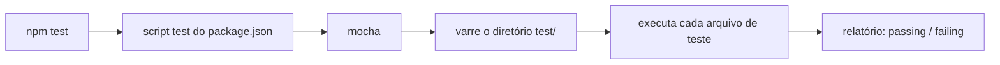

# Requisitos

## Introdução e contexto

Esta aula prepara o ambiente do módulo: o **Node.js** como base, um gerenciador de
pacotes, a estrutura de pastas `src/` e `test/` e a stack de testes formada por
**Mocha**, **Chai** e **Sinon**.

A ideia é ter um projeto pequeno e funcional o suficiente para rodar os primeiros
testes, sem a cerimônia de um projeto completo. Esse mesmo esqueleto será repetido
várias vezes ao longo do curso.

## Requisitos do ambiente

| Requisito | Observação |
| --- | --- |
| **Node.js LTS** | a versão usada na aula é a 23; qualquer LTS recente atende |
| **Gerenciador de pacotes** | NPM ou Yarn, à escolha — ambos funcionam |
| **Editor** | VS Code, usado nas demonstrações |

Verificação rápida:

```sh
node -v
npm -v
# ou
yarn -v
```

O Node já vem com o NPM instalado, então quem escolhe NPM não precisa de mais nada.

## Inicialização do projeto

O projeto da aula é criado com o gerador padrão, pulando o questionário:

```sh
mkdir meu-projeto-teste
cd meu-projeto-teste
npm init -y
```

O `npm init -y` cria o **`package.json`**, que guarda:

- as **dependências** de produção e de desenvolvimento;
- os **scripts** de execução, como o que sobe um servidor ou roda os testes.

## Dependências de teste

As três bibliotecas entram como dependências de **desenvolvimento**:

```sh
npm install --save-dev mocha chai sinon
```

O `--save-dev` é uma decisão de responsabilidade: essas bibliotecas só são
necessárias para quem desenvolve e testa, não para o cliente que usa o sistema
em produção. Elas ficam em `devDependencies` e não seguem no build de produção.

## Estrutura de pastas

```
meu-projeto-teste/
├── node_modules/
├── src/            # código fonte da aplicação
├── test/           # testes, de qualquer tipo
└── package.json
```

`src/` e `test/` ficam em paralelo. Dentro de `test/` cabem desde testes
unitários até integração e fim a fim — a organização por tipo vem depois,
conforme o projeto cresce.

## Script de testes

O `package.json` recém-criado não traz script de teste, então ele é definido
manualmente:

```json
{
  "scripts": {
    "test": "mocha"
  }
}
```

Assim, `npm test` delega ao Mocha, que por padrão varre o diretório `test/` e
executa todos os arquivos de teste encontrados. Sem esse ajuste, `npm test`
falharia por não ter um executor definido.



## Por que essa base importa

| Decisão | Efeito |
| --- | --- |
| Node LTS | estabilidade e suporte de longo prazo |
| dependências em `--save-dev` | produção sem ferramentas de teste |
| `src/` separado de `test/` | código e verificação não se misturam |
| script único `npm test` | todo mundo roda os testes do mesmo jeito |

Um projeto que já nasce com um comando único de teste reduz a barreira para
testar: não há desculpa para "esquecer" de rodar a suíte.

## Limitações e cuidados

- **Versão do Node**: recursos mais novos podem não existir em LTS antigas; fixe
  uma versão no time.
- **Script manual**: o Mocha não se autoconfigura; sem o `"test": "mocha"` o
  comando padrão não funciona.
- **Sem configuração ainda**: nesta etapa não há `recursive` nem padrões de
  arquivo — isso vem quando a estrutura de pastas crescer.
- **`node_modules` no `.gitignore`**: obrigatório, para não versionar
  dependências.

## Conclusão

Com Node, gerenciador de pacotes, `package.json`, as três dependências de teste
e o script `npm test`, o ambiente está pronto.

A próxima aula detalha o papel de cada ferramenta da stack: quem organiza, quem
verifica e quem simula.

<!-- commit de referência: 9adad124 -->
