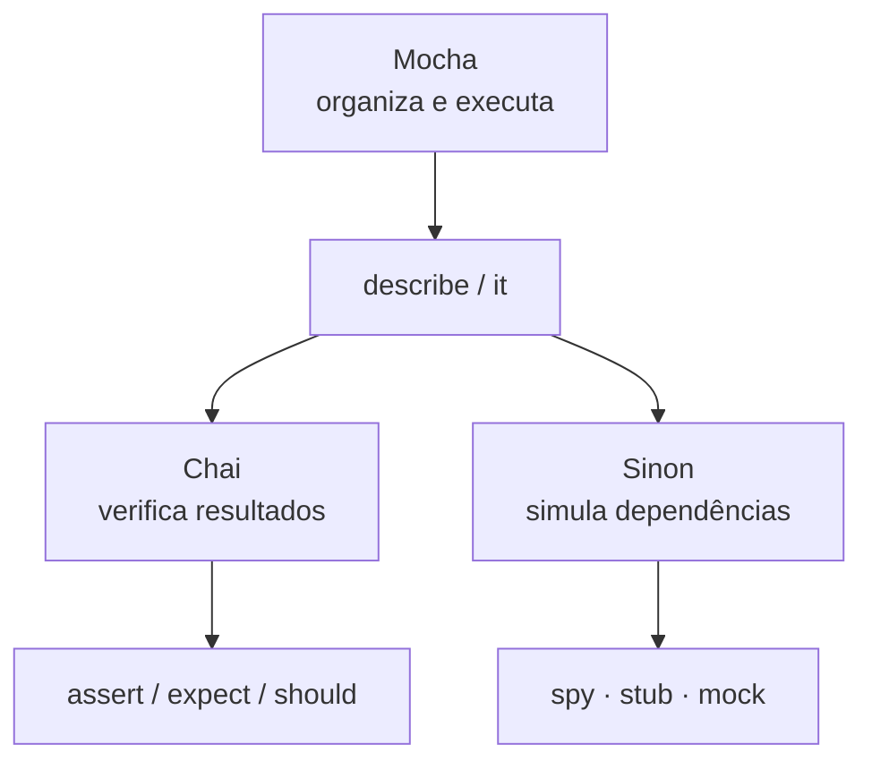
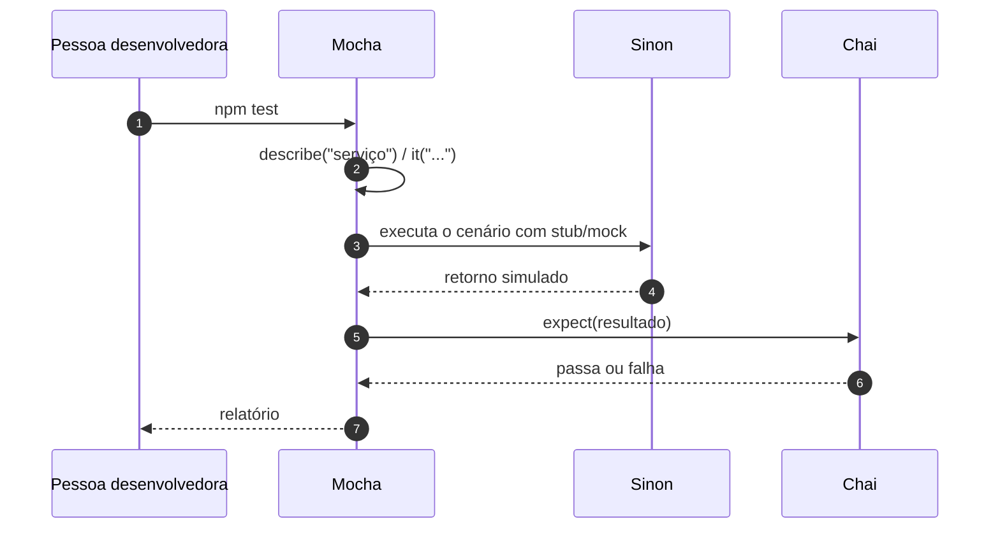

# Introdução à Stack de Testes

## Introdução e contexto

Nenhuma biblioteca de testes resolve tudo sozinha. A stack do módulo combina
três ferramentas com papéis bem diferentes:

| Ferramenta | Papel |
| --- | --- |
| **Mocha** | estrutura e executa os testes |
| **Chai** | faz as asserções (verifica resultados) |
| **Sinon** | simula comportamentos (spies, stubs e mocks) |

Entender essa divisão evita confusão: o Mocha não verifica nada e o Chai não
executa nada.



## Mocha: o organizador

O Mocha é um **framework de testes**: prepara os testes para execução
automatizada e organiza tudo em dois blocos principais:

- `describe` — agrupa testes relacionados (por exemplo, "função soma");
- `it` — declara um teste individual ("deve somar dois números").

```js
describe('função soma', () => {
  it('deve retornar a soma de dois números', () => {
    // asserção entra aqui
  })
})
```

O nome `it` vem de *individual test*. O texto do `it` deve descrever o
comportamento esperado, porque é ele que aparece no relatório.

### Hooks

O Mocha também oferece ganchos para preparar e limpar o cenário:

| Hook | Quando roda |
| --- | --- |
| `before` | uma vez, antes de todos os testes do bloco |
| `after` | uma vez, depois de todos |
| `beforeEach` | antes de cada teste individual |
| `afterEach` | depois de cada teste individual |

Eles resolvem o problema de **estado compartilhado**. Se a calculadora do
exemplo acumula resultados, o teste de multiplicação pode começar com o valor
deixado pelo teste de soma; reinicializar o objeto no `beforeEach` garante que
cada teste parta do mesmo ponto.

### A limitação

O Mocha **não traz asserções**. Ele chama o teste, mas não sabe dizer se o
resultado está correto — é aí que entra o Chai.

## Chai: as asserções

O Chai complementa o Mocha verificando se o resultado é o esperado. Ele oferece
três estilos equivalentes:

| Estilo | Exemplo |
| --- | --- |
| `assert` | `assert.equal(soma(2, 3), 5)` |
| `expect` | `expect(soma(2, 3)).to.equal(5)` |
| `should` | `soma(2, 3).should.equal(5)` |

O curso adota **`expect`**, por ser o mais explícito na leitura:

```js
expect(resultado).to.be.true
expect(lista).to.have.length(3)
```

A asserção sempre mora **dentro de um `it`**. É essa combinação que forma o
teste completo: o Mocha executa, o Chai julga.

## Sinon: a simulação

O Sinon permite testar **sem depender de recursos reais** — sem API no ar, sem
banco de dados. Ele trabalha com três conceitos:

| Conceito | O que faz |
| --- | --- |
| **spy** | observa uma função: foi chamada? quantas vezes? com quais argumentos? |
| **stub** | substitui uma função e define o retorno (ou uma exceção) |
| **mock** | objeto com expectativas pré-definidas sobre chamadas e argumentos |

```js
const spy = sinon.spy()
spy(1)
expect(spy.calledOnce).to.be.true

const stub = sinon.stub().returns(42)
expect(stub()).to.equal(42)
```

A diferença central:

- o **spy** não altera o comportamento, só registra;
- o **stub** altera o retorno;
- o **mock** combina substituição com verificação de expectativas.

## Como as três se combinam



Um teste típico de service, por exemplo, usa o Sinon para substituir o
repositório, chama o método real e usa o Chai para verificar o retorno.

## Benefícios da stack

- **Separação de responsabilidades**: cada ferramenta faz uma coisa bem.
- **Asserções legíveis**: `expect` deixa a intenção explícita.
- **Independência de infraestrutura**: stubs eliminam API e banco do teste.
- **Relatórios claros**: o Mocha mostra o que passou e o que falhou.
- **Hooks**: cenário preparado e limpo sem repetição.

## Limitações e cuidados

- **Três dependências**: mais ferramentas para aprender e manter.
- **Stub excessivo esconde integração**: se tudo é simulado, o teste não prova
  que o sistema funciona de verdade — daí a importância dos testes de
  integração.
- **Asserção fraca**: `expect(x).to.exist` costuma passar sem provar nada.
- **Mocks acoplados à implementação**: verificar chamadas demais engessa a
  refatoração.
- **`describe`/`it` mal nomeados**: o relatório vira uma lista sem significado.

## Conclusão

Mocha organiza, Chai verifica e Sinon simula. Com essas três peças, qualquer
teste — de uma função pura a um service com repositório — pode ser escrito sem
depender de infraestrutura.

A próxima aula coloca a stack em prática com o primeiro teste de verdade: uma
função de soma.

<!-- commit de referência: 7ca73c8d -->
