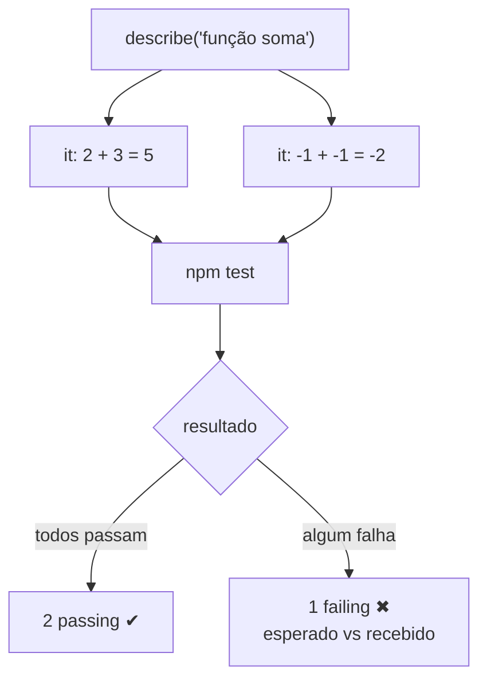
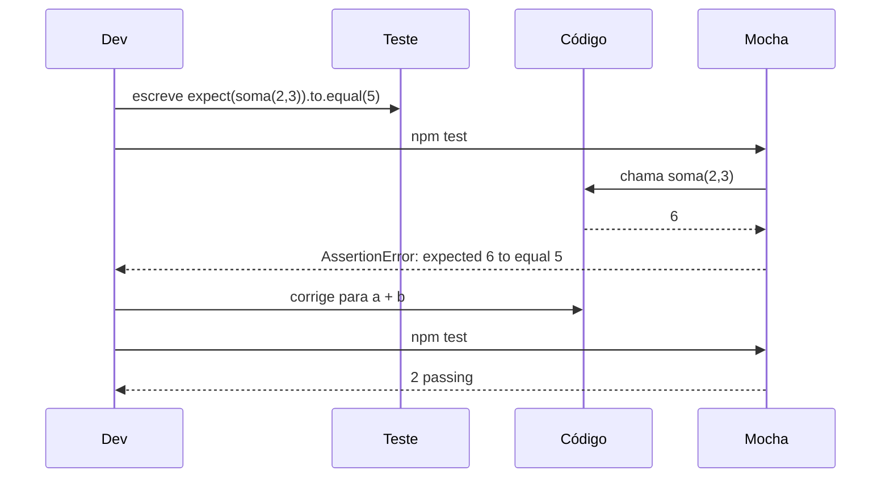

# Nossos Primeiros Testes

## Introdução e contexto

Esta aula escreve e executa o primeiro teste de verdade: uma função de soma,
testada com **Mocha** (estrutura) e **Chai** (asserção). O objetivo não é a
função em si, mas aprender a **ler o relatório** — tanto o verde de aprovação
quanto o vermelho de falha.

## A função testada

Em `src/calculadora.js`:

```js
function soma(a, b) {
  return a + b
}

module.exports = { soma }
```

O `module.exports` é o que permite importar a função no arquivo de teste.

## O arquivo de teste

A convenção adotada é: mesmo nome do arquivo testado + `.test.js`, dentro de
`test/`.

```
src/calculadora.js
test/calculadora.test.js
```

```js
const { expect } = require('chai')
const { soma } = require('../src/calculadora')

describe('função soma', () => {
  it('deve retornar a soma de dois números', () => {
    expect(soma(2, 3)).to.equal(5)
  })
})
```

Repare em quem faz o quê:

| Construção | Origem | Função |
| --- | --- | --- |
| `describe` | Mocha | agrupa os testes da função soma |
| `it` | Mocha | declara o teste individual |
| `expect` | Chai | verifica se o resultado é `5` |

## Executando

```sh
npm test
```

O Mocha varre `test/` e executa todos os arquivos encontrados. A saída mostra o
resultado por teste:

```text
função soma
  ✔ deve retornar a soma de dois números

1 passing
```

Cada `it` aprovado ganha um **check**. Um `describe` sem falhas aparece como um
bloco único; quando algo falha, o Mocha marca cada `it` problemático.

## Ampliando os cenários

Um único caso não prova muito. A aula adiciona um segundo teste, com números
negativos:

```js
it('deve retornar a soma correta com números negativos', () => {
  expect(soma(-1, -1)).to.equal(-2)
})
```

Agora são `2 passing`. Cada `it` novo cobre um **cenário** diferente da mesma
função — a base dos testes de borda.



## Lendo uma falha

Para entender o relatório negativo, a função é alterada de propósito: `soma`
passa a multiplicar.

```js
function soma(a, b) {
  return a * b // erro proposital
}
```

Rodando de novo:

```text
2 failing

1) função soma
   deve retornar a soma de dois números:
   AssertionError: expected 6 to equal 5
   + expected - actual
```

O relatório entrega o essencial:

| Informação | Exemplo |
| --- | --- |
| quantidade de falhas | `2 failing` |
| teste afetado | "deve retornar a soma de dois números" |
| tipo de erro | `AssertionError` |
| esperado vs recebido | esperado `5`, recebido `6` |

O segundo teste falha de forma ainda mais didática: `-1 * -1` resulta `1`, e o
teste esperava `-2`.

## O ciclo de trabalho

1. escrever a função;
2. escrever o teste que descreve o comportamento esperado;
3. rodar `npm test`;
4. ler a falha (se houver) e corrigir;
5. rodar de novo até tudo passar.



## Benefícios já visíveis

- **Feedback rápido**: `npm test` responde em segundos.
- **Erro localizado**: o relatório aponta o `it` e o valor divergente.
- **Documentação viva**: os nomes dos testes descrevem o contrato da função.
- **Regressão barata**: qualquer alteração futura é verificada de imediato.

## Limitações e cuidados

- **Um teste, um comportamento**: agrupar várias asserções sem relação dificulta
  saber o que quebrou.
- **Nomes vagos**: "testa soma" não informa o cenário; "deve retornar a soma
  correta com números negativos" informa.
- **Nem todo caminho está coberto**: dois casos felizes não cobrem entradas
  inválidas.
- **Testar a implementação**: o teste deve olhar o resultado, não o "como".

## Conclusão

O primeiro teste já mostra o valor do ciclo: escrever, rodar, ler a falha,
corrigir. `describe`/`it` organizam, `expect` verifica, e o relatório do Mocha
diz exatamente onde o código se afastou do esperado.

A próxima aula enfrenta o caso em que o resultado não está disponível no momento
da asserção: **funções assíncronas**.

<!-- commit de referência: dd9357f9 -->
