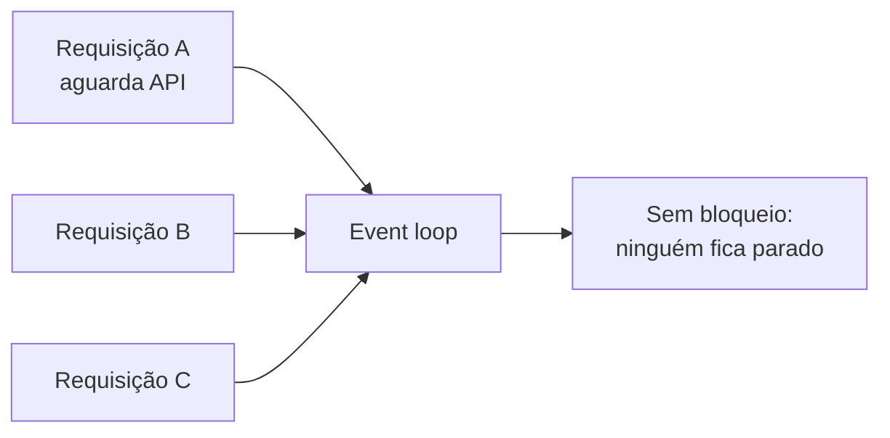
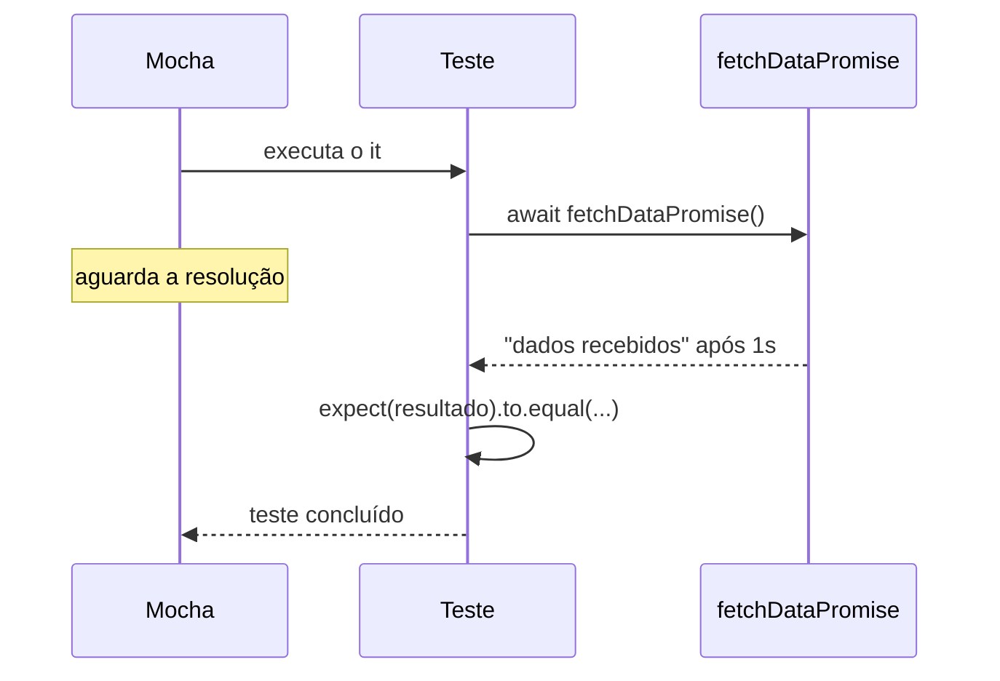

# Testando Funções Assíncronas

## Introdução e contexto

Funções assíncronas são a espinha do Node: chamadas de API, leitura de arquivos
e consultas ao banco não podem bloquear o processo enquanto esperam resposta.

O problema aparece no teste: se o Mocha considerar o teste concluído antes de a
operação terminar, ele falha mesmo com a implementação correta. Esta aula mostra
como sinalizar a espera em três estilos: **callbacks**, **promises** e
**async/await**.

## Por que assincronismo existe



Se cada requisição esperasse a anterior terminar, o servidor criaria um
**gargalo global**. Operações de I/O são justamente as mais demoradas — e as
mais comuns em uma API.

## A função sob teste

```js
function fetchData(callback) {
  setTimeout(() => {
    callback('dados recebidos')
  }, 1000)
}

function fetchDataPromise() {
  return new Promise((resolve) => {
    setTimeout(() => resolve('dados recebidos'), 1000)
  })
}

module.exports = { fetchData, fetchDataPromise }
```

O `setTimeout` de 1 segundo simula a latência de uma chamada externa. Sem
tratamento assíncrono, o teste terminaria antes do callback.

## Estilo 1: callback com `done`

```js
describe('fetchData com callback', () => {
  it('deve retornar dados recebidos', (done) => {
    fetchData((resultado) => {
      expect(resultado).to.equal('dados recebidos')
      done()
    })
  })
})
```

O `done` é injetado pelo **Mocha**. Enquanto ele não é chamado, o teste segue
aberto. É o sinal explícito de "terminei".

| Elemento | Origem | Papel |
| --- | --- | --- |
| `done` | Mocha | avisa que o teste assíncrono terminou |
| `expect` | Chai | verifica o valor recebido |

Sem o `done`, o Mocha encerraria o teste imediatamente e o resultado chegaria
tarde demais.

## Estilo 2: promise com `return`

```js
it('deve retornar os dados recebidos', () => {
  return fetchDataPromise().then((resultado) => {
    expect(resultado).to.equal('dados recebidos')
  })
})
```

Aqui **não** se usa `done`: ao retornar a promise, o Mocha aguarda a resolução
antes de julgar o teste. Se a promise for rejeitada, o teste falha.

## Estilo 3: `async/await`

```js
it('deve retornar os dados recebidos', async () => {
  const resultado = await fetchDataPromise()
  expect(resultado).to.equal('dados recebidos')
})
```

A leitura fica próxima de um teste síncrono: `async` na função do `it`,
`await` na chamada. Por baixo, continua sendo uma promise — o Mocha espera o
retorno da função assíncrona.



## `done` ou `return`?

| Situação | Use | Motivo |
| --- | --- | --- |
| função recebe **callback** | `done()` | não existe promise para retornar |
| função retorna **promise** | `return promise` | o Mocha aguarda a resolução |
| função retorna **promise**, estilo moderno | `async` + `await` | mesma garantia, leitura melhor |

Regra prática: **callback → `done`; promise → `return` ou `async/await`**.

## O que o relatório mostra

```text
função fetchData com callback
  ✔ deve retornar dados recebidos (1003ms)

2 passing (2s)
```

A duração aparece entre parênteses: 1003ms é a prova de que o Mocha realmente
esperou o `setTimeout`, em vez de encerrar de imediato.

## Benefícios

- **Teste fiel ao comportamento real** de I/O.
- **Falhas reais de promise** são capturadas (rejeição reprova o teste).
- **Três estilos convivem**: código legado com callback continua testável.
- **`async/await` simplifica** a leitura sem perder a espera.
- **Base pronta** para testar APIs e serviços.

## Limitações e cuidados

- **Esquecer `done` ou `await`** faz o teste passar por acidente — o pior tipo
  de falha.
- **Timeout padrão do Mocha** (2s) pode estourar com latências maiores; ajuste
  consciente é necessário.
- **`done` chamado duas vezes** gera erro; garanta um único caminho.
- **Teste lento por natureza**: prefira simular a latência em vez de dormir de
  verdade quando possível.
- **Misturar estilos** no mesmo arquivo confunde; padronize `async/await`.

## Conclusão

Testar assincronismo é ensinar o runner a esperar. `done` resolve callbacks,
`return` e `async/await` resolvem promises — e a escolha correta evita tanto
falso positivo quanto falso negativo.

A próxima aula aplica essa base a um domínio real: **objetos de valor** de um
sistema hospitalar.

<!-- commit de referência: 8815175f -->
