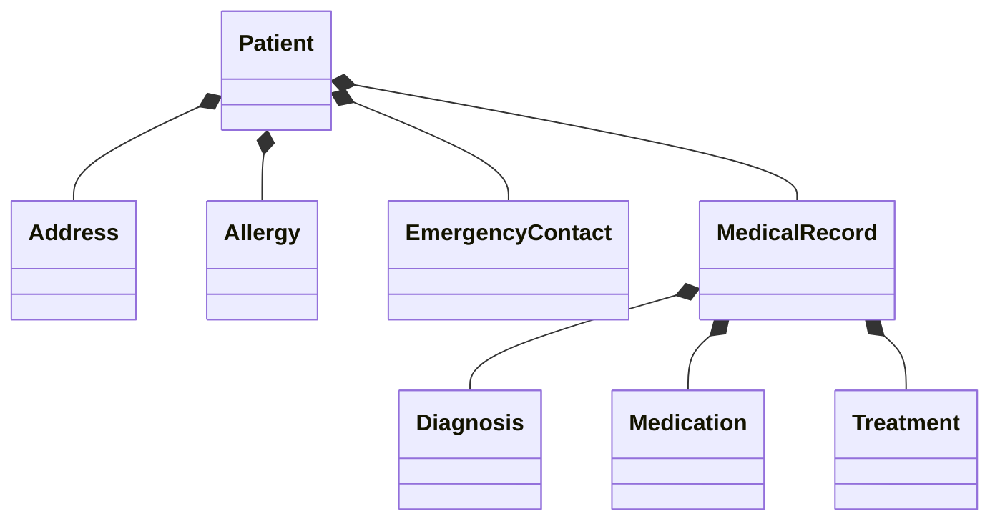
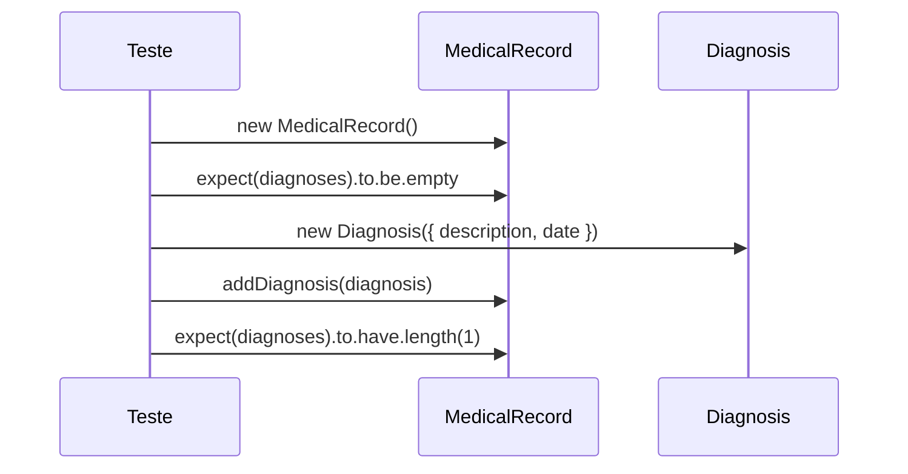

# Testando Objetos de Valor

## Introdução e contexto

O curso passa a usar um mini projeto de **DDD** para um sistema hospitalar de
agendamento de consultas. O foco desta aula são os **objetos de valor** —
classes que não têm identidade própria: dois objetos são iguais se todos os
atributos forem iguais.

Esses objetos são as menores unidades do domínio e a base dos testes seguintes.

## O domínio



| Objeto de valor | Atributos |
| --- | --- |
| **Address** | rua, número, cidade, estado, código postal |
| **Allergy** | nome da alergia |
| **EmergencyContact** | nome e telefone |
| **Diagnosis** | descrição e data do diagnóstico |
| **Medication** | nome, dosagem e instruções de uso |
| **Treatment** | descrição, data de início e data de fim |
| **MedicalRecord** | listas de diagnósticos, medicações e tratamentos |

Todas as classes guardam estado privado, validam no construtor e expõem getters.
`MedicalRecord` permite adicionar itens, sempre exigindo a instância correta do
objeto de valor.

## Validação no construtor

```js
class Address {
  #street
  #number

  constructor({ street, number, city, state, zipCode }) {
    if (!street) throw new Error('O campo street não pode ser vazio')
    if (number <= 0) throw new Error('O número deve ser um inteiro positivo')
    // ...
  }
}
```

Campos vazios e números inválidos lançam exceção. Testar essas regras é tão
importante quanto testar o caminho feliz.

## Igualdade por valor

Como não há identificador, a igualdade é feita comparando **todos** os campos:

```js
equals(other) {
  return (
    other instanceof Address &&
    this.#street === other.street &&
    this.#number === other.number
    // ...
  )
}
```

Dois endereços com os mesmos dados são iguais; um campo diferente já torna o
resultado `false`. Comparar com um objeto de outro tipo também retorna `false`.

## A estrutura dos testes

O diretório `test/` é um **espelho** de `src/`:

```
src/domain/value-objects/Address.js
test/domain/value-objects/Address.test.js
```

Essa simetria ajuda a localizar qualquer teste: se o arquivo de produção está em
tal caminho, o teste está no mesmo caminho, dentro de `test/`.

## O que cada arquivo testa

| Grupo | Casos cobertos |
| --- | --- |
| criação | cada atributo recebido é exposto corretamente |
| validação | campos vazios e valores inválidos lançam exceção |
| igualdade | objetos iguais retornam `true`; diferentes, `false` |
| tipo | comparar com objeto de outra classe retorna `false` |

O `beforeEach` evita repetição: um endereço válido é recriado antes de cada
teste, garantindo isolamento e aplicando **DRY**.

```js
describe('Address', () => {
  let validAddress

  beforeEach(() => {
    validAddress = new Address({ street: 'Rua A', number: 10, /* ... */ })
  })

  it('deve criar um endereço com os valores corretos', () => {
    expect(validAddress.street).to.equal('Rua A')
  })

  it('deve lançar erro quando a rua é vazia', () => {
    expect(() => new Address({ street: '', number: 10, /* ... */ }))
      .to.throw('O campo street não pode ser vazio')
  })
})
```

## Testando o MedicalRecord

O prontuário combina listas de diagnósticos, medicações e tratamentos:

```js
const record = new MedicalRecord()
expect(record.diagnoses).to.be.empty

record.addDiagnosis(new Diagnosis({ description: 'Gripe', date: new Date() }))
expect(record.diagnoses).to.have.length(1)
```

Além dos getters, os testes cobrem:

- prontuário recém-criado começa **vazio**;
- adicionar diagnóstico, medicação e tratamento atualiza a lista;
- adicionar um objeto de tipo errado lança exceção.



## Benefícios

- **Contrato explícito**: cada objeto de valor documenta suas regras.
- **Validação cedo**: erros aparecem na construção, não no meio do fluxo.
- **Igualdade confiável** sem depender de identidade.
- **Espelho `test/` × `src/`**: navegação previsível.
- **Reuso de cenário** com `beforeEach`.

## Limitações e cuidados

- **Testes muito longos**: agrupar todas as validações em um único `it` dificulta
  saber o que quebrou; a própria aula sugere desmembrar.
- **Exceções por campo**: testar um a um é mais verboso, mas localiza melhor.
- **Estado compartilhado**: sem `beforeEach`, um teste contamina o seguinte.
- **Duplicação de testes de composição**: se o objeto interno já foi testado,
  teste o **conjunto**, não repita atributo por atributo.
- **`instanceof` exige a mesma referência de classe**: cuidado com duplicação de
  módulos.

## Conclusão

Objetos de valor são testados por três ângulos: criação, validação e igualdade.
Com o espelho `test/` × `src/` e hooks de preparação, a suíte cresce organizada.

A próxima aula mostra como executar essa suíte quando os testes deixam de estar
todos em um único diretório.

<!-- commit de referência: 3f8fde01 -->
