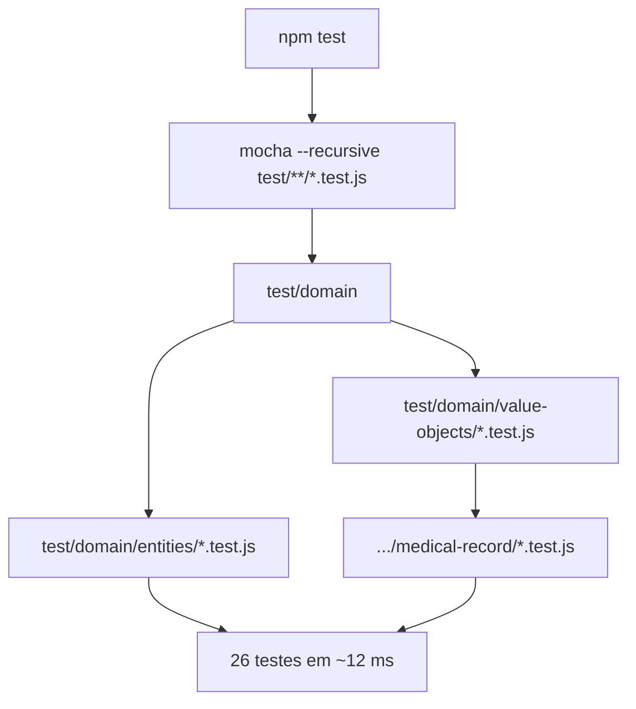
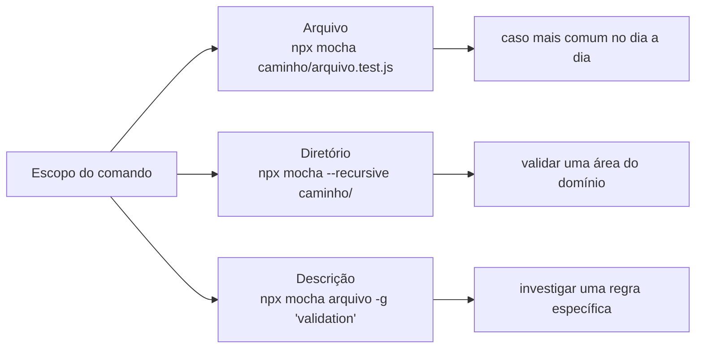

# Testes de Arquivos e Funções Específicas

## Introdução e contexto

Com o domínio espelhado em `test/`, a suíte deixa de ser um punhado de arquivos
soltos. O `npm test` original (`mocha`, sem mais nada) só olha o nível superior
de `test/` e passa a encontrar **zero testes**.

Esta aula ajusta o script para buscar recursivamente e mostra como rodar apenas
um arquivo, um diretório ou um `describe` específico.

## O problema

```
test/
└── domain/
    ├── entities/
    │   └── Patient.test.js
    └── value-objects/
        ├── Address.test.js
        └── medical-record/
            └── MedicalRecord.test.js
```

O Mocha, por padrão, não desce em subdiretórios. Resultado: `npm test` roda sem
encontrar nada, mesmo com 26 testes escritos.

## A solução: `--recursive` + padrão de arquivo

```json
{
  "scripts": {
    "test": "mocha --recursive test/**/*.test.js"
  }
}
```

| Parte | Papel |
| --- | --- |
| `--recursive` | entra em todos os subdiretórios de `test/` |
| `test/**/*.test.js` | considera apenas arquivos terminados em `.test.js` |

A combinação ignora qualquer outro arquivo que esteja na pasta e garante que
todo teste novo entre na suíte automaticamente.



Rodando, a saída mostra os blocos por arquivo (`Address`, `Allergy`,
`EmergencyContact`, `Diagnosis`, `Medication`, `Treatment`, `MedicalRecord`) e o
total: **26 passing** em cerca de 12 milissegundos — a velocidade típica de
testes unitários.

## Rodando apenas um arquivo

Quando a suíte cresce, rodar tudo a cada alteração fica lento. Duas saídas:

```sh
# direto pelo binário do Mocha
npx mocha test/domain/value-objects/Address.test.js

# ou criando um script dedicado
npm test -- test/domain/value-objects/Address.test.js
```

Resultado: os 11 testes de `Address`.

## Rodando um diretório inteiro

```sh
npx mocha --recursive test/domain/value-objects
```

Isso executa `Address`, `Allergy` e `EmergencyContact` — **15 testes** — e deixa
de fora o que está em `medical-record/`, que é um subdiretório à parte.

## Rodando por descrição

A opção `-g` (grep) filtra pelo texto do `describe` ou do `it`:

```sh
npx mocha test/domain/value-objects/Address.test.js -g "validation"
```

O `describe("validation")` do `Address` concentra os casos inválidos: rua, cidade,
estado e código postal vazios, além do número inválido — que gera três casos
(negativo, texto e zero). Total: **7 testes**.



## Escolhendo o nível de granularidade

| Necessidade | Comando |
| --- | --- |
| antes de commitar | `npm test` |
| trabalhando em um arquivo | `npx mocha <arquivo>` |
| validando uma camada | `npx mocha --recursive <diretório>` |
| depurando uma regra | `npx mocha <arquivo> -g "<descrição>"` |

## Benefícios

- **Suíte completa sem configuração manual**: todo `.test.js` entra sozinho.
- **Feedback rápido**: rodar um arquivo leva milissegundos.
- **Filtro por comportamento**: `-g` conecta o nome do teste ao comando.
- **Estrutura espelhada** continua funcionando sem ajustes.
- **Escalabilidade**: a mesma regra vale para centenas de arquivos.

## Limitações e cuidados

- **Glob depende do shell**: sem aspas, o `**` pode ser expandido de forma
  inesperada em alguns terminais.
- **`-g` é sensível ao texto**: renomear o `describe` quebra o comando salvo.
- **Recursivo demais** pode incluir arquivos auxiliares se o padrão for frouxo —
  por isso o `.test.js`.
- **Scripts personalizados** demais viram manutenção extra; prefira `npx`.
- **Rodar só um teste** não substitui rodar a suíte antes de integrar.

## Conclusão

`--recursive` com `test/**/*.test.js` resolve a estrutura hierárquica. `npx
mocha <caminho>` e `-g` dão o controle fino para o dia a dia.

A próxima aula sobe um nível no domínio: **entidades**, que têm identidade e
composição mais complexa.

<!-- commit de referência: 01d0e32e -->
