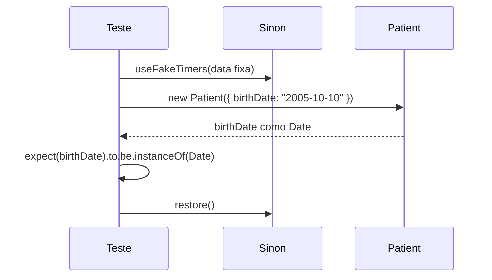
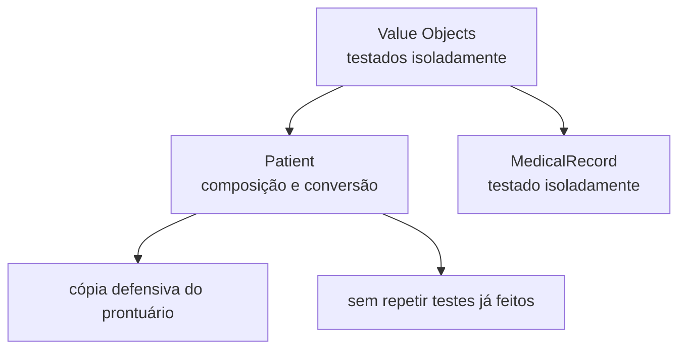

# Testando Entidades

## Introdução e contexto

Entidades têm **identidade única** e costumam reunir muitos atributos e outros
objetos de valor. A aula testa a entidade `Patient` de um sistema de agendamento
de consultas, mostrando como lidar com composição, conversão de tipos e
**dados que dependem do tempo**.

## A entidade

```js
class Patient {
  #id
  #identificationNumber
  #name
  #birthDate
  #gender
  #bloodType
  #address
  #phone
  #email
  #emergencyContact
  #medicalRecord
}
```

| Atributo | Observação |
| --- | --- |
| `id` | não vem no construtor; é responsabilidade do banco |
| `identificationNumber` | documento do paciente |
| `name`, `gender`, `bloodType` | dados básicos |
| `birthDate` | chega como **string** e é convertida em `Date` |
| `address`, `emergencyContact` | objetos de valor já testados |
| `medicalRecord` | instanciado internamente, não recebido |

O construtor recebe quase tudo, exceto `id` e `medicalRecord`.

## Conversão de data

```js
constructor({ birthDate, ...rest }) {
  this.#birthDate = new Date(birthDate)
  // ...
}
```

A conversão poderia estar em uma camada de serviço, mas ficou na entidade. Isso
torna o teste mais amplo: além dos atributos, é preciso garantir que a string
virou um `Date` válido.

## O teste

O arquivo `test/domain/entities/Patient.test.js` espelha
`src/domain/entities/Patient.js` e se organiza em três blocos:

| Bloco | Cobre |
| --- | --- |
| `describe("constructor")` | instanciação e atributos |
| conversão de data | string → `Date`, com data controlada |
| `describe("getters")` | retorno de cada campo e cópia do prontuário |

```js
const defaultPatientData = {
  identificationNumber: '123',
  name: 'Ana',
  birthDate: '2005-10-10',
  // ...
}

describe('Patient entity', () => {
  it('deve ser uma instância de Patient', () => {
    const patient = new Patient(defaultPatientData)
    expect(patient).to.be.instanceOf(Patient)
  })
})
```

## Controlando o tempo com Sinon

Testar conversão de data depende do "hoje". Para eliminar essa variável, o
**Sinon** entra pela primeira vez:

```js
beforeEach(() => {
  clock = sinon.useFakeTimers(new Date('2025-01-10T00:00:00'))
})

afterEach(() => {
  sinon.restore()
})

it('deve converter a data de nascimento', () => {
  const patient = new Patient({ ...defaultPatientData, birthDate: '2005-10-10' })
  expect(patient.birthDate).to.be.instanceOf(Date)
})
```

| Recurso | Papel |
| --- | --- |
| `useFakeTimers` | congela a data/hora do sistema |
| `sinon.restore()` | devolve o relógio real ao final |

Sem o `restore`, o relógio falso vaza para os testes seguintes — um dos motivos
pelos quais hooks de limpeza são obrigatórios.

### Cuidado com a numeração de meses

`Date` no JavaScript indexa meses a partir de **zero**: outubro é `9`, não `10`.
Os testes da aula comparam com um mês a menos (ou somam um no valor esperado)
por causa disso.



## Getters e cópia defensiva

Os getters devolvem os campos. Para o prontuário, a entidade entrega uma
**cópia**, não a referência interna:

```js
get medicalRecord() {
  return this.#medicalRecord.copy()
}
```

Assim, quem consome o paciente não altera o estado interno por acidente. O teste
verifica que o retorno é uma cópia — e não o mesmo objeto.

O `beforeEach` reinstancia o paciente antes de cada teste de getter, evitando
que uma alteração contamine o próximo caso.

## O que não é retestado

Endereço e contato de emergência já têm testes unitários próprios. Aqui basta
verificar que a entidade os expõe corretamente. O mesmo vale para o
`MedicalRecord`, testado detalhadamente na aula anterior.



## Executando apenas esta entidade

```sh
npx mocha test/domain/entities/Patient.test.js
```

Seis testes. Para um bloco específico:

```sh
npx mocha test/domain/entities/Patient.test.js -g "getters"
```

Três testes, todos passando.

## Benefícios

- **Cobre o que é específico da entidade**: conversão, composição, cópia.
- **Tempo determinístico** com `useFakeTimers`.
- **Sem duplicação**: objetos de valor já testados não são retestados.
- **Isolamento garantido** pelo `beforeEach`.
- **Defesa contra vazamento de estado** com a cópia do prontuário.

## Limitações e cuidados

- **Testar construtores é controverso**: adicionar um atributo pode exigir
  atualizar o teste; a aula usa, mas reconhece que depende do time.
- **Relógio falso sem `restore`** contamina a suíte.
- **Numeração de meses** é fonte clássica de erro.
- **`instanceof`** exige a mesma classe carregada; duplicação de módulos quebra.
- **Testes longos demais**: prefira um `it` por comportamento.

## Conclusão

Entidades exigem atenção a três pontos: conversão de dados, composição de
objetos de valor e cópia defensiva. Com Sinon controlando o tempo e hooks
isolando o cenário, o teste fica determinístico.

A próxima aula entra na persistência: **repositórios**, onde mocks e stubs
passam a ser protagonistas.

<!-- commit de referência: 8bba680e -->
